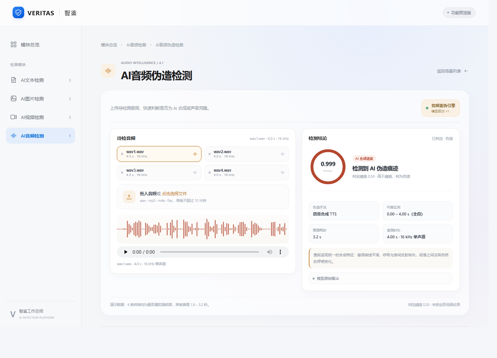
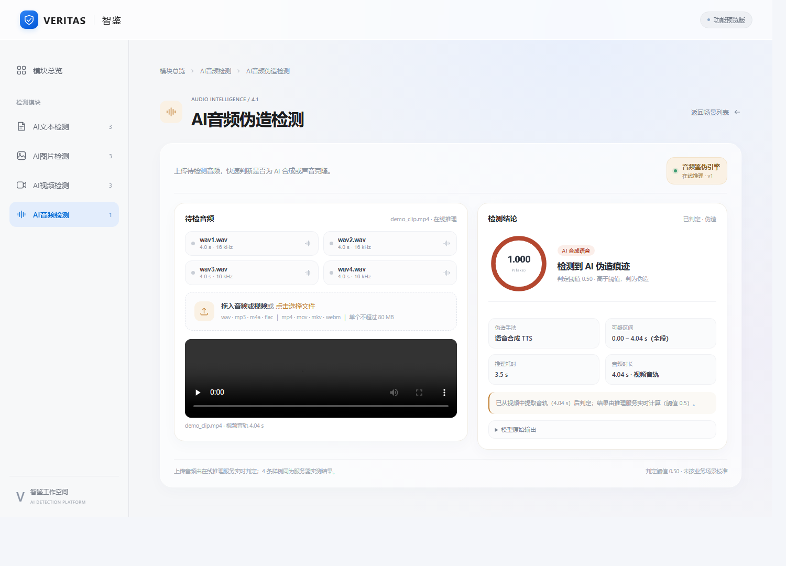
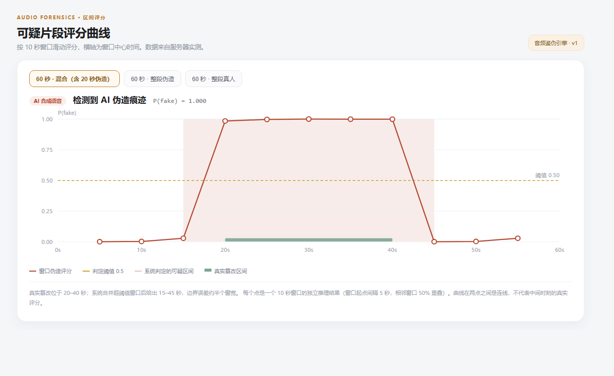

# VERITAS 智鉴 · AI 检测平台

多模态内容真实性检测平台：文本、图片、视频、音频四大模块，共 10 个业务场景。

**当前进度**：AI 音频伪造检测（4.1）已完整打通前后端 —— 支持音频与视频上传、AI 合成语音判定、长音频可疑片段评分曲线、检测报告导出；其余 9 个场景仍为框架空白页。



## 目录

- [已实现功能](#已实现功能)
- [快速开始](#快速开始)
- [检测能力与边界](#检测能力与边界)
- [接口](#接口)
- [目录结构](#目录结构)
- [其余场景与开发入口](#其余场景与开发入口)
- [已知限制](#已知限制)

## 已实现功能

### 检测

| 能力 | 说明 |
| --- | --- |
| 音频上传 | wav / mp3 / m4a / flac / ogg / opus，单文件 ≤ 80 MB、≤ 2 分钟 |
| 视频上传 | mp4 / mov / mkv / webm / avi / m4v，服务端自动抽取音轨后检测 |
| 真伪判定 | 输出 `P(fake)` 分数与 real / fake 结论，阈值 0.5（未校准） |
| 伪造手法 | 语音合成、声音转换、剪切拼接、语音编辑、声码器/编解码重合成 |
| 可疑片段 | 长音频滑窗评分，返回可疑时间段与逐窗分数 |
| 失败语义 | 明确区分「未接入」「解析失败」「时长超限」，不用示例结果冒充上传结果 |

### 交互

- **离线样例**：5 条服务器实测样例，不依赖后端也能演示；
- **在线推理**：本机打开时自动探测 `127.0.0.1:8000`，连上即切换为真实推理；
- **评分曲线**：长音频（>30 秒）展示窗口级评分曲线，短音频只有单点、不出折线；
- **报告导出**：一键生成 A4 检测报告（浏览器打印为 PDF，无第三方依赖）。





## 快速开始

### 前端

Node.js >= 20，无第三方运行依赖。

```sh
npm ci
npm run dev          # 源码模式，改完刷新即可
npm start            # 构建产物模式（需先 npm run build）
```

打开 <http://127.0.0.1:4173/#/audio/forgery>。

带 `?demo=<id>` 可直接落到某条样例结论：`wav1`–`wav4`（4 秒）、`long60`（60 秒滑窗）；`?report=1` 进入报告视图。

### 后端（可选）

不接后端时页面走离线样例模式。要启用真实推理：

```sh
cd backend
pip install -r requirements.txt
python -m uvicorn server:app --host 0.0.0.0 --port 8000
```

默认从 `$MODEL_ROOT`（可用环境变量覆盖）加载基座与适配器权重。启动约 8 秒、显存约 18 GiB。

前端指向后端：本机自动探测 8000 端口；跨机时用 `?api=http://<host>:8000`。

## 检测能力与边界

模型擅长**整段**判断，不擅长**逐帧**定位：

| 类型 | 表现 |
| --- | --- |
| 整段 TTS / 声音克隆 | 强（实测 0.98–1.00） |
| 纯真人录音 | 强（0.000–0.029） |
| 局部剪切拼接 | 弱：手工拼接近乎判不出 |
| 语音编辑（改词） | 弱：且模型自报的区间方向会反 |
| 编解码重合成 | 有争议：过于干净的真人朗读可能被判伪造 |

**区间定位机制**：超过 30 秒的音频按 10 秒窗、5 秒步长切窗，逐窗推理得到分数，再把超过阈值的窗口合并为绝对时间（精度约一个窗宽）。详细说明见 [音频伪造区间定位说明](docs/音频伪造区间定位说明.pdf)。

## 接口

`POST /api/v1/audio/forgery`

```jsonc
// 请求：内置样例 或 base64 上传
{ "sampleId": "wav1" }
{ "audioBase64": "<base64>", "fileName": "demo.mp4" }
```

```jsonc
// 响应
{
  "data": {
    "fileName": "demo.mp4",
    "media": "video",
    "audioExtracted": true,
    "audioDurationSec": 3.73,
    "verdict": "real",
    "pFake": 0.2018,
    "spoofMethod": null,
    "spoofMethodLabel": null,
    "fakeRegion": null,
    "durationSec": 3.73,
    "coverage": { "analyzed": 3.73, "total": 3.73 },
    "windows": [],
    "latencyMs": 3985,
    "engine": { "name": "audio-antispoof", "version": "v1", "threshold": 0.5 }
  },
  "requestId": "…"
}
```

错误统一为 `{"error":{"code","message"},"requestId"}`：`400 BAD_REQUEST`、`404 SAMPLE_NOT_FOUND`、`413 AUDIO_TOO_LARGE`、`413 MEDIA_TOO_LONG`、`422 AUDIO_UNREADABLE`、`422 MEDIA_UNREADABLE`。

## 目录结构

```
src/modules/audio/          4.1 场景：页面、契约、服务占位
  pages/forgery.js          页面主体（上传、波形、结论、曲线、报告）
public/demo/                演示样例（wav1–wav4、long60）
backend/                    推理服务：引擎、HTTP、CLI、启动脚本
docs/                       设计文档、预览图、报告样例
openspec/                   需求、场景规格与变更记录
scripts/                    开发服务、构建、检查
```

## 其余场景与开发入口

| 模块 | 业务场景 |
| --- | --- |
| AI 文本检测 | 论文与学术稿件、新闻稿与投稿内容、网文与小说 |
| AI 图片检测 | 通用生成图片、仅退款与售后凭证、证件与票据 |
| AI 视频检测 | 通用生成视频、人物换脸与深度伪造、售后与退货凭证 |
| AI 音频检测 | 音频伪造（**已实现**） |

- [需求摘录](openspec/references/AI检测平台_需求摘录.md)
- [公共约定与框架映射](openspec/changes/define-shared-foundation/design.md) · [公共行为要求](openspec/changes/define-shared-foundation/specs/shared-foundation/spec.md)
- [六人分工、10 个场景与必要交接](docs/TEAM_DEVELOPMENT.md) · [页面与 API 目录](docs/PAGE_MAP.md)
- [开发、Commit、PR 与 OpenSpec 规则](CONTRIBUTING.md) · [接口使用约定](docs/API_CONVENTIONS.md)
- [OpenAPI 快照](docs/openapi.json) · [场景接入说明](docs/接入说明.md)

## 检查

```sh
npm run check    # 结构、链接、打包边界
npm test         # 框架行为与 HTTP 集成
npm run build    # 生成 dist 离线包
```

## 已知限制

- 阈值 0.5 为模型默认值，**尚未按业务场景校准**；
- 服务无鉴权、CORS 全开，仅适用于内网演示；
- 同步接口 + 2 分钟上限，长音频（如 10 分钟视频）需异步任务支持；
- 单卡单进程，并发请求会排队；共享 GPU 繁忙时单条延迟可能显著上升；
- 其余 9 个场景仍为空页面。
