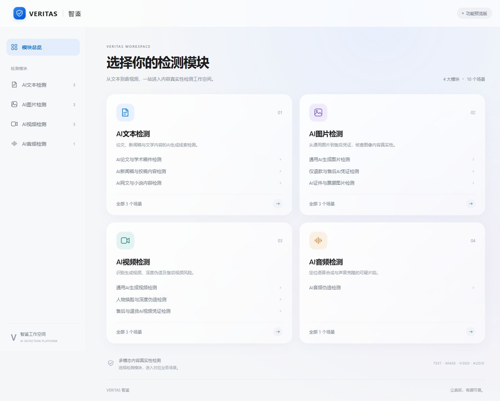

# VERITAS 智鉴

AI检测平台网页框架：**4 个模块、10 个业务场景页**。新闻与小说场景已有前端工作台、公开网页正文导入、EGTE句级AI检测，以及服务端新闻三审三校和小说重复/水稿检测适配层；其他场景算法仍待接入。仓库为Private；参考 [jumu-team/jumu](https://github.com/jumu-team/jumu) 的工作包、贡献约定、OpenSpec和CI组织方式。

## 本地启动

Node.js >=20，推荐22。当前无第三方运行或构建依赖。

```sh
npm ci
npm run dev
```

打开 http://127.0.0.1:4173 。可浏览模块与场景。新闻和小说分别使用独立的`POST /api/v1/text/news/import`、`POST /api/v1/text/novel/import`获取公开可读网页，不绕过登录、付费、验证码或访问限制。两个检测接口均支持前端切句后的EGTE逐句AI检测；新闻另支持三审三校，小说另支持重复/水稿检测。其余检测业务接口仍返回501。上传、持久化跨章记忆、鉴权与正式报告仍待实现。

## 服务端模型配置

模型凭据只能通过服务端环境变量设置，不能出现在`src/api.js`、浏览器请求、检测响应、日志或提交记录中。当前默认供应商为DeepSeek：设置`TEXT_MODEL_PROVIDER=deepseek`和`TEXT_MODEL_API_KEY`后，服务端自动使用`https://api.deepseek.com/chat/completions`、`deepseek-v4-pro`、JSON Output及`high`推理强度。端点、模型、推理强度、输出上限和超时仍可通过`.env.example`列出的变量覆盖。

本地开发直接编辑项目根目录的`.env`，填写DeepSeek Key；EGTE路径可按服务器环境覆盖：

```env
TEXT_MODEL_PROVIDER=deepseek
TEXT_MODEL_API_KEY=
EGTE_ROOT=/mnt/vos-6d37s2q0/users/yh/models/EGTE_CRED_RAID_20261023
EGTE_PYTHON_BIN=/mnt/vos-6d37s2q0/users/yh/models/EGTE_CRED_RAID_20261023/.venv/bin/python
EGTE_GPU=auto
```

然后正常运行`npm run dev`。服务端会自动读取根目录`.env`，且只接受`TEXT_MODEL_*`与`EGTE_*`字段；部署平台提供的环境变量优先于本地文件。`.env`已被Git忽略，`.env.example`只保留无密钥模板。未配置DeepSeek Key时，三审三校和水稿检测返回`MODEL_NOT_CONFIGURED`；EGTE不可用时句级检测返回`AI_DETECTOR_UNAVAILABLE`，均不会生成模拟结果。

## 服务器部署与EGTE调用

目标项目目录为`/home/wyt/projects/aigcdetect`，共享算法目录为`/mnt/vos-6d37s2q0/users/yh/models/EGTE_CRED_RAID_20261023`。项目不会向共享算法目录写文件，也不会把API Key发送到浏览器。Node服务第一次执行AI检测时启动常驻Python子进程，按需加载`cred`或`raid`分类器；后续句子和请求复用同一模型进程，避免每句重复加载Falcon。

上传后在项目目录执行：

```sh
cd /home/wyt/projects/aigcdetect
cp .env.example .env
# 用编辑器填写 .env 中的 TEXT_MODEL_API_KEY，并按实际环境确认 EGTE_PYTHON_BIN
npm ci
npm run build
npm run verify:egte
HOST=127.0.0.1 PORT=4173 npm start
```

`npm run verify:egte`会真实加载中文C-ReD并检测一个测试句；看到`"status": "ok"`才说明Python环境、Falcon权重、GPU与随机森林链路均可用。若共享目录中的`.venv`不可执行，应由`wyt`在自己的目录创建依赖环境，并只把`EGTE_PYTHON_BIN`改为该环境的Python路径，不要向共享模型目录安装或写缓存。服务进程示例见`deploy/aigcdetect.service.example`；反向代理应只暴露Node HTTP端口，不直接暴露Python子进程。

前端对每篇稿件或章节按句切分，并提交`segmentId/sentenceIndexes/start/end/text`；少于20字符的句子会与同段相邻句组成最多两句的评分片段，后端重新分句并核对编号、段落边界和`content.slice(start,end)===text`后才调用算法。结果返回`疑似AI`、`人工`或`无法评分`，列表可切换“全部显示”和“仅疑似AI”，筛选不改变总体统计。两句合并结果明确标为“合并评分”，得分属于整体片段，不能认定其中某一句具有相同结论。`aiScore`可换算成百分比显示为“AI类得分”，但它是300棵树输出的未校准平均值，不能称为AI几率或确定概率。两句合并后仍不满足算法最低条件时不会补成0分；长句保持完整，整组结果和单条长原文均提供滚动查看。

当前跨章能力仅比较同一次请求中提交的多个章节。一次只提交一章时会明确标记未执行跨章比较；作品级持久化记忆仍需后续存储与向量索引。

离线预览：运行 `npm run build` 后双击 `dist/index.html`。预览采用本地CSS和SVG，无CDN或外部字体依赖。

## 开发入口

- [需求摘录](openspec/references/AI检测平台_需求摘录.md)
- [公共约定与框架映射](openspec/changes/define-shared-foundation/design.md) · [公共行为要求](openspec/changes/define-shared-foundation/specs/shared-foundation/spec.md)
- [六人分工、10个场景与必要交接](docs/TEAM_DEVELOPMENT.md) · [页面与API目录](docs/PAGE_MAP.md)
- [开发、Commit、PR与OpenSpec规则](CONTRIBUTING.md) · [接口使用约定](docs/API_CONVENTIONS.md)
- [OpenAPI快照](docs/openapi.json) · [场景接入说明](docs/接入说明.md)

| 模块 | 业务场景 |
| --- | --- |
| AI文本检测 | 论文与学术稿件、新闻稿与投稿内容、网文与小说 |
| AI图片检测 | 通用生成图片、仅退款与售后凭证、证件与票据 |
| AI视频检测 | 通用生成视频、人物换脸与深度伪造、售后与退货凭证 |
| AI音频检测 | 音频伪造 |

各场景独立页面位于 `src/modules/<模块>/pages/`；模块服务、定义和类型在同目录。两位组长提供公共底座，六位同学按分工继续10个已有工作包。具体方案与开发细任务由负责人补充；同步main后开个人分支，小步提交PR，由维护者集成。

## 检查

```sh
npm run check
npm test
npm run build
```

CI另做OpenSpec严格验证和构建版HTTP冒烟。工作包文档与空接口检查通过不等于业务已实现。

## 预览


