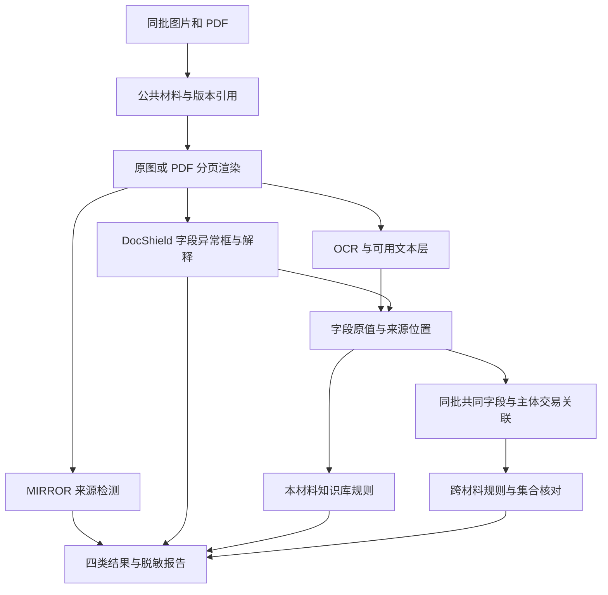

# 图片检测与材料核验技术边界

本设计依据用户技术方案与现有工程，供两个已有 OpenSpec 工作包接续使用。主线为中文证件、票据、收据和证明图片中的篡改字段定位、内容核验及同批跨材料核对；PDF 在核心图片链路后作为辅助输入适配，不单建程序或业务场景。外部 LLM 和商业核验 API 暂不启用。

## 技术与服务归属

前端沿用当前 GitHub 工程 **VERITAS 智鉴**的原生 JavaScript ES modules、CSS、Hash 路由和离线构建，不另行选择或替换框架。现有 Node.js HTTP 层保留场景入口；建议新增独立 Python 推理服务承载模型、OCR 与 PDF 处理，部署目录和内部调用契约在实现前与公共后端对齐。模型不在每次 HTTP 请求中重新加载。

| 能力 | 选择 | 边界 |
| --- | --- | --- |
| 整图 AI 来源 | MIRROR + 匹配的 DINOv3-H+ 与检测检查点 | 输出模型分数，不提供局部篡改定位 |
| 证件票据疑似篡改字段框选与解释 | DocShield-9B 直接接收材料图片 | 输出区域坐标与解释；逻辑异常作为核验候选，中文效果需实测 |
| 全量文字转写与核对证据补充 | PP-OCRv6 medium 检测与识别 | 提供文字框、识别文本和识别分数，不鉴定篡改；不作为 DocShield 的必需前置 |
| PDF 辅助输入 | 核心图片流程后接入候选 pypdfium2，分页复用同一处理链 | 不单建应用，不宣称已验证数字签名或登记真实性 |
| 材料核验 | 本地版本化知识库、确定性规则、字段与关系索引 | 任意文本无法判定时保留证据不足 |
| 外部 API | 预留适配，首期关闭 | 不上传材料，不用模型模拟登记核验 |

[pypdfium2](https://github.com/pypdfium2-team/pypdfium2#licensing) 提供 PDF 渲染及文本读取，其代码许可为 Apache-2.0 / BSD-3-Clause；打包时保留 PDFium 及构建依赖的许可文件。PDFium 非线程安全，采用独立进程或受控串行调用。纯文本提取不能代替扫描页 OCR，参见 [pypdf 说明](https://pypdf.readthedocs.io/en/stable/user/extract-text.html)。

## DocShield 与 OCR 的实际区别

[DocShield-9B 模型卡](https://huggingface.co/vankey/DocShield-9B)声明支持区域坐标、逐区域解释、逻辑异常和风险评分，支持中文。核对固定 revision 的[推理脚本](https://huggingface.co/vankey/DocShield-9B/blob/be48c35e645e4c9382f33c67d492172823b2be8d/inference.py)，其直接输入图片并解码生成文本，没有要求外部 OCR，也没有内置全字段转写、字段级置信分数或平台来源记录的结构化接口。

因此可直接解析 DocShield 输出的有效坐标，在票据上框选疑似改动字段；可记录它引用的文字及解释，并试验提示词约束的字段抽取。不能据此承诺它会完整、准确地列出全部字段，或稳定返回严格 JSON。模型生成的风险评分不是 OCR 识别分数，也不是校准后的真实伪造概率；没有逐字段分数时留空。

[PaddleOCR 产线](https://www.paddleocr.ai/latest/version3.x/pipeline_usage/OCR.html)则直接提供 `rec_texts`、`rec_polys/rec_boxes`、`rec_scores`，PP-OCRv6 medium 支持中文。OCR 的框表示文字在哪里，不表示该区域被修改；识别分数表示模型对读字的把握，不证明金额合理或证件真实。姓名/金额等字段语义、材料版本与页码来源需要平台抽取及关联，两种模型都不自动完成这些记录。

“原值”指本次材料可见的识别值，保留未规范化文本及其图像区域；若没有修改前文件，不能恢复或捏造篡改前的真实值。字段记录注明来自 DocShield、OCR、PDF 文本层或人工修订，保留各自值与框；不把两种输出合并成不存在的统一置信概率。

优先验证 DocShield 单独对中文票据的异常框选和字段抽取，再比较加入 OCR 后的字段完整率、金额/号码精确率、框定位与耗时。当前保留 OCR 用于全字段核对和跨材料比对；是否能在部分材料上省去 OCR，由对照结果决定。

2026-10-21 实测发现直接报告存在越界坐标和无依据的修改前后值。本轮已实现离线协作原型：OCR 编号关联、严格输出检查、独立十进制规则与局部二次 OCR；具体可执行边界及验证见[票据协作与证据复核](receipt-fusion.md)。模型解释仍为待复核意见，不将引用检查通过等同于篡改判断正确。

## 输入与证据流

图片原文件不可覆盖；预览、OCR 矫正、PDF 页图、模型输入与脱敏输出分别存储。PDF 内混合不同材料时保留文件、页码与材料片段关系，允许用户纠正分组。不得把一个 PDF 固定视为一份证件或一个主体。

PDF 逐页处理，记录页数、成功页和失败页。文本层有内容也需与渲染图/OCR抽样或关键字段核对；冲突时保留两侧来源，不能静默相信隐藏文字。扫描页 OCR 不到内容时显示不可识别。加密、损坏、超限、超时分别说明，允许提供密码后重新处理，密码不写日志。处理 PDF 时不执行嵌入脚本或任意外部资源。

MIRROR 对 PDF 页图给出的只是该渲染视图的模型分数，原生排版或扫描文档可能偏离其训练域；不把单页高分升级成整份 PDF 被伪造。DocShield 对渲染页的视觉证据也不能证明 PDF 文件编辑历史。两者都保留检测范围与域外限制。

## 结果语义

| 结果 | 表达 | 不能替代 |
| --- | --- | --- |
| AI 来源 | 整图生成倾向、原始模型分数、模型版本 | 篡改定位和事实核验 |
| 视觉线索 | 疑似区域、可见依据、定位可用性 | 号码规则或登记真实性 |
| 字段核对 | 某规则通过、违反、不适用、证据不足 | 图像是否修改 |
| 跨材料核对 | 同一命题在可比材料间一致、冲突、关联待确认 | 判断哪份材料必然正确 |

必须覆盖“有篡改线索但内容符合规则”和“未见篡改线索但内容有误”两类场景，不推断修改动机。未执行、失败、部分覆盖与实际结论按[公共规范](../../openspec/changes/define-shared-foundation/specs/shared-foundation/spec.md)分别表达。

方案中的 PASS、FAIL、WARN、NEI、NOT_APPLICABLE、ERROR 是检查结果的候选语义；执行状态、任务状态、材料版本的正式字段与公共底座对齐后定义。未配置外部服务显示未执行，不能显示已通过。

## 定位与更正

证据引用包括实际文件版本、材料片段、页码、OCR 原文及位置。PDF 保存页坐标、旋转、裁剪、渲染比例到展示像素的变换；图片统一与 EXIF 方向处理后的展示一致。模型坐标格式必须经已知位置样例确认，不能凭数字大小猜测。非法框显示定位不可用。

DocShield 原始输出留存；缺少视觉依据的逻辑判断只能成为待核验候选。生成式解释不得更改确定性计算结果。O/0、I/1、金额小数点等 OCR 歧义进入复核，不自动改字使校验通过。

界面区分“模型指出的疑似篡改区域”和“规则查出的不合理字段”：前者使用经过坐标验证的 DocShield 框，后者利用该字段的来源框高亮。跨材料冲突同时高亮双方字段。OCR 框与 DocShield 框可关联但分别保留来源；逻辑冲突不标成已发生视觉篡改。

人工修改字段或材料关系后，保留旧值与原因，重新运行受影响规则，旧报告保留原版本并标记过期。规则更新和知识库证据失效同样触发相关结果失效，不复用旧的通过结论。

## 报告与前端

2.1 提供单图/批量入口、逐项状态、原图与结果对照、风险/状态筛选和报告。2.3 提供同批材料、PDF 页导航、四类独立结果区；点击问题定位原图区域，跨材料冲突并排展示两侧原文、角色、时间与规则依据。

默认报告脱敏姓名、号码、地址等敏感项。图像导出使用不可逆像素遮盖，允许人工补充区域；后续 PDF 辅助接入时，建议由已脱敏页图重新生成报告，不复制原始隐藏文本、附件和元数据。是否保留可搜索文本须另做脱敏文本层设计。导出后重新提取文本并检查像素，网页遮罩不算脱敏交付。

上传数量、文件字节、PDF 页数、总渲染像素、超时和 GPU 并发需配置并显式拒绝超限。方案包的 20 MiB/100 张/500 MiB/50 页仅是建议初值，尚未确认为产品门槛；先按代表性材料实测后确认。

## 2026-10-21 SEED 主测更新

按用户新要求，本轮主测改为 SEED 本地定位 + OCR/规则 + DeepSeek 脱敏摘要解释，DocShield-9B 完整保留作对照。此前“外部 API 全部关闭”是历史方案；现仅允许用户授权的 DeepSeek 白名单摘要，原图与 OCR 原文仍不外发。下载、同样本误报/漏报、实际 API 验证与边界见[SEED 接入记录](seed-integration.md)。公共接口和业务前端尚未接入。
