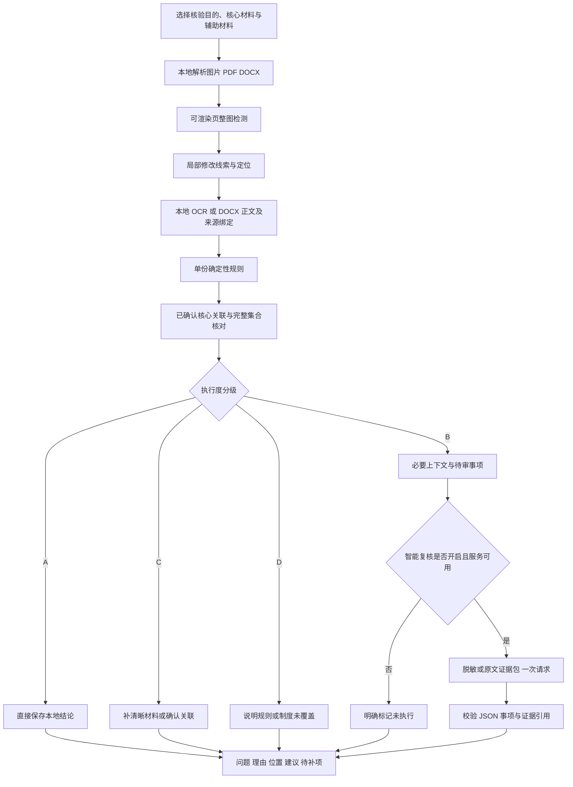

# 2.3 本地执行度、按需智能复核与结果契约

版本：2026-10-26。本文件说明本轮实际代码行为；研究清单中的所有审核点并未全部实现。地区、机构和材料依据见[调研文档](regional-review-research-20261026.md)，阶段验证见[交付记录](review-delivery-20261026.md)。路径均相对于项目根目录；`<平台根目录>`指代码上一级的运行资产目录。

## 1. 目标与处理顺序

本地能明确核对的问题直接给结果；需理解上下文的问题整理为一次有界的模型请求；输入不可靠、缺材料、缺适用制度的问题保留为补证或未覆盖。大模型不重新执行所有算术，也不能推翻已记录的确定性冲突。



整图模型仍为 MIRROR，定位仍为 SEED，中文文字提取使用现有 OCR 运行环境。上述三个阶段依次执行；单阶段失败不阻断其余独立检查。未渲染的 DOCX 可提取结构化正文，但没有图像鉴定结论。SEED 没报警，不会禁止本地规则或语义复核。当前云端请求仅含文本，没有原图、印章裁图或 PDF/Word 文件。

## 2. 执行度如何衡量

### 2.1 方法依据与含义

借鉴 [SelectiveNet，ICML 2019](https://proceedings.mlr.press/v97/geifman19a.html) 的选择性预测与风险—覆盖思想：允许系统不下结论，并同时记录覆盖率和已下结论部分的错误。借鉴 [Data Validation for Machine Learning，MLSys 2019](https://research.google/pubs/data-validation-for-machine-learning/) 的输入模式、约束和异常验证：先验证证据能不能使用，再评价结果。

本项目没有训练 SelectiveNet，也没有从这些论文继承准确率或理论保证。A/B/C/D 是工程执行状态，不是“95%真实”等概率。OCR 的 0.9 门槛是目前保守的工程阈值，未经中文业务留出集校准。

| 等级 | 本轮判定 | 路由 | 面向用户的含义 |
| --- | --- | --- | --- |
| A | 规则已得 PASS/FAIL，引用有绑定来源，识别分数达门槛，无字段歧义 | local | 这一项已有明确结果；PASS 不代表材料真实 |
| B | 可靠正文存在规则未覆盖的条款/上下文；或已确认核心关联仍需语义理解 | semantic | 可进一步理解内容，开启服务后按需复核 |
| C | 字段、页、关联范围或识别质量不足 | supplement | 补证或确认识别，不能让模型猜数字 |
| D | 未覆盖的政策、历史区划、目标或地区规则 | unsupported | 明确未覆盖，需要有效制度与适用依据 |

每项记录适用性、来源、识别质量、关系前提和覆盖状态。后端结构见 `server/execution-assessment.js`，版本 `local-review-routing/0.1`。相关检查可能同时存在：某文件金额算术是 A，合同支付条款是 B，缺审批材料是 C，机构报销标准是 D。

本轮 D 项保留在本地，不把没有政策的任务交给大模型猜。语义构包器可表达 D 类待审事项，但当前路由不会自动发送这些事项。普通 B 类条款复核仍会携带研究背景，提示政策缺口。

### 2.2 可直接计算与尚待标注的指标

- `localResolutionRate = A 项数 / 本次计划项数`。计划项含已执行、语义、补证、未覆盖；不含尚未建模的全国所有政策。应同时报告 A/B/C/D 原始计数，不能只报百分比。
- 规则执行率：完成且有结果的适用规则数 / 适用规则数；缺关键字段必须进入分母和缺证清单，不得删掉困难样本。
- 独立标注集上的冲突精确率、漏报率及选择性风险：只在人工确认规则适用、关系和预期结果之后计算。还应报告已给明确结论部分的覆盖率及拒判样本类型。
- 语义请求率、每批请求数、输入/输出 token、失败率、JSON 合格率、证据引用正确率、补证率；不把 JSON 格式正确当审核结论正确。
- 脱敏前后语义事项保留率、敏感标识残留、同主体代号一致性、合理/矛盾判断差异。成本收益应在同一有标注材料包上比较，不通过删证据虚增节省比例。

本轮已实现执行计数、工程路由、预算和输出校验；没有独立关系留出集、真实新版 API 成本报告或校准曲线。回放样本用于开发诊断，准确率字段保留空值。

## 3. 本轮新增本地规则

文件：`src/modules/image/documents/server/business-rules.js`，由 `document-rules.js` 调用。

| 规则 | 可执行条件 | 结果及拒判条件 |
| --- | --- | --- |
| 显示税率与该行税额 | 同一明确 `taxScope`，唯一税率和税额，CNY，可靠来源 | 0% 且税额非零为 FAIL；0% 且税额为零为 PASS |
| 行不含税金额×显示税率 | 以上条件加唯一同一行不含税金额 | 定点整数计算，差额最多 0.01 元；不判断法定税率是否正确 |
| 特殊计税保护 | 免税、不征税、星号、差额，或计税方式不明确 | 不当作数字零；NEI 或不提取，不套一般算式 |
| 起止时间 | 明确出差开始/结束或合同生效/截止，同类语义和有效日历 | 结束早于开始为 FAIL；缺项、歧义、错误日期转待补证 |

OCR 显式字段提取版本 `explicit-ocr-fields/0.3`；数电票版式提取版本 `cn-digital-vat-layout/0.2`。版式规则根据唯一标题、金额/税率/税额列、合计边界及行几何绑定税率；每行独立 scope，多页加页前缀。不能把一行 13% 与整张混合税率发票总税额相乘比较。显式 DOCX 标签也可提取本行税率/税额/不含税金额及起止日期。

沿用原有金额总计、大小写、日期、票号、身份号码、角色字段比较与完整集合核对。身份证户籍地址与现住址不同、预付款先于验收、缺少某地住宿发票等，不能在没有具体适用条件时判错。地方差旅金额上限本轮没有入代码。

## 4. 单份与多份材料如何组织

单份文件先提取来源绑定字段和正文块。完全被确定性字段覆盖的内容无需重复语义审查；存在合同、付款、验收、用途、审批等剩余条款或足量未覆盖文本时生成内容复核项。低分文本另外形成补证项。

多份文件以明确核心为中心，仅沿已经确认的主体/交易关系检查。比较金额、日期、票据编号还分别要求相应范围确认。上传在一起、名字相同、金额相同都不是自动确认关系的依据。原有完整集合引擎可以做付款或票据组汇总；当前页面以核心关联为主要入口，并未开放所有集合编辑功能。

语义跨材料项仅含相关核心边，不比较所有辅助文件组合。每批最多 10 份文件，语义包最多 40 项、100 字段、100 正文块、正文总字符预算 12000，单块最多 1600 字符。超限或无法安全使用的内容形成 `losses/omitted`；不能静默删除后显示全部通过。

## 5. 脱敏与原文模式

两个提示词位于 `src/modules/image/documents/prompts/`：

- `deepseek-semantic-redacted-v1.txt`：任务内主体代号一致，比较结构化事实和可安全保留的语义。
- `deepseek-semantic-original-v1.txt`：保留必要原文字段与条款，直接核对上下文。

默认脱敏。姓名、证件号、税号、账户、地址、票号等字段换成任务内代号；出生日期隐去；必要金额和业务日期保留。已识别敏感值在正文中同步替换。自由文本还要通过封闭业务词表检验；无法确认安全的片段省略并记录损失。**这会损失部分语义，当前不能声称自由文本脱敏召回率已经验证充分。** 本地所有规则始终使用本地原始事实，不受外发脱敏影响。

原文模式由用户明确选择，可发送核查必要的高质量 OCR / DOCX 正文，而不是整份文件、图片或无关材料。模型回应也限制在事项相关信息。此处是“外发内容处理模式”，不等同于法定涉密等级认证或涉密系统适配。

两种模式均不发送本地路径、文件名、文件哈希、账号凭据、批次身份元数据；原始 ID 与匿名证据 ID 的映射只保留本地。前端不提交 API 密钥或服务端 endpoint。缓存区分源版本、模式、模型、提示词和证据；不会把脱敏结果当作原文复核结果复用。

## 6. 结构化输入与输出

`buildSemanticPackage()` 生成：

| 部分 | 内容 |
| --- | --- |
| background | 审核目标、目的、地区、业务日期、固定研究目录及适用性未确认提示 |
| materials | 匿名材料 ID、类型、是否核心 |
| evidence | 字段或必要原文、识别质量、页码、匿名行范围；本地另存来源映射 |
| items | 每个必须回答的事项、所涉材料、可引用证据、焦点引用、完整性和政策是否已提供 |
| relations | 仅确认过的核心关系，金额/日期/票据范围；明确属于用户声明 |
| localFindings | 相关的已执行本地结论作为背景，不新增重复审查任务 |
| losses | 脱敏、质量、范围限制等遗漏，阻止对应事项输出充分合理 |
| outputSchema | 固定 JSON 字段及含义 |

`review-policy-catalog.json` 提供 21 项官方研究来源、14 场景与 2 篇论文。按目的、全国/地区筛选最多 6 项背景；机构专属资料不会因为地域相同自动套用。所有条目 `autoApplicable:false`。查阅日期是 2026-10-26，**没有运行时实时政策检索**；只有地区和日期，无法确认机关、高校或企业的适用制度。此目录不是可以任意查询的法规数据库。

模型严格输出示例（虚构证据编号，仅展示契约）：

```json
{
  "summary": "付款条件需要补充验收记录后核对。",
  "items": [{
    "id": "q1",
    "verdict": "needs_more_information",
    "explanation": "e1 载明验收后付款，e2 是付款记录，尚缺验收日期。",
    "warning": "",
    "recommendation": "补充验收记录并确认该笔付款属于尾款还是预付款。",
    "evidenceIds": ["e1", "e2"]
  }]
}
```

`verdict` 只能是 `reasonable / issues_found / needs_more_information`。每个事项恰好回答一次，合理与不合理都解释。发现问题必须有明确 `warning`；必须引用该事项已有证据，不能借用别项、捏造来源或把政策缺失判符合。证据不完整禁止 `reasonable`。字段缺失、多余字段、未知 ID、无效引用、截断输出都按失败处理。材料中的“忽略之前规则”等内容始终视为待审文本，不能改变系统要求。

## 7. 成本、服务接入与失败处理

服务实现：`server/semantic-review.js`。任务开启 `semanticReview`，且服务端环境启用 `DEEPSEEK_ENABLED=true/1` 并具备有效配置才真正发送。固定官方 HTTPS API，当前支持 `deepseek-flash / deepseek-v4-pro`，默认前者；依据 [官方模型说明](https://api-docs.deepseek.com/quick_start/pricing/) 和 [接口说明](https://api-docs.deepseek.com/api/create-chat-completion/) 配置结构化输出。不在文档写入密钥。

每个任务目录持久记录最多 **1 次**实际尝试，包括失败；并发争用不能重复发送。相同证据和版本可以复用有效缓存。超时最多 90 秒，回复最多 64 KiB，输出 token 上限 6000，不自动重试。重新提交是新任务，会产生新的预算；目前没有账户级配额系统，公共身份、账单和服务限额仍待平台集成。

失败、服务未配置、任务关闭、预算用尽都保留本地结果。语义成功不覆盖 A 类本地冲突；明确语义问题与图像疑点合并展示，但不把图像线索、内容不一致和已证实伪造混为一类。没有读取图像的大模型不能声称鉴定印章、字体或修改前内容。

## 8. 页面及接口

沿用 `POST /api/v1/image/documents`。`options.semanticReview`、`options.privacyMode` 控制复核；`context.region` 和 `context.businessDate` 提供有限背景。用户选择功能，不选择公安、税务等身份，不按身份分配功能。

结果新增 `review.executionAssessment`、`semanticReview` 和 `presentation`。页面默认展示任务结论、需关注问题、相关材料、下一步建议和智能复核解释；模型名称、分数、字段、底层规则放在折叠详情中。核验中显示“当前正在检测，请您耐心等待~”。修改模式或背景后原结果失效，避免把上一轮结论挂在新选项下。

当前没有接入官方税务验票、人口库、机构制度上传与有效性审核、在线最新政策检索、印章真实性核验或完整报告脱敏导出。可做的检查和未覆盖项共同组成结果，不能把未覆盖项包装成已通过。
