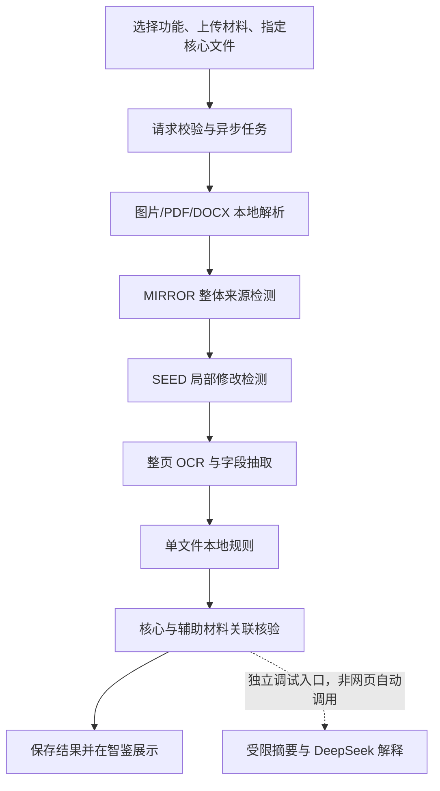

# VERITAS 智鉴：通用图片与证件票据模块交接及指导文档

**整理日期：2026 年 10 月 25 日**

**负责人：吕佳文；任务范围：2.1 通用图片、2.3 证件与票据**
**用途：供师兄了解现有实现、检查技术路线、指导实验与后续开发。**

本文根据当前工作区代码、OpenSpec 工作包、迁移验收报告、历史实验原始结果和近期需求讨论整理。为便于分享，省略服务器地址、用户名目录、绝对路径、数据存储位置、认证文件位置及凭据；代码仅按逻辑模块和文件名定位。示例中的材料、金额及编号均为说明性内容，不引用真实业务敏感信息。

本文中的“已实现”指工作区中存在相应代码，“已测试”指存在对应执行记录，“已验收”仅限明确写出的测试范围。三者均不自动代表生产可用或独立数据上的效果达标。2026 年 10 月 25 日进行的是代码与历史证据核对、文档整理，没有重新运行规模模型评测，也没有新增外部 API 调用。

---

## 1. 项目目标与当前结论

### 1.1 本人的任务范围

项目沿用团队已有的 **VERITAS 智鉴**，不另建平台或替换前端框架。本人负责两个既有工作包：

| 任务 | 目标 | 工作包 | 当前完成程度 |
| --- | --- | --- | --- |
| 2.1 通用图片 | 判断图片的 AI 生成来源倾向，提供可复用的检测结果 | `add-image-general` | MIRROR 离线推理、资产验证和规模实验已完成；独立业务页面与接口尚未实现 |
| 2.3 证件与票据 | 整体 AI 检测、局部修改定位、单文件内容核验、围绕核心材料的跨文件核验 | `add-image-documents` | 已有本地基础工作台、异步 HTTP、图片/PDF/DOCX 解析、模型编排、OCR 和部分规则；完整业务效果、自动语义核查与生产接入未完成 |

售后图片、售后视频、通用视频、换脸、音频和文本检测由其他成员负责。本模块可以提供通用图片来源检测能力，但不代做其他场景的业务流程。

### 1.2 当前可以演示什么

1. 在智鉴的证件票据工作台选择功能、上传多份材料、指定核心文件。
2. 指定材料类型，提供核心与辅助材料之间的关联确认及比较口径。
3. 对图片、PDF、DOCX 做本地解析，生成可用页图或结构文字。
4. 按 MIRROR → SEED → OCR 顺序调度已准备的本地模型；无空闲 GPU 或阶段失败时如实记录。
5. 从 OCR 或明确标签的 Word 文字中提取部分业务字段，执行单文件和核心关联规则。
6. 展示任务状态、材料预览、疑似区域、字段、规则结果及未覆盖项。

真实中文发票已通过浏览器完成“上传 → OCR → 字段 → 规则 → 展示”。新工作台的完整 GPU 链路曾因 GPU 全部高负载而未完成端到端验收；这与迁移时各模型分别成功加载、推理并不矛盾。

### 1.3 当前不能承诺什么

- 不能承诺所有中文票据、身份证、合同和审批材料都能完整抽取、准确核验。
- 不能把规则通过视为发票税务查验通过、身份真实、印章真实或合同有效。
- 不能把模型分数直接解释为真实伪造概率。
- 不能把通用图片上的 MIRROR 指标当成中文票据局部篡改准确率。
- 不能把目录中列出的材料类型或业务场景视为对应规则已全部实现。
- 当前没有正式公共认证、完整权限治理、生产队列、完整字段修订界面和独立脱敏报告导出。
- 当前工作台不自动调用 DeepSeek；最近讨论的按核查事项选择性调用 API 尚待实现。

## 2. 需求演进与阅读顺序

### 2.1 主要阶段

| 阶段 | 变化与交付 | 阅读历史记录时应注意 |
| --- | --- | --- |
| 2026-10-21：基线准备 | MIRROR、DocShield-9B、OCR 资产及环境；离线字段证据、金额规则、PDF、规模实验 | 当时业务接口和页面尚未接通 |
| SEED 主测调整 | 主线调整为 SEED 局部定位，DocShield 保留对照；增加摘要型 DeepSeek 解释 | 旧文档里以 DocShield 为主线的描述不是当前最终方案 |
| 历史专项研究 | SEED 与 DocShield 同样本比较、发布者参考框审计、DeepSeek 图像对照 | 专项脚本不等于工作台已经具备相同能力 |
| 2026-10-22：迁移恢复 | 环境恢复、仓库读取验证、固定权重加载、小样本推理、后端测试 | 文件 rsync 一致只证明迁移完整，恢复验收另有记录 |
| 2026-10-22：基础工作台 | 核心材料计划、图片/PDF/DOCX 解析、异步 HTTP、智鉴前端接入 | 阶段模型编排已写入代码，但新链路 GPU 端到端仍待补测 |
| 2026-10-23：功能入口修正 | 移除公开的机构身份选择和身份功能限制 | 现在按功能选择；内部机构场景研究不能作为前台角色菜单 |
| 2026-10-24 起：成本与语义核查讨论 | 允许向 API 提供相关 OCR 内容和必要局部信息；讨论本地优先、按事项分流 | 这是新需求和建议方案，当前提示词、外发校验器、HTTP 尚未完成相应升级 |

### 2.2 建议师兄按以下顺序阅读

先看第 3 节的 Git 状态，再看第 4～8 节的实现与代码组织；第 9～11 节说明数据和测试证据；第 12 节是最新待实施方案；第 13～15 节列出待办、指导问题及接手步骤。第 16 节提供不含具体存储路径的证据索引。

历史文档存在“接口均为 501”“不允许任何文字外发”“默认固定 GPU 编号”等阶段性表述。应结合日期、当前代码和最新用户约束理解，不直接沿用为当前状态。

## 3. Git 分支、提交状态与工作包归属

### 3.1 本次核对到的分支状态

| 分支 | 当前提交 | 用途 |
| --- | --- | --- |
| `ljw/image-general` | `41d7b21` | 计划承载 2.1；目前实际检出的工作分支 |
| `ljw/image-documents` | `41d7b21` | 计划承载 2.3；已有本地分支 |
| `main` | `41d7b21` | 本地团队基础提交 |

**两个功能分支尚未通过新增提交分开承载实现。当前大量成果处于 `ljw/image-general` 检出状态下的未提交工作区，其中包含 2.1 和 2.3 两部分。**

因此不能说“切到票据分支就能取得全部票据实现”，也不能把本工作区的文件自动归入两个分支的提交历史。师兄评审时应看当前工作区内容与相应工作包，而不仅看分支提交差异。

本次没有 fetch、pull、commit、push、merge、rebase、归档、切换分支或清理工作区。远端读取权限曾在迁移验收时验证通过；本次没有重新核对远端是否出现新提交。

### 3.2 当前成果按职责如何归属

| 归属 | 工作区中的主要成果 | 尚缺的交付 |
| --- | --- | --- |
| 2.1 | MIRROR 下载审计、底座准备、完整加载、坏图处理、批量评测、迁移复跑支持 | 通用图片页面、独立单图/批量业务 API、常驻推理服务、报告接入 |
| 2.3 | SEED/OCR/DocShield 研究适配、单份及跨材料规则、统一解析、核心计划、工作台、异步服务、解释提示词与预算 | 独立中文业务评测、完整专项规则、自动语义核查、完整报告及公共能力联调 |
| 共享接缝 | 图片模块服务分发、场景元数据、HTTP 服务、OpenAPI、项目检查、冒烟与框架测试 | 与组长统一材料、版本、权限、任务和报告契约 |
| 开发支撑 | 迁移脚本、恢复测试、资产清单、环境快照、验证脚本、实验说明 | 正式可复现发布包与部署说明仍需随交付整理 |

### 3.3 后续提交组织建议

获得提交授权后，应先划分共享接缝，再按功能形成可独立检查的提交，例如：模型适配与证据契约、规则内核、材料解析、工作台接入、语义核查路由。不得为“让分支看起来干净”而删除未跟踪成果。模型权重、研究数据、缓存、真实材料、实验原始响应和凭据不进入代码提交。

当前包元数据中的仓库地址仍有历史名称，与用户指定的 AIGCNWPU/aigcdetect 不完全一致；这是后续元数据整理项，本次没有改动它。

## 4. 总体架构及结果语义

### 4.1 当前技术栈

| 层次 | 实现 | 说明 |
| --- | --- | --- |
| 前端 | 原生 JavaScript ES modules、CSS、Hash 路由 | 沿用 VERITAS；没有引入 React/Vue 等新框架 |
| HTTP 与规则服务 | Node.js、原生 HTTP、JavaScript 规则模块 | 负责参数检查、任务编排、字段与关系规则、结果返回 |
| 本地执行 | Node 子进程调用独立 Python 环境 | 当前按批次/阶段加载，尚未实现模型常驻服务 |
| AI 来源 | MIRROR | 使用固定 Phase2 检查点和匹配底座 |
| 局部修改 | SEED | 保存分数、概率图、mask、区域及框 |
| 文字识别 | PP-OCRv6 medium | 当前本地 CPU 推理，提供文字、框及识别分数 |
| 对照模型 | DocShield-9B | 研究对照，未进入当前工作台默认流水线 |
| PDF | PDFium 相关适配 | 分页渲染、文本层记录、坐标映射 |
| Word | DOCX XML 解析；可选受限 LibreOffice 转换 | 旧 DOC 不直接支持 |
| 外部解释 | DeepSeek 摘要适配器及独立研究脚本 | 工作台自动调用尚未接入 |
| 存储 | 项目管理的本地文件及 JSON 结果 | 不是完整数据库、任务队列或正式权限系统 |

### 4.2 当前主链路



某阶段失败不会把其他阶段伪装成成功，也不会自动跳过可执行的内容规则。关闭视觉模型仍可运行 OCR 和规则。对于未渲染成页图的 DOCX，可以使用已提取的结构文字做有限规则检查，但视觉检测显示未运行。

### 4.3 必须分开的四类结论

| 结论维度 | 可以说明什么 | 不说明什么 |
| --- | --- | --- |
| AI 来源 | 输入视图在 MIRROR 下的生成倾向 | 不证明具体字段被改，也不证明业务事实错误 |
| 局部修改线索 | SEED 指出的可疑区域及分数 | 不直接证明造假、动机或修改前原值 |
| 单文件内容 | 格式、算术、字段关系是否符合已适用规则 | 不替代官方登记和真实性核验 |
| 跨文件内容 | 有明确关系和口径的材料是否一致 | 不能单凭矛盾决定哪份材料必然真实 |

执行状态与核验状态也分开：

- 执行状态包含排队、运行、完成、部分完成、失败、未运行。
- 规则状态包含 `PASS`、`FAIL`、`NEI`，以及需要时的 `NOT_APPLICABLE`、`WARN`、`ERROR`。
- `NEI` 表示证据不足或覆盖不足；不等同正常，也不等同异常。
- 规则执行完成不代表整份材料核验完成；未处理页、未覆盖模板和未核验政策必须单列。

## 5. 分模块实现说明

### 5.1 通用图片 AI 检测：MIRROR

**已实现：**固定源码和完整权重验证、底座初始化文件准备、严格加载、来源类别映射、批量清单输入、输入哈希检查、坏图拒绝、原始分数与耗时记录。

MIRROR 使用 DINOv3-H+ 相关底座和固定 Phase2 检查点。现有研究预处理沿用固定脚本，包括尺寸调整、中心裁剪和部分图片格式转换；所谓“整图检测”是图片级来源分类，不意味着逐像素覆盖原图全部内容。

它已经被 2.3 的本地编排复用，但 2.1 的独立页面仍是空实现，独立业务 API 仍明确返回未实现。常驻加载、平台级批量队列、完整版本结果复用和正式报告尚未交付。

**主要代码：**`smoke_mirror.py`、`prepare_mirror_backbone.py`、`prepare_scale_evaluation.py`、`evaluate_results.py`、`local-runtime.js`。

### 5.2 局部修改检测：SEED

**已实现：**严格加载完整权重，按方向归一化后的图片切 512×512 图块，末块贴边、小图补白，合并图块概率及前景区域，保存概率图、二值 mask、连通区域、框和分数。

历史基线采用图块分数阈值 0.5 和 mask 阈值 0.5，图片分数取图块最大值。这些是研究配置，未完成中文业务阈值校准。

SEED 框表示疑似修改区域；OCR 框表示文字位置。二者不能互换。离线 `seed_evidence.py` 支持用实际 mask 像素关联 OCR 多边形；当前目标解释摘要的 `region_rule_links` 使用框相交，仅表示空间关联，不是像素级篡改证明。

当前工作台把区域返回前端。局部定位精度仍需使用可靠标注单独评测，不能由“有框输出”得出定位准确的结论。

**主要代码：**`seed_detector.py`、`seed_evidence.py`、`evaluate_seed.py`、`audit_seed_localization.py`。

### 5.3 OCR、字段及证据来源

**已实现：**整页 OCR、文字多边形和识别分数、显式中文标签与版式字段抽取、购方/销方区域区分、日期和金额规范化、标签/值来源保留、低置信或重复字段的歧义处理。

字段来源包含材料与字段版本、父文件哈希、派生页图哈希、页码、OCR 框及模型来源。字段更正与结果失效在规则内核有支持，但完整前台修订历史尚未接通。

不会为使规则通过而自动把 `O` 改成 `0`、把模糊小数点改成预期值。局部重识别结果作为新的候选证据保留，不能冒充独立来源。

中文发票已有专门版式适配，但没有通用的自由文本语义抽取器。复杂合同条款、流水逐笔明细和审批制度不能仅靠现有字段别名完整理解。

**主要代码：**`smoke_ocr.py`、`ocr-fields.js`、`vat-layout.js`、`date-fields.js`、`docx-fields.js`、`retry_ocr_regions.py`。

### 5.4 单文件本地规则

这里的“正则”实际由正则表达式、精确计算、日历算法、版式约束和证据条件共同组成。

| 规则 | 当前实现 | 适用条件与缺口 |
| --- | --- | --- |
| 身份号码 | 18 位结构、MOD 11-2 校验、生日日历、与明确生日/性别字段的一致性 | 历史行政区划、真实身份、人证一致不在当前覆盖内 |
| 发票号码 | 数电票号码格式；明确票种下的传统电子普票代码/号码格式 | 传统票细分类型需明确输入；界面尚未提供完整细分票种配置 |
| 号码与日期 | 在已实现的明确适用期间内比较 | 早期试点等缺地区依据时保留 NEI |
| 价税关系 | BigInt 定点金额运算，核对净额＋税额＝合计 | 需字段来源明确且无歧义；当前研究容差 0.01，不覆盖所有行级舍入制度 |
| 大小写金额 | 中文金融大写转金额后，与明确币种的小写比较 | 不支持的变体不猜测，返回覆盖不足 |
| 日期 | 明示格式解析、有效日历及可比较事件 | 不把不同语义的日期强行要求相等 |
| 版本和覆盖 | 检查来源、修订及重复字段，保留未处理页 | 页面上的完整修订流程与所有失效传播仍需联调 |

**主要代码：**`document-rules.js`、`batch-engine.js`、`date-fields.js`、`vat-layout.js`。

### 5.5 核心材料与跨文件核验

用户必须指定核心材料。辅助材料围绕核心形成关系，未经确认的同名、同额、同批上传只构成候选，不能自动升级为可信关系。

当前内核支持：

1. 材料和字段索引、核心选择、场景适用性检查。
2. 同主体或同交易关系，以及购方、销方、付款方、收款方等业务角色。
3. 金额、日期、同一票据等比较范围的显式确认。
4. 核心与辅助材料的字段比较；记录双方证据。
5. 显式完整集合的结算及票据汇总，去重、红蓝票关联和符号处理。
6. 记录未参与比较、关系被拒绝、字段不足及未覆盖原因。

当前主流程调用 `evaluateReview`，不使用旧 `evaluateBatch` 的全对比较路径。旧路径保留用于历史测试和研究，不代表当前工作台仍枚举全部材料组合。

内核设置材料、字段、单材料关系和集合引用数量上限。10/100/200 份材料的受控测试分别生成 9/99/199 条星状候选，证明该测试配置下没有形成全对组合；这不是吞吐量或所有输入下的严格耗时保证。HTTP 工作台目前最多接收 10 份材料。

**重要限制：**核心材料不是天然真值；人工关联确认目前是本地用户声明，不是经过认证的机构审核记录。多票/多付款集合编辑器尚未进入前端；内核支持同主体关系，但界面完整交互仍待补齐。

**主要代码：**`review-plan.js`、`batch-engine.js`、`invoice-sets.js`、`cross-material-coverage.js`。

### 5.6 图片、PDF、Word 统一解析

| 输入 | 当前解析能力 | 不能据此宣称的能力 |
| --- | --- | --- |
| 图片 | 多种常见图片格式、EXIF 方向归一化、透明背景处理、部分格式多帧解析 | 不代表前台已经开放所有格式，也不证明内容真实 |
| PDF | 分页渲染、页状态、父文件绑定、旋转/裁剪及像素到 PDF 坐标映射、文本层记录 | 未完成数字签名、隐藏文本与可见页一致性、附件与元数据脱敏验收 |
| DOCX | 正文段落和表格 XML 提取，结构位置；可选受限转换为页图 | 结构块没有可靠物理页映射；页眉页脚等部分内容缺失时为 partial |
| DOC | 当前解析器明确不支持 | 请求入口接受某后缀不等于解析成功，需要受控转换后重新提交 |

前端当前明确支持 PNG、JPG/JPEG、PDF、DOCX。后端解析器还支持 WebP、BMP、GIF、TIFF 等；输入检查、解析器支持范围和前台选项不是完全相同的一层。

DOCX 解析检查 ZIP/XML、路径穿越、宏、嵌入对象及危险结构，不执行外部关系；转换使用独立 LibreOffice profile，限制宏和链接更新。该预检不等于操作系统级网络隔离，生产 worker 仍需完善隔离。

一个 PDF 可以混装多个主体或多张票，当前不会因为同文件就自动认定为同一材料事实。重复语义字段保留歧义；智能拆分和人工分组体验尚未完整实现。

**主要代码：**`material_parser.py`、`pdf_adapter.py`、`pdf_evidence.py`、`parse_material.py`、`pdf_to_evidence.py`。

### 5.7 DeepSeek、提示词与开源 skills

#### 当前产品侧适配器

`deepseek_explainer.py` 和 `review_explanation.py` 目前只允许检测分数、相对区域坐标、OCR 质量统计、规则类型/状态、区域与规则关联等白名单摘要，不包含 OCR 原文、真实字段值或图片。

`deepseek-target-review-v1.txt` 要求中文 JSON、引用已有证据编号、区分视觉与内容、不推断修改前值或动机、不声称看过未提供的图片。响应结构及引用编号可校验，但校验通过不等于解释正确。

当前调试入口每次显式选择至多 3 个页面；有持久预算、缓存和无自动重试约束。目标解释预算还要求 SEED 成功且分数不低于 0.5，未要求区域数量必须大于零。故“没有框”和“不调用”不是完全相同的条件。网页工作台直接拒绝开启外部解释，目前无自动 API 调用。

这与最新需求不完全一致：内容语义核查不应被 SEED 阈值限制；允许发送相关 OCR 内容与必要局部信息后，需要同时更新提示词、请求结构、外发检查、返回校验和路由，而不是只修改一句提示词。

#### 开源 skills 的实际使用方式

| 参考 | 采用的方法 | 未直接采用的部分 |
| --- | --- | --- |
| Anthropic `reconciliation` | 同期间、同口径比较，区分未解释差异和时间差 | 原有示例阈值不当作中国业务制度 |
| Anthropic `audit-support` | 明确目标、证据需求、例外和未覆盖项 | 不套用国外审计制度或自动作合规判断 |
| Loopfour `contract-to-invoice` | 围绕发票对照合同，结论回指证据 | 不让 LLM 覆盖确定性金额结果或直接批准票据 |
| Loopfour `payment-reconciliation` | 弱关系不强匹配，考虑分期、退款、手续费 | 不自动记账、付款或外发全部业务标识 |
| Loopfour `invoice-health-check` | 区分字段完整与算术正确 | 不采用未经校准的统一真伪分 |

这些是固定版本保存的设计参考，不是安装到 DeepSeek 内部的可执行金融插件，也不是专门面向中文票据的完整方案。中文字段、规则、例外及外发约束由本地代码和中文提示词实现。来源、固定版本和许可记录见 `review-prompt-research.md` 与参考清单 `pinned-manifest.json`。

开发过程另使用 OpenSpec 的 `openspec-update-change`、`openspec-apply-change` 管理已有工作包，它们不参与材料鉴伪推理。

#### 独立图像研究脚本

`compare_deepseek_vision.py` 是独立的图像上传对照工具，历史上存在整图及裁剪输入实验。它没有接入当前 HTTP 工作台，也不适用上述文本摘要适配器的全部限制。该历史工具的存在不能作为生产外发范围已经放开的依据；后续如复用，需要按当前“必要文字和局部、非整份文件”的需求重新约束。

### 5.8 前端及 HTTP

前端仅按功能显示：发票核验、采购履约核验、收付款核对、报销材料核验、身份材料核对。没有公安、税务、公司、高校等公开身份菜单，不按用户机构身份限制功能，选项名称不带括号备注。

目前提供上传、核心文件选择、材料类型、地区、关联依据、任务轮询、页图与区域、字段和规则展示。双侧联动定位、完整字段修订、多票集合编辑及正式报告导出仍未全部实现。

业务入口为 `POST /api/v1/image/documents`：

| action | 行为 |
| --- | --- |
| `scenarios` | 返回功能、适用材料与候选范围 |
| `review` | 校验请求，创建任务并返回 202 和任务编号 |
| `status` | 返回任务当前状态或已保存的最终结果 |

主要请求字段：`objective`、`jurisdiction`、`coreMaterialId`、`files`、`confirmations`、`options`。文件通过 JSON 内的 Base64 提交；不允许客户端指定任意服务器路径、API 配置或直接声明受信关系。

开发限额：每批 1～10 文件；单文件 12 MiB、解码总量 24 MiB、JSON 正文 34 MiB；最多 20 页进入模型/OCR；超出或失败部分保留状态。单服务实例一次只处理一批，忙时返回 429。它不是正式排队系统。

服务重启后可以通过既有任务编号读取已经落盘的最终结果；页面尚不自动恢复任务编号。进行中的任务恢复、取消及生产重试语义尚未完整实现。

## 6. 代码如何组织与建议阅读顺序

下列为逻辑组织，不提供服务器或仓库具体目录。重复文件名以所在逻辑模块区分。

```text
VERITAS 现有框架
├─ 图片模块接缝：definition.js、service.js、contracts.d.ts
├─ 页面：documents.js、general.js
├─ 证件票据服务
│  ├─ 请求与编排：review-service.js、review-workflow.js、local-runtime.js
│  ├─ 核验计划：review-plan.js、review-scenarios.js
│  ├─ 字段抽取：ocr-fields.js、vat-layout.js、docx-fields.js、date-fields.js
│  ├─ 规则：document-rules.js、batch-engine.js、invoice-sets.js
│  └─ 场景与覆盖：catalog.js、material-catalog.json、cross-material-coverage.js
├─ Python 能力
│  ├─ 材料解析：material_parser.py、pdf_adapter.py、pdf_evidence.py
│  ├─ 局部检测：seed_detector.py、seed_evidence.py
│  └─ 外部解释：deepseek_explainer.py、review_explanation.py
├─ 提示词：deepseek-receipt-summary.txt、deepseek-target-review-v1.txt
├─ 模型与实验脚本：smoke_*、evaluate_*、parse_material.py、explain_review.py 等
├─ 框架工具：serve.mjs、openapi.mjs、check.mjs、smoke-test.mjs
└─ 测试、迁移工具、OpenSpec 与技术文档
```

| 阅读顺序 | 文件 | 重点 |
| --- | --- | --- |
| 1 | 图片模块 `service.js` | 只有 documents 分支进入真实业务，其他场景保持未实现 |
| 2 | `review-service.js` | 请求边界、任务状态、单批并发、结果恢复 |
| 3 | `review-workflow.js` | 从文件到解析、三个模型阶段、规则及结果的完整串联 |
| 4 | `local-runtime.js` | Python 环境、资产定位、缓存、GPU 选择和子进程调用 |
| 5 | `review-plan.js` | 核心关系、比较范围、候选数量、显式集合 |
| 6 | `ocr-fields.js`、`vat-layout.js` | OCR 如何变成有来源的字段 |
| 7 | `document-rules.js`、`batch-engine.js`、`invoice-sets.js` | 单份与跨份规则的实际条件 |
| 8 | `material_parser.py`、`pdf_adapter.py` | 输入格式、失败边界、页与结构来源 |
| 9 | 目标提示词及两个解释模块 | 当前允许外发什么、为什么尚不具备全文语义核查 |
| 10 | 对应测试与实验报告 | 区分受控用例、实际模型实验和独立业务效果 |

现有 `contracts.d.ts` 仍偏场景级草案，较完整的 2.3 请求行为在服务校验器和 OpenAPI 中；公共类型与业务实现仍需要统一。

## 7. 材料类型与规则覆盖范围

### 7.1 当前登记的具体材料

服务层登记 18 类具体材料，另有 `unknown`：

| 业务组 | 材料 |
| --- | --- |
| 发票与凭证 | 增值税发票、数电发票、收据 |
| 身份与证明 | 身份证、证明、户籍材料、申请表、授权书 |
| 交易与履约 | 合同、订单、验收记录、交付单 |
| 资金 | 银行付款回单、银行流水 |
| 报销与审批 | 报销单、科研审批、项目审批、出差审批 |

类型由用户指定，不是已完成的自动文档分类。能接收某类型文件，也不等于已有完整专用抽取器和业务判断。

### 7.2 现有知识目录的含义

`material-catalog.json` 和 `catalog.js` 收录 12 类金融材料关系研究：采购报销、差旅、医疗理赔、住房交易、保理、汇票贴现、信用证、海关价格质疑、存款继承、金融资产质押、仓单质押、费用分摊。

这些是有来源的候选材料和规则边界，不是 12 套已交付业务系统。机构必交材料、额度、时限、资格等需要机构确认的版本化政策；当前缺少政策时保留 NEI，不自动判申请不合格。

### 7.3 C01–C15 与 G01–G08

C01–C15 是身份证、传统发票、数电发票、收据、证明这五类材料的同类及异类配对覆盖矩阵。已实现通用字段比较、关系门槛、双侧来源等基础，存在每组五类情形的 75 个合成门槛用例，但不等于 15 类专项业务验收全部完成。

G01–G08 是组合业务目标：员工与公司报销、分期开票付款、红蓝票重开退款、换证迁址更名、同名不同主体、同 PDF 混装、OCR 更正重算、视觉与内容结论分离。部分机制已有实现，完整联合场景和真实样本验收仍缺。

生产核查仍围绕核心与明确集合组织；配对矩阵用于覆盖设计，不要求运行时枚举所有材料组合。

## 8. 典型处理案例与预期输出

### 8.1 单文件金额明显错误

假设发票识别为净额 100、税额 13、合计 114，字段唯一、识别可信、币种与含义明确。

本地金额规则应直接输出 FAIL，理由为三者计算不一致，附三个字段的来源。无需为了重做加法调用大模型。SEED 是否报警独立展示；如果金额读不清，应先保留识别不确定，不能直接判内容错误。

### 8.2 单文件正常、跨文件冲突

假设发票为 100＋13＝113，合同为 114，且用户明确确认二者对应同一交易、同一完整范围与同一含税口径。

单文件算术 PASS；跨文件金额 FAIL，引用双方材料。若合同实际上为分期或不同含税口径，前提不成立，应先澄清或作语义核查。不能因为核心是发票就认定合同一定正确或发票一定伪造。

### 8.3 没有视觉报警但条款可能冲突

例如 OCR 得到发票总额及合同付款条款，SEED 没有定位区域。当前本地规则仍运行；当前网页不会进一步调用 DeepSeek。未来应对规则无法解释但证据充分的条款关系生成语义核查事项，按预算发送相关文字，不能由 SEED 阈值决定是否核查内容。

### 8.4 推荐报告结构

每份材料及每个核查事项分别记录：执行状态、覆盖范围、模型版本和分数、疑似区域、字段及来源、本地规则、关联材料、语义复核结果、缺证及复核建议。模型新增发现必须单列，不覆盖确定性规则的原始计算结果。

## 9. 数据集与研发材料清单

### 9.1 已有数据及用途

| 数据 | 本地实际范围 | 主要用途 | 当前限制 |
| --- | --- | --- | --- |
| GenImage 与 Chameleon | 既有共享资产；冻结评测分别取 800 和 100 张 | MIRROR 来源分类诊断 | 非中文票据专用；训练重合及标签来源仍有限制 |
| RealText-V1 | 实际 794 张 train 图：631 black、163 white；另外说明配图不计样本 | DocShield/SEED 同样本诊断、输出与定位审计 | 非独立测试；未取得像素 mask；不能凭中文说明认定图像均为中文 |
| CORD-v2 | 官方 test 100 张 | 印尼票据 OCR、位置及文字找回 | 无鉴伪真值，发布图存在模糊/遮盖，不能统一当作未编辑负例 |
| CrossCred | 286 张中文材料、21 类；78 组中 76 组完整 | 跨材料字段矛盾、组内关系与解释研究 | 已下载审计，未完成当前平台独立业务评测；无逐图真假标签和像素 mask |
| FCTM 公开示例 | 10 张中文商标注册证修改图及 10 张 mask；仅 1 种 mask | 中文文字修改定位、坐标回映工程验证 | 同一源样例的多个版本，不能当成 10 个独立模板；不是中文发票集 |
| 中文公开票据 PDF | 食品采购票 6 页、设备票 5 页、空白官方票样 1 页，共 3 份 12 页 | 中文版式与金额字段开发 | 已参与开发，无独立篡改标签 |
| 中文官方指引 PDF | 9 页 | 多页 PDF、OCR 和来源定位 | 非票据鉴伪数据集 |
| 中文 DOCX 表单 | 科研预算表、出差审批表 2 份 | Word 解析与表格结构 | 空白模板，无篡改及跨文件配套真值 |
| 受控工程材料 | 16 份/64 页 PDF 边界集、混合 PDF、受控 Word 等 | 资源上限、坐标、坏文件、金额故障与部分失败 | 人工构造工程用例，不能与真实检测准确率混算 |

RealText 的原 metadata 有 2,200 条记录，发布文件总量也不是图像数量。上述 794 是实际训练图数。CrossCred 的论文、README 和发布包数量分别存在 505、287、286 的差异，本文使用实际文件数 286；CSV 的图片后缀与实际 PNG 不一致，加载时需做已审计映射。

DocTamper 与 RTM 当前未形成完整可用下载，不计入已具备数据集。

### 9.2 CrossCred 的 21 类材料

| 类型 | 数量 | 类型 | 数量 | 类型 | 数量 |
| --- | ---: | --- | ---: | --- | ---: |
| 税收完税证明 | 80 | 纳税证明 | 23 | 无欠税证明 | 32 |
| 手持承诺函 | 23 | 缴费详情 | 30 | 生活缴费凭证 | 6 |
| 授权书 | 8 | 销售合同 | 10 | 购销合同 | 2 |
| 房屋租赁合同 | 2 | 商用办公室租赁合同 | 4 | 小程序信息 | 12 |
| 出库单 | 2 | 借条 | 12 | 增值税电子普通发票 | 5 |
| 在职证明 | 4 | 常住人口登记卡 | 2 | 淘宝店铺经营证明 | 19 |
| 收入纳税明细 | 6 | 营业执照 | 2 | 京东订单详情 | 2 |

CrossCred 主要提供分组图片和自然语言异常说明，适合跨内容核验，但注释不能直接当普遍业务规则。例如“同一身份信息对应不同账户”或者“同一用户号出现不同地址”，需要期间、账户范围和业务前提，不能机械判错。

公开包存在人工脱敏痕迹，不应把这些痕迹直接当目标业务篡改定位真值。尚缺的三张图片导致两组不完整，评测需明确排除或标记缺证。

### 9.3 数据使用与独立性

RealText 按非商业研究许可内部使用；CORD 需保留来源归属；公开政府、高校材料不自动具有任意商业再分发许可。模型代码、基座权重和数据许可应分别核对，不能因为某仓库为 MIT 就推定全部资产均可商业分发。

当前已有中文材料主要用于开发诊断。尚未完成独立中文关系留出评测；已有阶段记录明确独立留出数量为 0。不能用“官方 test”名称掩盖它已经参与本项目开发分析的事实。

## 10. 历史模型与规则实验

以下为已归档历史实验，不是本次文档整理重新测得的成绩。耗时与显存受当时硬件、输入、并发和脚本影响，不作为新服务器 SLA。

### 10.1 MIRROR：900 张固定清单

GenImage 八组各 100 张，Chameleon 100 张；每组真/假各 50，合计真 450、假 450。固定阈值 0.5，900/900 推理成功。

| 指标 | 结果 |
| --- | --- |
| 真负 / 误报 | 448 / 2 |
| 真正 / 漏报 | 446 / 4 |
| 准确率 | 99.333% |
| 假样本召回 | 99.111% |
| 真样本误报率 | 0.444% |
| ROC-AUC / AP | 0.999723 / 0.999732 |
| 单样本耗时中位 / P95 | 0.0855 秒 / 0.1205 秒 |

误报均来自 Chameleon；漏报来自 Chameleon 1、BIGGAN 2、ADM 1。标签主要来自目录与冻结清单，训练重合和真值来源未完全审计；不能把该结果称为独立中文票据准确率。

### 10.2 DocShield-9B：60 张票据诊断

RealText 训练相关材料中固定取正常 30、篡改 30，使用发布者提示词、BF16、贪心解码、最大 1,024 token，无外部 OCR 提示。

| 标注组 | 正确 | 错误 | 无有效结论 |
| --- | ---: | ---: | ---: |
| 正常 30 | 28 | 误报 2 | 0 |
| 篡改 30 | 检出 12 | 漏检 16 | 截断 2 |

全部输入正确结论为 40/60＝66.67%；全部篡改输入检出为 12/30＝40%。只在 58 个可解析且未截断结果上计算，准确率为 68.97%、召回 42.86%，不能省略两例无结论来宣传效果。

耗时中位 18.62 秒、P95 42.11 秒。原始输出找到 58 个数字框，其中 27 个若解释为原图像素则无效；坐标空间未完成校准，因此不能直接认定这些都是定位错误或据此计算定位 IoU。

初期小样本还出现越界框、无依据的修改前后叙述；加入 OCR 编号后引用更可追溯，但仍有缺字段、依据模糊推断修改、漏检等情况。保留 DocShield 作对照，不让其单独决定材料真假。

### 10.3 SEED：同 60 张及 CORD 100 张

在与 DocShield 相同的 60 张上：

| 正常判正常 | 正常报警 | 篡改漏检 | 篡改检出 | 无有效结果 |
| ---: | ---: | ---: | ---: | ---: |
| 17 | 13 | 0 | 30 | 0 |

准确率 78.33%，召回 100%，正常样本报警率 43.33%，ROC-AUC 0.97778。补回 DocShield 的 16 个有效结论漏检，但新增 11 个原先被正确判正常的报警。表现为高召回、高误报，不能直接作为自动拒绝材料的依据。

SEED 的 160 张最终运行全部完成，记录耗时中位约 0.37 秒、P95 5.73 秒，含本地后处理和写图。首轮 6 张大页因像素上限未处理，提升研究上限后对同一清单复跑；首轮失败保留，不覆盖原始记录。

**CORD 解释修正：**100/100 发布图报警是观察性报警率，不是 100% 误报率。CORD 不提供鉴伪真值，发布图可见模糊/遮盖，历史把其全部当作未经编辑负例的解释已撤回。不能反过来把这些报警全部算成正确检出。

后验缩放诊断只取 12 张：6 张 RealText 中正常 3/3 未报警、篡改 2/3 检出，6 张 CORD 仍报警。这是输入方式诊断，不是独立测试，也没有据此替换原基线。

### 10.4 SEED 与发布者参考框的一致性审计

在 30 张篡改标签材料上复用已有推理结果，对发布者参考矩形与预测连通区域框做一对一匹配，没有启动新模型推理。

| 项目 | 结果 |
| --- | ---: |
| 参考矩形 | 162 |
| 预测区域 | 260 |
| 框 IoU ≥ 0.1 / 0.3 / 0.5 的匹配对 | 131 / 125 / 116 |
| IoU ≥ 0.5 至少命中一个参考框的图片 | 30/30 |
| IoU ≥ 0.5 全部参考框命中的图片 | 11/30 |
| 与全部参考矩形零重叠的预测区域 | 125 |
| 参考矩形内无预测 mask 像素 | 22 |

这是**发布者矩形一致性审计**，不是像素级真实篡改精度。参考框未经逐项人工确认，可能不完整；零重叠预测不能直接等同错误定位。不能与未校准坐标空间的 DocShield 做定位精度排名。

### 10.5 OCR：CORD 100 张

100/100 运行成功；对 2,356 个标注文字检查，空间覆盖 2,304/2,356＝97.79%，同位置文字可找回 2,111/2,356＝89.60%。总额值单独统计为 86/100 找回。

这些是固定空间匹配和文字边界条件下的找回指标，不是 CER、全页 OCR 精确率或业务字段语义准确率。印尼金额标点、币种前缀及合并行影响匹配，不可无条件删除标点修正。

初版评估程序先去空格再判断词边界，低估合并行识别结果，得到 48.94%；后修正评估程序，原结果保留。模型、样本和空间阈值没有因此更换。报告应同时说明这次指标实现修订。

### 10.6 中文票据：12 页开发诊断

3 份公开 PDF 的 12 页 OCR 成功，共 1,607 个 OCR 区域、92 个业务字段；页级检查 52 项，为 40 PASS、12 NEI、0 FAIL。

- 食品票 6 页：标签被竖向合并，价税字段不足，相关算术保留 NEI。
- 设备票 5 页：每页提取 10 字段，价税和大小写金额各 5 组通过；早期试点政策范围有 NEI。
- 空白票样 1 页：业务字段为 0，缺字段保留 NEI，没有出现“空表全部通过”。

选定 10 个字段目视抽查 10/10 匹配，但不是全量字段准确率。将提取后的金额人为增加 1 元后，两条规则 FAIL；这是合成字段故障，没有修改真实图像，不能当作视觉篡改检出。

早期全对诊断曾生成 622 个候选，因没有可信关系全部保持 NEI；候选数不是核实事实数。当前工作台已采用核心计划，不能把旧实验数量当成新主链路的候选策略。

### 10.7 核心材料规则阶段实验

2026-10-22 复用有哈希绑定的真实 OCR，运行 18 次样本、17 张唯一图片，提取 102 个字段，得到 62 PASS、47 NEI、0 FAIL。重复的一张图片和它的 10 个字段不能当新增样本。

这次只重跑规则，没有新增视觉推理或 DeepSeek 调用。中文材料均参与过开发，独立留出数量为 0；印尼 5 页没有被套用中国身份号/税票格式规则。

### 10.8 DeepSeek：必须分开记录的三类证据

| 实验/流程 | 实际记录 | 结论边界 |
| --- | --- | --- |
| 历史白名单摘要 API 验证 | 3 个公开研究样本、3 次成功，合计 3,218 token；不发图、不发 OCR 原文 | 证明摘要解释链路及引用结构可运行；三张适用金额规则为空，未验收金额矛盾解释 |
| 独立图像研究对照 | 3 张图片、11 个不同图片/提示条件，记录 14 次请求：11 次成功、3 次连接失败；成功响应记录 token 合计 16,516 | 输入包含整图，部分条件含候选位置和局部裁剪；不是当前产品适配器，也不是盲测独立准确率 |
| 新服务器恢复及新工作台验收 | 本地摘要校验、预算、缓存、dry-run；实际外部调用为 0 | 不代表全项目历史从未调用过 API，也不代表新的语义核查已验收 |

图像对照包含盲看、发布者位置提示、裁剪提示、原模型提示词及错误提示对照。14 条请求中包含失败后的后续成功记录，不能把它写成 14 个独立成功案例；11 个不同条件的最终记录均成功。一次错误位置提示对照返回未见可见证据，但单例不能证明模型具有稳定抗诱导能力。

图像实验记录中的金额、文字、位置提示和已知真假信息可能影响回答。引导条件不能用于宣称模型独立发现了全部异常。本次只核对既有结果，没有重新发送图片或读取认证内容。记录中的 token 汇总也不等于最终账单，失败请求的实际计费未核对。

## 11. 工程测试、迁移恢复与实际演示记录

### 11.1 迁移恢复验收

迁移前 rsync checksum 一致由用户报告；新服务器另完成环境与推理验收，结果为“在明确冒烟范围内通过”。

| 项目 | 历史验收结果 |
| --- | --- |
| Git | HEAD、分支、refs 保持；迁移基线文件无丢失；必要修复另有差异记录 |
| GitHub | SSH 仓库读取成功；当轮未 fetch/pull/merge/rebase |
| 工具 | Python 3.10.18、Node 20.20.2、OpenSpec 1.13.1；11 个工作包严格验证通过 |
| 五套环境 | 下载、MIRROR、DocShield、OCR、SEED 环境恢复；固定依赖快照无版本不匹配 |
| MIRROR | 4 个有效输入成功，1 个预期坏输入被拒绝，严格加载无缺失/多余参数 |
| DocShield | 3/3 重试成功，严格加载检查通过，无截断 |
| OCR | 3/3 成功 |
| SEED | 3/3 成功，严格加载通过 |
| PDF | 1 份真实 PDF、1 页完成渲染/OCR/来源绑定；签名及文本层一致性未核验 |
| 规则证据 | 中文设备票提取 10 字段，4 PASS/1 NEI；其他不适用版式保留缺证 |

当时选用的是现场空闲单卡，不沿用旧服务器卡号。历史卡号不是当前启动配置。当前选卡器根据实时显存和利用率筛选，代码中的开发门槛为可用显存至少约 24,000 MiB、利用率低于 15%；该门槛仍可根据实测调整，但不能干扰他人任务。

已解决的恢复问题包括系统 CUDA 库路径与 DocShield 依赖冲突、GUI/headless OpenCV 共用文件问题、离线 wheel 复用，以及早期受限运行环境不暴露 GPU/回环接口。修复限定在本项目环境，失败日志保留。

旧 900 张、160 张等规模实验没有在新服务器全量重跑，不能换个报告日期就当作新机器测得的指标。

### 11.2 各阶段测试数量

| 阶段 | 记录 | 解释 |
| --- | --- | --- |
| 迁移恢复 | 框架 5、图片后端 130、Python 验证 63、迁移测试 11；对应检查/构建/冒烟通过 | 当时 10 个业务接口仍为 501；这是当时状态 |
| 2026-10-22 工作台增量 | Node 172、Python 90；check/build/smoke 及 11 个 OpenSpec 工作包通过 | 2.3 接通后其余 9 个业务接口保持未实现 |
| 2026-10-23 功能入口修正 | Node 174，无失败/跳过；check/build/smoke 和本工作包严格验证通过 | 浏览器验证五功能均可选、无机构身份选择、无括号选项说明、移动端无横向溢出 |

不同阶段的数量不能累加成独立用例总数。历史测试曾因环境依赖缺失显式跳过部分用例，后续迁移的 63 项记录为无跳过通过；报告时应保留各自阶段口径。

本次为文档整理，未重新执行以上测试，因此最新“全量 Node 测试通过”证据日期仍为 2026-10-23，Python 90 项证据来自 2026-10-22。

### 11.3 PDF、Word 与前端实测

| 测试 | 结果 | 限制 |
| --- | --- | --- |
| 受控 PDF | 16 份/64 页，旋转、裁剪、隐藏文字组合；渲染和坐标往返通过 | 工程验证，不是鉴伪评测 |
| 中文官方 PDF | 9/9 页渲染和 OCR 完成 | 无全文逐字真值；当时研究金额版式未匹配，不能算金额通过 |
| 混合 PDF | 4/4 页完成 | 未将隐藏文本直接当可见事实 |
| 两份真实 DOCX | 分别提取 35/30 个结构块、转换 3/1 页 | 部分页眉页脚未提取，明确 partial |
| 浏览器真实发票 | 10 字段，5 条规则：4 PASS/1 NEI | 此次关闭视觉模型；不是整链路 GPU 验收 |
| 真实图片＋PDF HTTP 批次 | 共 11 字段、7 项规则/覆盖检查；OCR 完成，批次 partial | GPU 忙，模型阶段记录 `no_idle_gpu` |
| 受控 Word 核心＋合同＋坏 PDF | 跨文件 1 FAIL、2 NEI；坏 PDF failed | 合成工程用例，不是实际业务篡改集 |

LibreOffice 首轮因线程创建及资源上限失败；限制并发、禁用 OpenCL 后两份模板复跑成功。页面使用拦截 API 的交互测试与真实后端发票测试分别留档，不能将前者当模型结果。

## 12. 最新讨论：本地优先、按事项调用 API

**本节为待实施方案，不是已完成代码。**用户已明确允许相关 OCR 内容与必要局部信息进入 API，同时希望减少费用、不上传整个文件；当前文本白名单适配器尚未升级，OpenSpec 也需同步这一变化。

### 12.1 推荐处理顺序

1. 本地解析，获得页、段落、表格及来源。
2. 运行视觉检测和整页 OCR，独立保留执行状态。
3. 本地整理核心、辅助材料、主体、交易、时间、金额和相关条款证据。
4. 执行单份及跨文件确定性规则。
5. 按每个核查事项分流，而不是给整份文件简单设置“调用/不调用”。
6. 对语义待判断事项组织必要证据，在预算内合并请求大模型。
7. 验证模型证据引用，保留本地规则原结果，输出分层报告。

### 12.2 四类路由

| 本地结果 | 判断条件 | 后续动作 |
| --- | --- | --- |
| 确定异常 | 识别可信、规则适用、比较口径明确 | 模板生成理由，不为重复计算调用 API |
| 已覆盖且未发现异常 | 该事项证据齐全且确定性规则已覆盖 | 结束该事项；不能据此宣称整文件真实 |
| 语义待判断 | 有足够文本，但条款、例外或描述关系需要理解 | 汇总相关内容后调用 API |
| 证据不足 | 缺页、缺材料、识别不清或关联不明 | 重识别、补证、人工确认；不让模型猜缺失事实 |

SEED 没报警也可能存在内容矛盾，故内容语义路由不能依赖视觉报警阈值。发现一条明显错误也不意味着可以跳过用户要求核验的其余事项。

### 12.3 给 API 的信息应如何组织

建议输入包含任务目标、核心材料、相关辅助材料、必要字段、待判断问题、对应条款上下文、本地规则证据、识别不确定性和稳定来源编号。必要局部图应带页码及裁剪范围，不默认上传整页或整个文件。

本地能够确定的字段直接组织；无法可靠理解的条款保留相关原文，不先用另一次 LLM 请求生成可能失真的摘要。印章文字可由 OCR 提供；印章外观的多模态复核需要单独实现裁剪、请求结构及效果验证，不能只修改文本提示词。

### 12.4 成本控制及评测

- 不逐 OCR 框、逐字段或逐规则调用；同一核心下有关联的待判断事项合并。
- 仅发送必要上下文，但不能删掉影响结论的例外条款。
- 对完全相同的证据、提示词、模型与规则版本复用缓存；证据变化后失效。
- 限制任务调用次数、输入规模、输出长度、重试次数和任务总预算。
- 记录路由原因、调用数、实际 token、缓存命中、失败及语义遗漏。
- 分开评估“不需要调用的事项比例”和“因错误跳过 API 而漏掉的语义冲突”。不能只优化费用。

实际节省来自少调用、少重复输入和较短输出，不能假定“模型思考更少”一定直接等于费用更低。当前还没有该方案的费用对照或质量实测。

## 13. 未完成事项与推荐推进顺序

| 优先级 | 工作 | 建议验收证据 |
| --- | --- | --- |
| P0 | 更新 2.3 OpenSpec，统一最新外发范围与按事项分流方案 | 需求、设计、行为规格、任务和提示词边界一致 |
| P0 | 空闲单卡补测新工作台完整链路 | 真实图片/PDF/DOCX 从上传到三模型、规则及前端的结果；失败项单列 |
| P0 | 选择一个首批业务闭环，建议发票＋合同＋付款凭证 | 明确字段、关联前提、例外、输出和验收数据 |
| P1 | 结构化整理 CrossCred，冻结开发/留出组 | 核心、关系、适用口径、冲突字段、双侧来源和人工预期结论 |
| P1 | 用 FCTM 示例验证定位评估实现，再补独立中文真值集 | mask 几何检查、像素指标与模板独立性说明 |
| P1 | 实现规则覆盖记录、事项路由和 API 证据组织 | 明显错误不调用、缺证不猜测、无视觉报警仍可语义核查的测试 |
| P1 | 少量代表案例真实 API 验证 | 预算内的正确引用、条款例外、失败处理和成本记录 |
| P1 | 完善同人关系、完整集合编辑及双侧定位 | 真实多文件界面操作、分期/退款/红蓝票用例 |
| P2 | 2.1 独立页面/API 与常驻模型服务 | 来源检测能力可供其他场景复用，减少重复加载 |
| P2 | 公共认证、任务、版本、存储、报告联调 | 访问隔离、恢复、取消、结果失效和导出验收 |
| P2 | 扩展更多中文材料、行项目和机构规则 | 每项有来源版本、独立用例及覆盖说明 |

正式部署前还需完成上传 worker 隔离、资源调度、并发、失败恢复、材料保留治理、模型及数据许可链、独立脱敏报告等工程工作。当前基础工作台不应被直接视为商业上线版本。

## 14. 希望师兄重点指导的问题

1. **首批商业闭环：**先收敛到发票—合同—付款凭证，还是优先身份证与证明？当前同时列很多类型容易分散规则与数据工作。
2. **视觉线索的产品定位：**SEED 在现有训练相关清单上高召回、高误报，应如何设置人工复核、分数展示和后续校准实验？
3. **来源模型的适用域：**MIRROR 用于扫描票据、原生 PDF 渲染页时，应如何建立独立域内负例和接受标准？
4. **确定性与语义判断边界：**哪些事项必须由本地规则裁定，哪些可以交给大模型；如何判断比较前提已经足够明确？
5. **关联建立方式：**首期保留人工确认，还是增加建议关联？如何避免同名、同额错误关联扩散？
6. **数据与标注：**CrossCred 中哪些自然语言异常解释应修订或排除；如何补充正常分期、退款、代付等对照？
7. **质量与成本门槛：**字段准确率、冲突误报、缺证覆盖、定位质量、API 成本分别如何设置阶段目标？目前没有双方确认的数值门槛。
8. **公共架构接入：**本地批次模型进程何时转为常驻 worker；任务、材料版本和报告由哪些公共接口承接？
9. **可分享结果：**报告应如何同时呈现视觉、内容、语义判断及覆盖不足，避免使用一个未经校准的综合真假分？

## 15. 接手、运行与复现注意事项

### 15.1 开始工作前

先核对当前分支和未提交内容，再读取两个既有工作包。不要重新初始化 OpenSpec，不要依据旧文档自动切换分支或清理工作区。OpenSpec 固定使用 1.13.1；客户端未显示技能时，读取仓库所带技能说明。

环境、权重、缓存及实验目录由项目配置统一解析，不在本文重复部署路径。模型运行前查询当前 GPU 空闲情况，默认单卡，不复制旧卡号，也不结束其他人的进程。

### 15.2 常用项目检查

在已激活项目环境、位于仓库根目录的终端中：

```sh
git status --short --branch
git branch -vv
openspec --version
openspec list --json
openspec validate --all --strict --no-interactive
npm run check
npm test
npm run build
```

开发预览使用 `npm run dev`；构建后的预览使用 `npm start`，不要让两个服务争用同一端口。接口冒烟使用 `npm run smoke`。远程浏览器通过既有 SSH 端口转发访问智鉴页面，不需要公开服务器地址。

Python 测试和模型复跑应分别使用对应环境与脚本，不用单一环境混装全部模型依赖。本文提供的是入口与证据索引，不包含可直接复制的机器专属路径或认证配置。

### 15.3 实验复现原则

1. 固定模型源码、权重、样本清单、预处理、阈值和指标定义。
2. 创建新的实验输出批次，不覆盖历史结果或原始文件。
3. 分别记录解析失败、模型失败、截断、规则未覆盖和实际冲突。
4. 输出包含输入哈希、模型版本、规则版本、来源与执行环境。
5. 开发集与留出集按材料组、来源和模板隔离；相同模板变体不能跨集冒充独立样本。
6. API 默认不因检查脚本或页面预览而调用；明确选择调试案例及预算后再执行。
7. 不读取或输出认证文件内容，不将密钥、真实 OCR 或原图写入可公开文档。

## 16. 证据与文档索引

以下用“批次名称＋文件名”定位，省略具体目录。需要原始证据时由项目负责人提供对应本地记录；分享本文不意味着分享其中的真实材料和原始响应。

| 编号 | 文档或证据 | 用途 |
| --- | --- | --- |
| E01 | 当前 Git 分支、HEAD、工作区状态 | 证明两个分支未形成独立新增提交，成果仍在工作区 |
| E02 | `server-migration.md`；迁移批次 `acceptance-summary.json` | 迁移范围、环境恢复、真实模型冒烟和未测项 |
| E03 | `architecture.md`、`decisions.md` | 历史技术选择；需结合后续日期更新阅读 |
| E04 | `assets-and-validation.md`、`receipt-fusion.md` | 初期资产加载、OCR/DocShield 协作、坏框及歧义处理 |
| E05 | `scale-evaluation.md`；规模批次 `mirror-metrics.json`、`docshield-metrics.json`、CORD `metrics.json` | MIRROR 900、DocShield 60、OCR 100 的指标与限制 |
| E06 | `seed-integration.md`；SEED 最终基线 `metrics.json` | SEED 同样本、CORD 口径修正、历史摘要 API 验证 |
| E07 | 定位审计批次 `audit.json`；模型对照批次 `comparison.json` | 参考框一致性、同样本比较；不是独立像素真值评测 |
| E08 | 独立图像 API 对照批次 `deepseek.json` | 14 条请求、11 个条件、3 次失败及用量记录 |
| E09 | `chinese-validation.md`；中文开发批次评估与抽查记录 | 12 页中文票据、字段、金额规则及受控故障 |
| E10 | `dataset-inventory.md`；`crosscred-audit.json`、`fctm-audit.json` | 实际下载内容、计数、缺失、类型与标注边界 |
| E11 | `target-review-rules.md`；规则阶段 `rules-experiment.json`、`rules-summary.json` | 核心计划、18 次规则运行、覆盖和复杂度用例 |
| E12 | `material-parsing.md`；解析阶段 `summary.json` | 图片/PDF/DOCX 解析实测与安全边界 |
| E13 | `target-review-delivery.md`；工作台批次 `summary.json` | 172/90 测试、真实 HTTP、受控 Word、GPU 未验收项 |
| E14 | `function-only-tests-20261023.log`；浏览器 `browser-result.json` 及截图 | 174 项回归及功能入口修正 |
| E15 | `review-prompt-research.md`、`pinned-manifest.json`、两份 DeepSeek 提示词 | 开源方法来源、提示词、当前外发限制 |
| E16 | `cross-material-rules.md`、`financial-material-rules.md`、`material-catalog.json` | 配对矩阵、复杂场景、候选知识目录与未覆盖规则 |
| E17 | 两个已有工作包的 proposal、design、tasks、spec；公共底座约定 | 正式范围、里程碑、接口与团队边界 |

## 17. 本次交接的完成范围

本次整理完成了代码、分支与历史证据的交叉核对，补充了此前汇总未充分覆盖的图像 API 对照和定位参考框审计，并把最新成本控制讨论与现有实现明确分开。

未改写原实验结果、未把历史指标标成新服务器复跑、未调用外部 API、未新增模型评测、未调整业务代码、未进行 Git 提交或分支操作。下一阶段应以第 13 节的可验收交付推进，而不是仅继续扩充材料名称或提示词长度。
