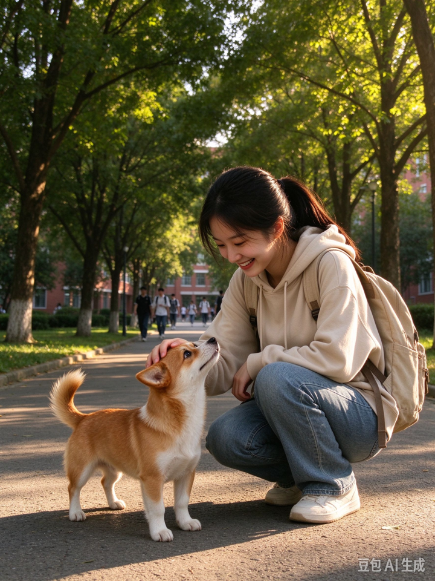
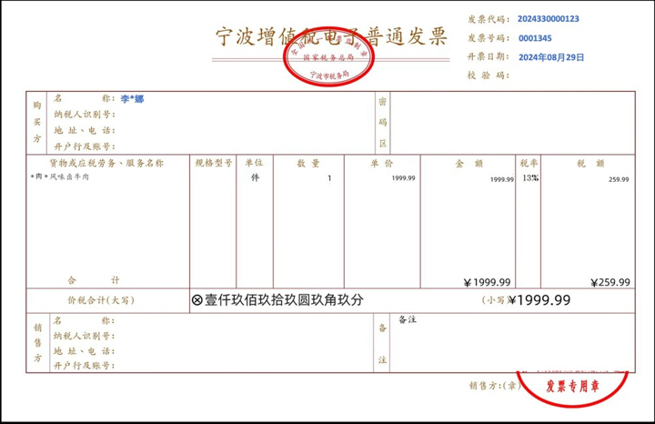
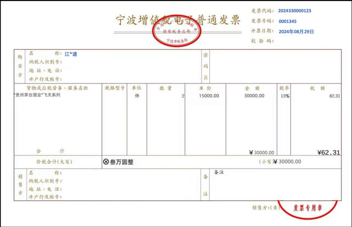
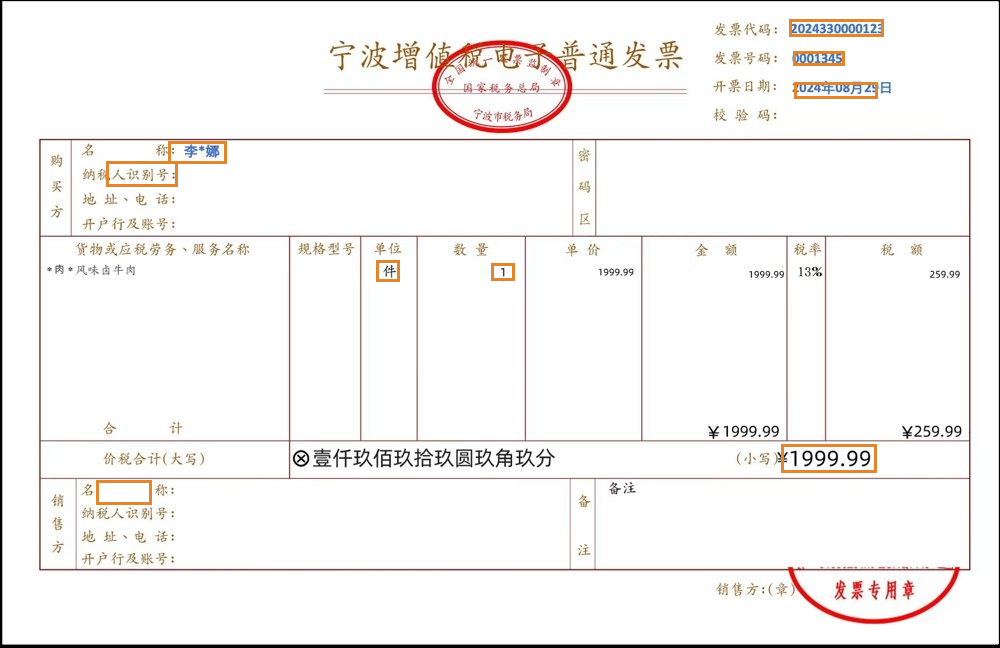
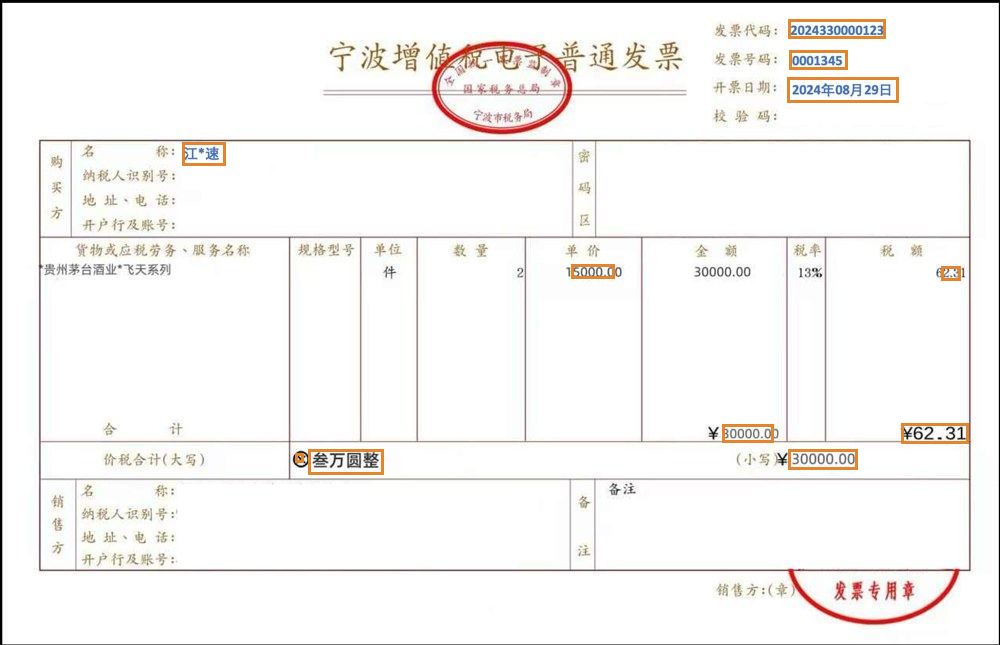

# VERITAS 智鉴 · 2.1/2.3 对外 API 调用全流程指南

> 版本：V1.0（2026-11-12） · 代码位置：`services/market-api/` · 配套规范：[market-api-and-mcp-tasks.md](market-api-and-mcp-tasks.md) · 接口速查：[services/market-api/README.md](../../services/market-api/README.md)
>
> 本文所有请求/响应示例均来自**真实测试**（真机引擎 + 真实大模型复核），输入图片即测试图片，随文嵌入。

---

## 1. 总览

### 1.1 定位

把平台两个子分支的检测能力以阿里云市场风格开放：`POST` + `base64`/`URL` 入参、统一信封
`{"code","msg","success","taskNo","data"}`、篡改区域返回**原图像素坐标** `tamperedLocation` 与热力图 `heatmap`。

| 子分支 | 开放能力 | 端点 |
| --- | --- | --- |
| 2.1 通用 AI 生成图片检测 | 整图检测、局部篡改、人像伪造、生成来源候选、文件凭证/来源声明 | `/v1/image/general/detection`（+ `/result`） |
| 2.3 证件票据材料核验 | 多材料核验（视觉模型 + OCR + 规则 + 跨材料比对）、**智能核验（大模型复核，脱敏/原文两种模式）**、轻量字段提取 | `/v1/document/review`（+ `/result`）、`/v1/document/fields` |

### 1.2 调用架构与两种运行模式

```
调用方
  │ Authorization: APPCODE <code>
  ▼
services/market-api（Python FastAPI）
  │  ① app.py      鉴权 → 参数解析(form/JSON) → 校验 → 信封
  │  ② upstream.py 材料载入（base64/URL/魔数嗅探/限幅）
  │  ③ 任务提交/轮询 ──┬─ upstream 模式：转发平台 Node 服务（真实引擎）
  │                    │    2.1 → DDA / TruFor / VLAForge / RPA
  │                    │    2.3 → MIRROR / SEED / OCR / 规则 / DeepSeek 智能核验
  │                    └─ fixture 模式：回放 runtime/reviews 保存结果（data.dataSource="fixture"）
  │  ④ mappers.py  平台结果 → 市场 schema（两种模式共用，对外字段恒定）
  │  ⑤ boxes.py    TruFor 置信度热力图 → 连通域像素框（tamperedLocation）
  ▼
{"code":200,"msg":"成功","success":true,"taskNo":"…","data":{…}}
```

- **upstream 模式**（生产）：真实引擎。启动需
  `AIGC_MARKET_API_MODE=upstream AIGC_MARKET_API_UPSTREAM=http://127.0.0.1:4173`；
  平台侧智能核验需 `REVIEW_ENGINE=direct DEEPSEEK_ENABLED=true DEEPSEEK_API_KEY=…`（密钥只在服务端）。
- **fixture 模式**（联调/测试）：`AIGC_MARKET_API_MODE=fixture`，返回真实历史结果的重放，**必须**带
  `data.task.dataSource="fixture"` 标识，不可当作本次真机检测结果。

---

## 2. 代码结构与各文件职责

```
services/market-api/
├── app.py            FastAPI 主服务（6 端点 + 鉴权 + 信封 + 任务表）
├── mappers.py        平台结果 → 市场 schema（2.1/2.3 纯函数映射）
├── boxes.py          篡改热力图 → tamperedLocation 像素连通域框
├── upstream.py       平台 Node 服务客户端 + 材料载入校验
├── fixtures.py       fixture 回放模式（保存结果池 + 内存任务表）
├── README.md         接口速查、参数表、错误码、urllib3/curl 示例
├── requirements.txt  fastapi / uvicorn / httpx / pillow / numpy / scipy
└── tests/            21 项测试（pytest）
    ├── test_mappers.py   映射正确性（含两条真机智能核验样本回归）
    └── test_api.py       接口行为（鉴权/参数/错误/异步/URL 下载）
```

### 2.1 `app.py` — 主服务

| 函数/路由 | 功能 |
| --- | --- |
| `POST /v1/image/general/detection` | 2.1 提交：载入图片（base64/URL）→ 校验 JPG/PNG/WebP、≤20MB → 解析 `features/restrictProbability/maxLocations` → fixture 立即回放 / upstream 提交平台并默认**同步等待**（`asyncSubmit=true` 则立即返回 taskNo） |
| `POST·GET /v1/image/general/detection/result` | 按 `taskNo` 查询 2.1 结果（GET 支持查询串 `?taskNo=`） |
| `POST /v1/document/review` | 2.3 提交：JSON 完整形态（`materials[]`/`confirmations[]`/`options`）或 form 单材料快捷模式 → 组装平台 review 请求（`coreMaterialId`、`privacyMode`、`semanticReview` 等）→ 同步/异步 |
| `POST·GET /v1/document/review/result` | 按 `taskNo` 查询 2.3 结果，支持 `includePreview` |
| `POST /v1/document/fields` | 单份材料轻量提取：固定 `runModels=false`（仅解析 + OCR + 规则），返回字段与原文 |
| `GET /health` | 健康检查（返回当前 mode 与 upstream 地址） |
| `check_auth` | 校验 `Authorization: APPCODE <code>`，合法值来自环境变量 `AIGC_MARKET_API_APPCODES`（未配置仅接受 `dev-apicode`） |
| `read_params` | form-urlencoded 与 JSON 双协议统一解析 |
| `envelope` / `new_task_no` | 统一信封与任务号（`yyyyMMddHHmmssSSS + 6位随机`，同时返回平台侧 jobId/reviewId 便于对账） |
| `poll_upstream` | 每 2s 轮询平台至终态；同步超时返回 `task.status="running"` 供继续轮询 |
| `task_envelope` | 终态结果 → 映射 → 注入 `task{taskNo,platformTaskId,status,dataSource}`；失败给 `code=500 + detail` |

### 2.2 `mappers.py` — 结果映射（对外字段的唯一出处）

| 函数 | 功能 |
| --- | --- |
| `map_general_result` | 2.1 平台结果 → `detectionResult`（`suspected_ai_generated / no_obvious_ai_evidence / ai_generated_declared`）、`aiScore`（0–100 + `semantics:"uncalibrated_model_signal"`）、`tamper`（分数/阈值/热力图 base64/像素框）、`faceForgery`（逐脸框与分数）、`sourceCandidates`（闭集标注）、`provenance`（C2PA/厂商声明）、`image`、`engine`（模型+权重指纹截断 16 位）；`features` 参数可裁剪返回段落 |
| `map_documents_result` | 2.3 → `conclusion{result,issueCount,checkStats}`、`issues[]`（证据=字段+识别值+页码+OCR 原文+坐标框）、`materials[]`（角色/字段/逐项检查/五阶段状态/页级 `tamperedLocation`）、`crossChecks[]`、**`aiReview`**（智能核验：`status/summary/privacyMode/findings[{verdict,explanation,warning,recommendation,evidence}]`，证据指针 `fieldId/blockId` 解析为实值）、`actions/limitations/engine`；内部状态码（PASS/FAIL/NEI）与规则代码一律转中文语义枚举，不外泄 |
| `general_task_status` / `documents_task_status` | 平台任务状态 → 终态判定 |

### 2.3 `boxes.py` — 热力图转离散区域框

`locations_from_map(confidenceMap, image_size, restrict_probability, max_locations)`：
解码 base64 PNG → 0..1 归一 → 阈值分割 → scipy 连通域标注 → 按面积降序取前 N →
映射回原图像素 `{top,left,width,height,probability}`（域内平均置信度）。
语义与阿里云示例一致：**probability ≥ restrictProbability 的区域才返回坐标**；平台声明坐标体系
（`exif_oriented_full_image`）原样透出为 `locationCoordinates`。

### 2.4 `upstream.py` — 平台客户端与材料校验

| 函数 | 功能 |
| --- | --- |
| `UpstreamClient.general_detect/general_status` | 2.1 提交/轮询（平台契约 `{action:'detect'|'status',…}`），平台错误码透传为业务错误 |
| `UpstreamClient.documents_review/documents_status` | 2.3 提交/轮询（`{action:'review'|'status',…}`） |
| `load_material_bytes` | `image`（base64，兼容 dataURL 前缀）/`imageUrl`（下载）/`file`（PDF/DOCX base64）三选一强校验；魔数嗅探格式（PNG/JPEG/WebP/PDF/DOCX）；图片 ≤20MB、文档 ≤12MB |
| `sniff_image_media_type` | 文件头魔数识别，杜绝"改后缀伪装" |
| `MarketError` | 业务异常（code/msg/detail），由 `app.py` 统一转信封 |

### 2.5 `fixtures.py` — 离线回放

`FixtureStore` 扫描 `runtime/reviews`（general/* 与根目录 2.3 结果）构建已完成结果池；
`FixtureTasks.submit/result` 维护内存任务表，按提交顺序确定性选取样本——同一套 mapper 输出，
仅 `dataSource` 不同，保证联调与测试的可复现性。

### 2.6 `tests/` — 21 项自动化测试

- `test_mappers.py`（8 项）：真实保存结果断言（AI 声明/篡改可疑/未见线索三类 2.1 样本、双材料 2.3 样本）、
  像素框边界与阈值语义、features 裁剪、内部码不泄漏、**两条真机智能核验样本回归（redacted + original）**。
- `test_api.py`（13 项）：鉴权（缺失/无效）、参数错误族、404、features 校验、form/JSON 双形态、
  异步提交+轮询往返、URL 下载（本地起 HTTP 服务）、信封一致性。

---

## 3. 通用调用约定

- **鉴权**：请求头 `Authorization: APPCODE <code>`；失败返回 HTTP 401 + 信封。
- **信封**：`{"code":200,"msg":"成功","success":true,"taskNo":"…","data":{…}}`；
  业务错误 HTTP 200（鉴权 401），`code` 见下表。
- **同步/异步**：默认同步等待（`syncTimeoutSeconds` 默认 180s，可设 5–300s）；超时未完成返回
  `data.task.status="queued|running"` + taskNo，继续调 `/result` 轮询；`asyncSubmit=true` 立即返回。

| code | 含义 | 典型触发 |
| --- | --- | --- |
| 200 | 成功（含仍在排队/处理的同步超时返回） | — |
| 400 | 参数错误（`detail` 给出细节） | 缺图 / base64 无效 / URL 拉取失败 / 枚举非法 / 格式不符 |
| 401 | APPCODE 缺失或无效 | 未带鉴权头、码错误 |
| 404 | 任务不存在 | taskNo 有误 |
| 413 | 文件超限 | 图片 >20MB、文档 >12MB |
| 500 | 平台处理失败 | 引擎执行失败 |
| 503 | 平台服务不可达 | upstream 模式下平台未启动 |

---

## 4. 2.1 通用图片检测 · 真实用户流程

### 4.0 测试输入（本次真实使用的图片）



> 注意素材库中豆包示例有两个版本：`original.jpg`（1773×2364，**内嵌 AIGC 声明**，触发 `ai_generated_declared`）
> 与 `original.png`（600×800，**无任何元数据标识**，文件标识检测正确返回“未发现声明”，整图模型仍可判定
> `suspected_ai_generated`）。两者均可用于测试，分别覆盖“文件标识优先”与“纯模型信号”两条判定路径。

### 4.1 提交检测（同步）

```python
import base64, urllib.parse, urllib3
host = 'http://127.0.0.1:8090'
http = urllib3.PoolManager(timeout=urllib3.Timeout(total=260.0))
headers = {'Content-Type': 'application/x-www-form-urlencoded; charset=UTF-8',
           'Authorization': 'APPCODE 你的AppCode'}
image_b64 = base64.b64encode(open('doubao.png','rb').read()).decode()
post_data = urllib.parse.urlencode({
    'image': image_b64,            # 或 imageUrl
    'restrictProbability': '0.5',  # 区域框置信度阈值
    'maxLocations': '3',           # 最多返回 3 个区域框
}).encode('utf-8')
response = http.request('POST', host + '/v1/image/general/detection', body=post_data, headers=headers)
```

平台内部流转（upstream 模式，本次实测 **35.0s**）：
市场 API → 平台 Node → DDA 整图检测 → TruFor 局部篡改 → VLAForge 人像 → RPA 来源候选 → 逐段映射。

### 4.2 成功响应（真实返回，base64 已截断）

```json
{
  "code": 200,
  "msg": "成功",
  "success": true,
  "taskNo": "20261112200704516366309",
  "data": {
    "detectionResult": "ai_generated_declared",
    "aiScore": {
      "score": 98.47,
      "semantics": "uncalibrated_model_signal",
      "coverage": "中心336×336区域；边缘未参与本次模型判断。",
      "decisionBasis": "file_declaration"
    },
    "summary": "AI 生成（文件标识）：文件内部已记录 AI 生成声明。",
    "tamper": {
      "status": "completed",
      "detectionResult": "no_obvious_signal",
      "score": 0.079976,
      "threshold": 0.2,
      "scoreSemantics": "uncalibrated",
      "heatmap": "iVBORw0KGgoAAAANSUhEUgAAAwAAAAQACAIAAADZRKlXAAEA…（base64 已截断）",
      "heatmapFormat": "png",
      "meanConfidence": 0.960943,
      "tamperedLocation": [
        { "top": 0, "left": 0, "width": 1773, "height": 2364, "probability": 0.964887 }
      ],
      "locationCoordinates": "exif_oriented_full_image"
    },
    "faceForgery": {
      "status": "completed",
      "analyzedFaceCount": 1,
      "detectionResult": "no_obvious_signal",
      "faces": [
        { "index": 1, "detectionResult": "normal", "score": 0.000196, "threshold": 0.5,
          "box": { "top": 870, "left": 863, "width": 244, "height": 241 } }
      ]
    },
    "sourceCandidates": {
      "status": "completed",
      "closedSet": true,
      "calibration": "uncalibrated_closed_set",
      "candidates": [
        { "source": "midjourney-6", "score": 0.476647 },
        { "source": "gpt-image-1", "score": 0.313177 },
        { "source": "dalle-3", "score": 0.1534 }
      ],
      "summary": "已完成已知生成器候选分析；未知来源和混合编辑暂不能确定归属。"
    },
    "provenance": {
      "c2pa": "absent",
      "aiDeclarationsFound": true,
      "declarationSummary": "文件包含来源声明，尚未验证声明者身份。",
      "providerChecks": [
        { "provider": "doubao", "name": "豆包", "status": "evidence_found",
          "declarations": [ { "role": "producer", "value": "doubao", "location": "xmp" } ] },
        { "provider": "qwen",   "name": "千问 / Qwen", "status": "not_found", "declarations": [] },
        { "provider": "openai", "name": "OpenAI / ChatGPT", "status": "not_found", "declarations": [] }
      ]
    },
    "image": { "format": "JPEG", "width": 1773, "height": 2364,
               "sha256": "5c4b8127806164c127c8b20e7d12a9a57d1c63b6ba4deeeae0f0376dcd58417d" },
    "timing": { "seconds": 15.876587 },
    "engine": { "tamper": "TruFor · weights ac1d90e329a72e0d…",
                "faceForgery": "VLAForge",
                "sourceCandidates": "RPA OpenFake27 · weights bb6a7b3cb50368f0…" },
    "task": { "taskNo": "20261112200704516366309",
              "platformTaskId": "4ab8568c-ea79-479e-aeac-8425d42c8fc3",
              "status": "completed", "dataSource": "engine" }
  }
}
```

解读：文件内嵌豆包 AIGC 生成声明（XMP `Label=1`、`ContentProducer=…`），平台据此优先给出`ai_generated_declared`（对应前端「AI 生成（文件标识）」），判定依据 `file_declaration`；整图模型信号 98.47/100 与声明相互印证。局部篡改未见线索（0.08 < 阈值 0.2），热力图高置信覆盖整图；人像 1 张未见伪造线索；来源候选为闭集参考（首选 midjourney-6）。注意：声明仅证明“文件自称 AI 生成”，声明者身份未验证（见 declarationSummary）；`dataSource:"engine"` 表示真机结果。

`tamper.heatmap` 解码后即篡改热力图（本次真实输出）：


### 4.3 异步提交与轮询（真实流程）

```python
# 立即返回
r = http.request('POST', host + '/v1/image/general/detection',
                 body=urllib.parse.urlencode({'image': image_b64, 'asyncSubmit': 'true'}).encode(), headers=headers)
task_no = json.loads(r.data.decode())['taskNo']
# 之后轮询
r = http.request('POST', host + '/v1/image/general/detection/result',
                 body=urllib.parse.urlencode({'taskNo': task_no}).encode(), headers=headers)
# → {"code":200,…,"data":{"detectionResult":"…","task":{"status":"completed",…}}}
```

### 4.4 2.1 失败响应（真实触发）

```json
// HTTP 401（未带鉴权头）
{"code": 401, "msg": "缺少 Authorization: APPCODE <code> 请求头", "success": false}

// HTTP 401（APPCODE 错误）
{"code": 401, "msg": "APPCODE 无效或未授权", "success": false}

// HTTP 200 业务错误：未提供图片
{"code": 400, "msg": "参数错误：image、imageUrl、file 必须且只能提供一个", "success": false}

// HTTP 200 业务错误：base64 无效
{"code": 400, "msg": "参数错误：base64 内容无效", "success": false}

// HTTP 200 业务错误：把 PDF 提交给 2.1（detail 给出嗅探到的真实格式）
{"code": 400, "msg": "参数错误：通用图片检测仅支持 JPG/PNG/WebP", "success": false, "detail": "application/pdf"}

// HTTP 200 业务错误：taskNo 不存在
{"code": 404, "msg": "任务不存在", "success": false, "detail": "20260101000000000000000"}
```

---

## 5. 2.3 材料核验 · 真实用户流程

### 5.0 测试输入（本次真实使用的两张发票）

| 核心材料 invoice-a.jpg（价税合计 ¥1999.99） | 辅助材料 invoice-b.jpg（价税合计 ¥30000.00） |
| --- | --- |
|  |  |

两张票**发票代码、号码、开票日期完全相同**，但购买方、数量、单价、金额不同——正是核验要抓的矛盾。

### 5.1 流程 A：完整核验 + 智能核验（脱敏模式，真实测试 60.8s）

**请求**（JSON 完整形态）：

```python
payload = {
    'objective': 'invoice_review',        # 核验目的
    'coreMaterialIndex': 0,               # 第 1 份为核心材料
    'materials': [
        {'name': 'invoice-a.jpg', 'type': 'invoice', 'image': base64.b64encode(open('invoice-a.jpg','rb').read()).decode()},
        {'name': 'invoice-b.jpg', 'type': 'invoice', 'image': base64.b64encode(open('invoice-b.jpg','rb').read()).decode()},
    ],
    'confirmations': [                    # 人工关联声明：用户确认两票同一交易
        {'materialIndex': 1, 'reason': '同一笔交易的发票与付款凭证', 'sameInvoice': False},
    ],
    'options': {'runModels': True, 'semanticReview': True, 'privacyMode': 'redacted'},
    'syncTimeoutSeconds': 270,
}
response = http.request('POST', host + '/v1/document/review',
                        body=json.dumps(payload).encode(),
                        headers={**headers, 'Content-Type': 'application/json; charset=UTF-8'})
```

平台内部流转：MIRROR 整图 → SEED 篡改定位 → OCR 字段 → 单份/跨材料规则 →（B 级待审项）→
**DeepSeek 智能核验（脱敏包外发，姓名/税号等替换为代号，保留必要金额）**。

**成功响应**（真实返回，节选；完整结构见 §2.2）：

```json
{
  "code": 200, "msg": "成功", "success": true,
  "taskNo": "20261112152305427794141",
  "data": {
    "objective": "invoice_review",
    "conclusion": {
      "result": "issues_found",
      "issueCount": 20,
      "checkStats": { "fail": 7, "pass": 10, "nei": 1, "not_applicable": 0, "error": 0 },
      "summary": "本次发现 20 项需关注内容，请核对下列问题后再办理相关业务。"
    },
    "issues": [
      {
        "title": "价税金额核对",
        "message": "不含税金额1999.99元＋税额259.99元，应为2259.98元；票面价税合计1999.99元，相差259.99元，超过0.01元容差。疑似文件遭遇篡改，请核对原件。",
        "materials": ["invoice-a.jpg"],
        "evidence": [
          { "field": "net_amount",   "value": "1999.99", "page": 1, "observedText": "¥1999.99",
            "box": { "top": 421, "left": 705, "width": 76,  "height": 18 } },
          { "field": "tax_amount",  "value": "259.99",  "page": 1, "observedText": "¥259.99",
            "box": { "top": 419, "left": 897, "width": 69,  "height": 21 } },
          { "field": "gross_amount","value": "1999.99", "page": 1, "observedText": "(小写)¥1999.99",
            "box": { "top": 447, "left": 733, "width": 137, "height": 21 } }
        ]
      }
      // …共 20 项
    ],
    "materials": [
      {
        "index": 0, "name": "invoice-a.jpg", "type": "invoice", "role": "core", "status": "completed",
        "fields": [
          { "key": "invoice_code",   "value": "2024330000123", "confidence": 0.999949, "page": 1,
            "observedText": "发票代码：2024330000123", "box": { "top": 17, "left": 712, "width": 172, "height": 17 },
            "extractionAmbiguous": false },
          { "key": "invoice_number", "value": "0001345", "confidence": 0.999988, "page": 1,
            "observedText": "发票号码：0001345", "box": { "top": 48, "left": 712, "width": 132, "height": 17 },
            "extractionAmbiguous": false }
          // …共 14 个字段
        ],
        "checks": [
          { "title": "价税金额核对", "status": "fail",
            "explanation": "不含税金额1999.99元＋税额259.99元，应为2259.98元；票面价税合计1999.99元，相差259.99元，超过0.01元容差。疑似文件遭遇篡改，请核对原件。" }
          // …逐项检查
        ],
        "stages": { "mirror": {"status": "completed"}, "seed": {"status": "completed"},
                    "ocr": {"status": "completed"}, "rules": {"status": "completed"},
                    "explanation": {"status": "completed"} },
        "pages": [
          { "page": 1, "status": "completed",
            "tamperedLocation": [
              { "top": 21,  "left": 791, "width": 90, "height": 13, "probability": null },
              { "top": 53,  "left": 795, "width": 47, "height": 10, "probability": null }
              // …SEED 共标出 9 处
            ] }
        ]
      }
      // 第二份材料 invoice-b.jpg（role=auxiliary，SEED 11 处）
    ],
    "crossChecks": [
      { "title": "field_comparison", "status": "nei", "materials": ["invoice-a.jpg", "invoice-b.jpg"],
        "explanation": "same_invoice_not_confirmed" }
      // …共 14 组
    ],
    "aiReview": {
      "status": "completed",
      "privacyMode": "redacted",
      "summary": "本次仅对两张发票及用户声明的关联关系做内容核查。m1、m2均存在金额口径矛盾：价税合计与不含税金额相同，但另列税额，且税额与税率、不含税金额不匹配；m2的13%税率与所列税额明显不符。两材料虽显示相同发票代码、号码和日期，但购买方、数量、单价、金额、税额均不同，不能仅凭相同显示标识认定为同一交易。证据不完整且存在脱敏损失，未作政策适用判断。",
      "findings": [
        {
          "verdict": "issues_found",
          "explanation": "m1内部金额口径不一致：不含税金额e7为1999.99，税额e8为259.99，但价税合计e5及大写e6均为1999.99，未体现加税；同时按13%税率对1999.99计算税额应约为260.00，与259.99存在分位差异。…",
          "warning": "m1价税合计与不含税金额相同却另列税额259.99，金额口径矛盾；按13%计算的税额与所列税额存在分位差异，需核实发票金额栏位及税额计算。",
          "recommendation": "核对m1原票的金额、税额、价税合计栏位及计税方式，确认是否存在录入或脱敏错位；如为含税价开票，应取得能解释税额与合计关系的说明或更正材料。",
          "materials": ["invoice-a.jpg"],
          "evidence": [
            { "field": "gross_amount", "value": "1999.99", "confidence": 0.982001, "page": 1,
              "observedText": "(小写)¥1999.99", "box": { "top": 447, "left": 733, "width": 137, "height": 21 } },
            { "field": "gross_amount_words", "value": "壹仟玖佰玖拾玖圆玖角玖分", "confidence": 0.997347, "page": 1,
              "observedText": "壹仟玖佰玖拾玖圆玖角玖分", "box": { "top": 447, "left": 292, "width": 261, "height": 20 } }
          ]
        },
        {
          "verdict": "issues_found",
          "explanation": "m2内部金额与税率明显不自洽：不含税金额e32为30000.00，税额e33为62.31，价税合计e30仍为30000.00；按13%税率e34计算，30000.00对应税额应约为3900.00，与62.31差距巨大。…",
          "warning": "m2税率13%与税额62.31严重不符，且价税合计与不含税金额相同却另列税额，金额口径和税率适用均存在明确矛盾。",
          "materials": ["invoice-b.jpg"], "evidence": [ /* 价税合计 30000.00 / 叁万圆整 … */ ]
        },
        {
          "verdict": "issues_found",
          "explanation": "用户声明m1与m2为同一交易，但两材料除发票代码、号码、日期显示相同外，购买方e4与e29不同，数量、单价、不含税金额、税额、价税合计均不同，且金额量级差异巨大。…",
          "warning": "m1与m2虽显示相同发票代码、号码和日期，但购买方、数量、单价、金额、税额均不一致，不能认定为同一交易；需核实是否存在重复使用票号、版本替换或关联关系误标。",
          "materials": ["invoice-a.jpg", "invoice-b.jpg"], "evidence": [ /* 发票代码 2024330000123 / 票号 0001345 双方对照 */ ]
        }
      ],
      "disclaimer": "智能复核为辅助参考，不构成新增鉴伪证据；本地确定结论不因复核改变。"
    },
    "actions": [ "…补充/处理建议（含复核 recommendation）" ],
    "limitations": [ "本地开发工作台；公共登录、权限和长期存储尚未接入。", "…共 4 条" ],
    "engine": { "engineVersion": "…", "batchVersion": "…", "semanticReviewEngine": "direct" },
    "task": { "taskNo": "20261112152305427794141", "platformTaskId": "8b96e165-3120-40a8-b7a4-2f3fba88759a",
              "status": "completed", "dataSource": "engine" }
  }
}
```

要点：**智能核验检出 3 项 `issues_found`**——两张票各自的金额口径矛盾、B 票 13% 税率与税额 62.31 严重不符、
以及"同票号但内容完全不同，不能认定同一交易"；脱敏模式下姓名等以代号（m1/m2/e5…）外发，证据经指针解析
还原为字段实值（含 OCR 原文与坐标框）。

**页级篡改定位**（`materials[].pages[].tamperedLocation`，坐标画在真实页图上）：

| invoice-a：9 处橙框 | invoice-b：11 处橙框 |
| --- | --- |
|  |  |

### 5.2 流程 B：智能核验原文模式（对照测试，真实测试 60.8s）

只改一个参数：`'privacyMode': 'original'`（允许必要原文外发）。真实返回同样 3 项 `issues_found`，
证据直接为实值（`invoice_code=2024330000123`、`gross_amount=30000.00` 等），
`aiReview.privacyMode="original"`；差异示例：

```json
"aiReview": {
  "status": "completed",
  "privacyMode": "original",
  "findings": [
    { "verdict": "issues_found",
      "explanation": "m1显示不含税金额1999.99（e7）、税额259.99（e8）、价税合计1999.99（e5、e6、e49），价税合计应等于不含税金额加税额，但此处价税合计…",
      "evidence": [
        { "field": "gross_amount", "value": "1999.99", "observedText": "(小写)¥1999.99", "page": 1 },
        { "field": "gross_amount_words", "value": "壹仟玖佰玖拾玖圆玖角玖分", "page": 1 }
      ] }
    // …
  ]
}
```

> 选择建议：默认 `redacted`（脱敏，姓名/税号/账户以代号外发）；仅在确需原文核对且符合数据授权时用 `original`。

### 5.3 流程 C：轻量字段提取（真实测试 30.4s）

不需要视觉模型、只要 OCR 字段时用 `/v1/document/fields`（内部固定 `runModels=false`）：

```python
r = http.request('POST', host + '/v1/document/fields',
                 body=json.dumps({'image': invoice_a_b64, 'materialType': 'invoice'}).encode(),
                 headers={**headers, 'Content-Type': 'application/json; charset=UTF-8'})
```

真实返回（节选）：

```json
{
  "code": 200, "msg": "成功", "success": true, "taskNo": "20261111205336706412429",
  "data": {
    "objective": "invoice_review",
    "materials": [
      {
        "index": 0, "name": "image.jpg", "type": "invoice", "status": "completed",
        "pages": [ { "page": 1, "status": "completed" } ],
        "fields": [
          { "key": "invoice_code",        "value": "2024330000123", "confidence": 0.999949, "page": 1,
            "observedText": "发票代码：2024330000123", "box": { "top": 17, "left": 712, "width": 172, "height": 17 },
            "extractionAmbiguous": false },
          { "key": "invoice_number",      "value": "0001345",        "confidence": 0.999988, "page": 1 },
          { "key": "invoice_date",        "value": "2024年08月29日", "confidence": 0.999937, "page": 1 },
          { "key": "name",                "value": "李*娜",          "confidence": 0.999541, "page": 1 },
          { "key": "gross_amount",        "value": "1999.99",        "confidence": 0.982001, "page": 1 },
          { "key": "gross_amount_words",  "value": "壹仟玖佰玖拾玖圆玖角玖分", "confidence": 0.997347, "page": 1 }
          // …共 14 个字段
        ],
        "ocrStage": { "status": "completed" }
      }
    ],
    "task": { "status": "completed", "dataSource": "engine" }
  }
}
```

### 5.4 2.3 失败响应（真实触发）

```json
// objective 非法
{"code": 400, "msg": "参数错误：objective 必须是 ('invoice_review', 'procurement_review', 'merchant_reconciliation', 'research_reimbursement', 'identity_consistency') 之一", "success": false, "detail": "free_check_all"}

// 未提供任何材料
{"code": 400, "msg": "参数错误：image、imageUrl、file 必须且只能提供一个", "success": false}

// imageUrl 不可达
{"code": 400, "msg": "图片 URL 下载失败", "success": false, "detail": "…"}
```

未开启/未配置智能核验时（不报错，显式降级）：

```json
"aiReview": { "status": "not_run", "reason": "provider_disabled",
              "findings": [], "summary": "", "privacyMode": "redacted", "disclaimer": "…" }
```

---

## 6. 真机测试记录汇总

| # | 场景 | 输入 | 模式 | 耗时 | 关键结果 | 平台存档 |
| --- | --- | --- | --- | --- | --- | --- |
| 1 | 2.1 检测（含文件标识） | 豆包人像图 original.jpg（§4.0） | engine | 35.0s | `ai_generated_declared`（豆包 XMP 声明，98.47/100）；篡改未见线索+热力图；1 人脸；来源候选 3 项 | `4ab8568c…` |
| 2 | 2.3 完整核验 | invoice-a+b（§5.0） | engine | 54.7s | 17 项问题（FAIL 7）；SEED 框 9+11；跨材料 14 组 | `e4f0232e…` |
| 3 | 2.3 字段提取 | invoice-a | engine | 30.4s | 14 字段，置信度 0.98–0.9999 | `09396228…` |
| 4 | 2.3 + 智能核验（redacted） | invoice-a+b | engine+DeepSeek | 60.8s | 3 项 findings 全 `issues_found`，脱敏代号合规 | `8b96e165…` |
| 5 | 2.3 + 智能核验（original） | invoice-a+b | engine+DeepSeek | 60.8s | 3 项 findings，证据实值解析 | `6001b1e7…` |

自动化回归：`python3 -m pytest services/market-api/tests/ -q` → **21/21 通过**（含 #4/#5 两条真机样本断言）。

---

## 7. 后续（P1）

MCP server（`stdio` + streamable HTTP）将以同一套 mapper 开放 5 个工具
（`image_general_detect` / `image_general_task_result` / `document_review` / `document_review_task_result` /
`document_extract_fields`），入出参与本文 API 一致；设计与任务清单见
[market-api-and-mcp-tasks.md](market-api-and-mcp-tasks.md) 第三节。
