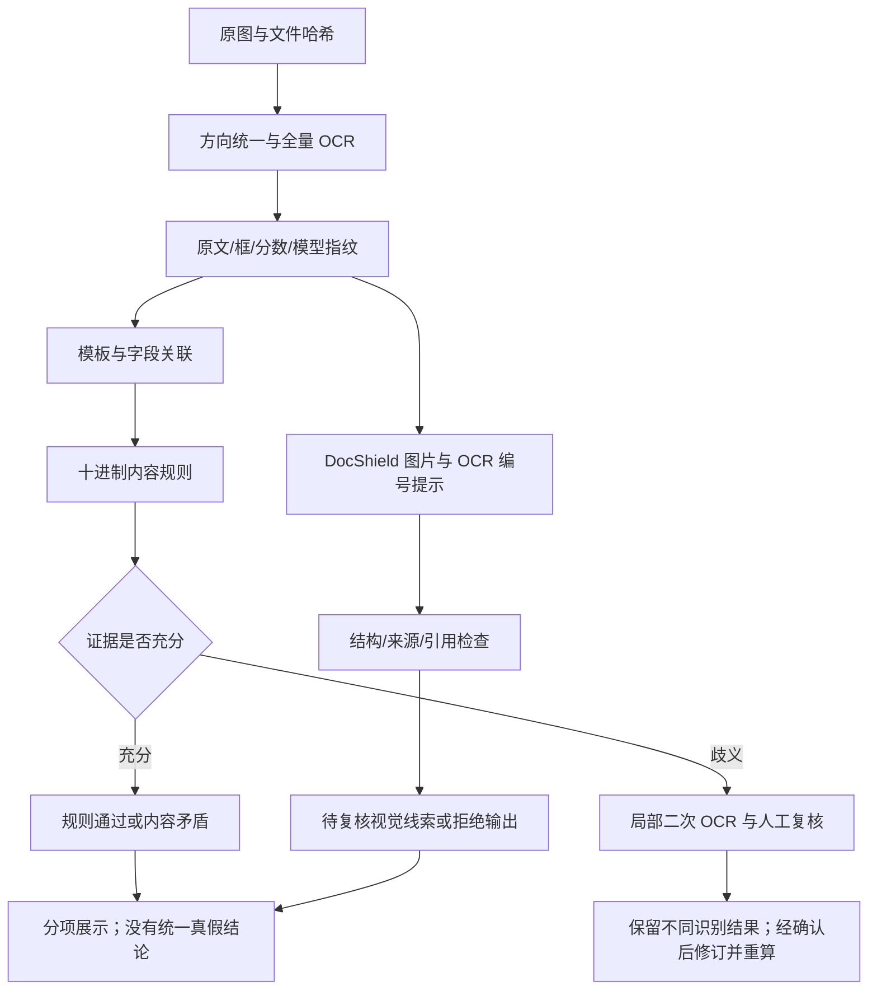

# 票据多方法协作与证据复核

更新：2026-10-21。对应 `add-image-documents` 任务 2.2–2.4、3.1、3.3、3.6。本轮已有离线可执行原型，尚未接入公共 API、智鉴页面、人工修订服务或正式报告。研究原型中的字段和状态不是新增公共契约。

## 分工与执行顺序

| 方法 | 负责内容 | 输出限制 |
| --- | --- | --- |
| MIRROR | 整图 AI 来源倾向 | 独立输出，不参与金额规则，不定位文字篡改 |
| PP-OCRv6 medium | 全量文字、文字框、识别分数 | 保留当前可见原文；分数不是伪造概率 |
| 模板与版面关联 | 根据明确标签、同行与列头寻找字段 | 多候选、缺标签或币种口径不明时保留缺证 |
| 本地十进制规则 | 不含税金额＋税额＝价税合计、明示税率算术 | 只检查输入字段关系，不证明税务登记或交易发生 |
| DocShield-9B | 文字区域的待复核视觉线索 | 不要求其执行金额计算或恢复修改历史；解释始终为未核实模型意见 |
| 局部二次 OCR | 对低识别分或非法数字区域补充观察 | 不覆盖初次结果，同模型重复识别不算独立证据 |

流程图中的人工确认和修订重算仍需接公共版本服务；当前原型已验证改变 OCR 内容后拒绝复用旧模型结果、重新执行金额规则，不代表人工修订界面已经完成。

## 已实现的输出约束

入口为 [receipt_evidence.py](../../scripts/image-validation/receipt_evidence.py)，版本 `receipt-evidence/0.1`。

1. OCR 必须成功，图片哈希、方向统一后尺寸、页码、坐标系一致；区域编号不能重复，框不能越界或退化，识别分数必须为有限的 0–1 数值。
2. 每次模型推理绑定输入图片和完整 OCR 证据摘要。OCR 内容或版本发生变化，即使仍是同一张图片，也拒绝复用旧模型结果。
3. 模型只输出 `observations`，每项包含 OCR 编号、逐字引用的值和描述。不要求模型提供控制业务执行的布尔字段、坐标或风险分。
4. 只接受完整 JSON，允许有记录地剥离完整 JSON 代码围栏和模型结束标记。重复键、非标准数值、截断、额外正文、缺字段或无依据引用不能靠猜测修复。
5. 有效引用关联到已有 OCR 文字框，框的含义是“模型引用的文字位置”，不是已证实的篡改范围，更不是字符级精确掩码。
6. 校验通过只证明结构和引用有效。模型原始解释单独标记 `description_verified=false`，不能作为已确认事实；没有候选也不能显示“真实”。
7. 外部核验保持未执行，整份材料真假结论为空，模型视觉线索不能覆盖确定性规则结果。
8. 即使给模型的任务是视觉观察，也不能假设返回内容就是视觉证据。通过引用检查的结果标为 `unclassified_model_observation`；若与 OCR 歧义区域重合，明确记录重合原因，不将同一 OCR 值被模型复述算作独立佐证。

原生 DocShield 直接坐标路径仍保留原始推理脚本，须另行完成坐标空间标定。此次 OCR 编号协作不把之前的越界坐标按猜测比例拉回原图。

## 金额规则与适用边界

当前是三个显式研究版式，不是完整票种分类或税务知识库：

- 中文：明示“不含税金额/金额（不含税）”“税额”“价税合计（小写）”。支持标签与值同框、标签右侧唯一同行值；三个金额须有明确一致符号或“币种：人民币”。不把泛化的“合计”强行解释为含税总额。
- 英文收据：明确 `Amount:`、`Tax Rate:(…%):` 和 `Sub-Total: $…` 的研究版式。依据该版式解释作算术检查，`$` 不自动等同美元，也不核定税率是否合法。
- GST 汇总表：共同识别 `GST Summary`、`Amount (RM)`、`Tax (RM)` 列头和紧邻的税率行。非零税率缺少含税/未税口径时为证据不足；0% 与非零税额可报告显示值矛盾，不升级成伪造结论。

金额使用 `Decimal`，保留正负号；采用两位小数 `ROUND_HALF_UP`、绝对差不超过 0.01 的研究计算策略。含税与未税计算分别处理。此容差不是已批准的通用税务舍入规则，正式模板需明确票种、币种、逐行/汇总舍入和依据。

当前 OCR 复核门槛为 0.90，仅作为实验调度参数，不是已校准正确率。`9..747`、`1O0.00`、科学计数法及未明确格式的千分位不会自动修复；先输出证据不足和局部复核请求。完整明细合计、大小写金额转换、票号及身份规则、跨材料关系仍未实现，不把已完成的两条算术检查当作全部核验。

## 局部复核与冲突处理

[retry_ocr_regions.py](../../scripts/image-validation/retry_ocr_regions.py) 验证与原 OCR 相同的权重文件哈希后，对指定区域按文字高度加边，放大两倍重识别。保存原图裁剪框、缩放倍数、重采样方式、全部候选文字与分数；新框按实际变换回映到方向统一后的原图。不会改写原图、原始 OCR 或任一规则结果。

多次识别不同则保留冲突；识别一致也不自动视为真实字段。正式接入时可让用户查看局部原图并确认，生成有操作者、原因和来源的字段修订，再重算关联规则及跨材料结果。不能选择“最容易让算术通过”的候选。

`smoke_docshield.py --ocr-report ... --rule-guided` 另提供受控局部图实验：依据 FAIL/NEI 项的字段及表头证据选择一个带边距的裁剪区域，原图与该区域一同输入。程序记录选择依据、规则版本和原图裁剪框；模型仅获得区域编号，不获得规则 PASS/FAIL 等结论，避免用内容矛盾诱导它编造视觉异常。正常通过的票据不额外裁剪。该模式仍属于研究对照，不证明检出率提高。

## 实测结论与下一步

本地运行记录位于 `tmp/image-workspace/reports/`，研究材料及含原值报告不进入 Git。

- 正常研究收据的 `25.34 + 2.28 = 27.62` 通过；按版式解释的 `25.34 × 9%` 舍入为 `2.28`。
- 长票据的非零税率行存在低识别分和非法数字 `9..747`，保留证据不足；显示 0% 的一行税额为 `2.03`，按当前 OCR 值记录内容矛盾并保留列头、税率、金额、税额证据。
- 视觉专用提示词首次在两张样本上均给出空观察项，包含伪造标签样本。不能据此宣称降低误报或解决漏检；作用是把未经验证的模型叙述与可计算事实分开。需要扩大独立中文负例和篡改样本后比较效果。
- 用含权重指纹的新 OCR 报告重跑后，DocShield 两张图片仍返回空观察项，生成约 1.55 秒和 1.34 秒，PyTorch 分配显存峰值约 18.33 GiB；完整代码围栏被记录并剥离，结构校验通过。输出更短导致耗时下降，不能解释为完整检测能力等价提速。
- 四个局部区域重识别耗时各约 0.44–1.18 秒。`9..747` 仍为 `9..747`，`20.382` 和 `2.03` 也未变化；税率局部识别为 `T@6%`，还检测到相邻表头片段。完整保留全部候选，不用提高的识别分替换原结果或清除缺证。
- 首次局部重识别因早期报告缺少权重指纹被拒绝；随后重新采集完整 OCR（32/84 区域，约 13.51/50.81 秒），以新证据摘要重跑模型。没有向旧报告补写推测的指纹。
- 规则引导首轮把完整规则上下文传给模型，长票据输出回显了上下文而非观察项，已按结构错误拒绝，见 `docshield-rule-guided-v1.json` 和 `receipt-rule-guided-v1.json`。随后仅提供编号和清晰局部图，正常收据仍无观察项；长票据约 5.21 秒返回 `ocr-72`、`9..747` 及数字格式异常解释。引用有效，但解释只是 OCR/内容层面问题，不算已验证视觉线索；见 `docshield-rule-guided-v2.json`、`receipt-rule-guided-v2.json`。这是一项受控提示对照，不作为独立效果指标。
- 中文规则、负数、舍入、含税/未税、缺项、同行歧义、恶意结构、引用和版本失效以合成夹具测试；这不是中文真实图片 OCR 精度验收。

下一步优先补独立中文字段标注与真实负例、人工更正和关系证据，逐步落实 [C01–C15/G01–G08](cross-material-rules.md)。公共接口对齐后再迁移到正式服务和智鉴页面；PDF 后续作为同一证据链的页级辅助输入。

## 2026-10-21 SEED 主测更新

按用户新要求，本轮主测改为 SEED 本地定位 + OCR/规则 + DeepSeek 脱敏摘要解释，DocShield-9B 完整保留作对照。此前“外部 API 全部关闭”是历史方案；现仅允许用户授权的 DeepSeek 白名单摘要，原图与 OCR 原文仍不外发。下载、同样本误报/漏报、实际 API 验证与边界见[SEED 接入记录](seed-integration.md)。公共接口和业务前端尚未接入。
