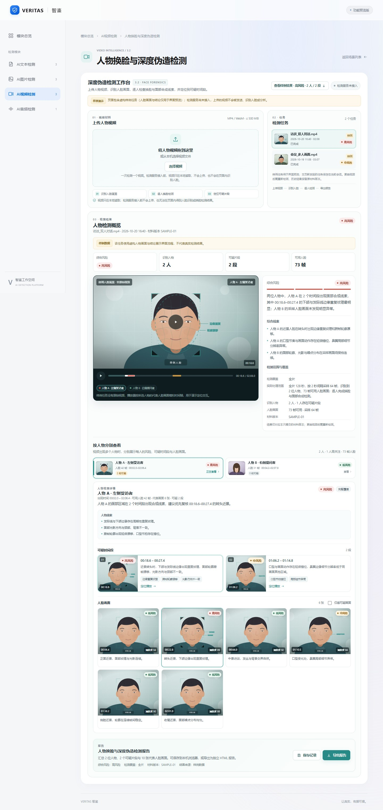
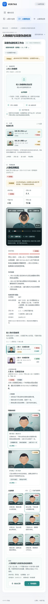

# 3.2 人物换脸与深度伪造检测前端

场景路由 `#/video/deepfake`。本轮交付前端工作台：人物视频本地读取、逐人物检测结果展示、多人分别查看、可疑片段与时间轴定位、人脸画面核对、报告保存和导出。真实人脸识别、换脸算法、异步任务、文件存储、权限和跨刷新历史仍待后端接入；现有 `POST /api/v1/video/deepfake` 继续返回501。

## 已实现

- 视频材料：MP4/WebM 拖拽或选择，单文件不超过 500 MiB；浏览器本地读取时长、画面尺寸并生成封面，不上传、不写服务端。
- 人物画面识别结果：展示检测服务返回的可用人脸画面数量、人物出现区间、代表人脸画面与清晰度；未识别到人物时明确显示“无法判断”，不输出低风险。
- 逐人检测：每位人物分别展示综合风险、检测覆盖、检测结论、人物线索、可疑时间段和该人物的人脸画面。视频出现多人时可切换人物查看，时间轴同步突出所选人物片段。
- 可疑片段定位：片段关联人物、起止时间、面部合成线索和代表人脸画面；点击片段或人脸画面可定位播放器，时间轴支持鼠标拖动和键盘调整。
- 材料版本：每次提交根据文件名、大小和最后修改时间生成材料版本标识；结果、报告和页面均保留版本。更换视频后仍显示历史结果对应版本，并提示重新检测，不把旧结果当作新材料结论。
- 失败与覆盖：运行、失败、取消、部分覆盖、未识别到人物分别展示；不合法结果统一按失败处理，不把部分字段包装成成功报告。
- 报告：保存记录到当前浏览器 `localStorage`（键 `veritas.video.deepfake.reports.v1`，最多20条），或导出独立 HTML 报告；样例任务在页面和报告中均保留“样例数据”标识。

内置两条样例任务（双人访谈、多人会议）用于展示界面。人物画面为程序生成的抽象示意，结论为虚构数据，不代表真实检测结果。未配置检测服务时，点击“开始检测”只提示未接入，不调用现有501接口。





## 检测适配入口

页面通过 `window.Veritas.videoDeepfakeDetection` 暴露适配入口，源码在 `src/modules/video/deepfake/detection.js`。页面不直接读取密钥，也不默认调用 `/api/v1/video/deepfake`；接入真实服务时由适配器完成上传、人物识别、换脸检测、任务轮询和结果映射。

```js
window.Veritas.videoDeepfakeDetection.configure(async ({ file, metadata }, { signal, onProgress }) => {
  const body = new FormData();
  body.set('video', file, file.name);
  onProgress?.({ stage: '上传视频', percent: 10 });

  const response = await fetch('/your-deepfake-detection-endpoint', {
    method: 'POST',
    body,
    signal,
    credentials: 'same-origin',
  });
  if (!response.ok) throw new Error('检测服务处理失败，请稍后重试。');

  const data = await response.json();
  // 在适配器内映射为下方结果结构；页面会再次做边界校验。
  return data;
});

// 移除配置（恢复“检测服务未接入”状态）
// window.Veritas.videoDeepfakeDetection.configure(null);
```

适配器输入：

| 字段 | 含义 |
| --- | --- |
| `file` | 通过前端文件类型、大小检查的原生 `File`，不是远端引用 |
| `metadata.name` | 文件名 |
| `metadata.size` | 字节数 |
| `metadata.type` | 浏览器声明的 MIME 类型 |
| `metadata.duration` | 浏览器读取的时长（秒） |
| `metadata.width` / `height` | 视频画面尺寸 |
| `metadata.materialVersion` | 页面生成的材料版本标识，可用于服务端关联材料 |
| `options.signal` | 页面离开、取消或重新检测时触发；适配器应传给上传/轮询请求 |
| `options.onProgress({ stage, percent })` | 可选进度回调；`stage` 最多100字符，`percent` 为 `null` 或 0—100 |

适配器返回结构（前端归一化后展示）：

| 字段 | 要求 |
| --- | --- |
| `risk` | `low` / `medium` / `high` / `unknown`，分别显示低/中/高风险/无法判断；不得在前端自行推断 |
| `summary` | 非空结论，最多4000字符 |
| `coverage` | `full` 或 `partial` |
| `scope` | 非空实际处理范围，最多2000字符；部分覆盖必须如实说明 |
| `duration` | 视频时长（秒）；与浏览器读取时长相差超过2秒会被拒绝 |
| `sampledFrames` | 实际采样画面数，0—100000 的整数 |
| `faceFrames` | 识别到可用于检测的人脸画面数，0—100000 的整数 |
| `findings` | 可选综合线索数组，最多12条、单条500字符 |
| `persons` | 人物结果数组，最多20人；未识别到人物时必须为空且 `risk` 为 `unknown` |
| `persons[].id` | 唯一人物标识 |
| `persons[].label` | 人物名称或匿名标识，最多60字符 |
| `persons[].risk` / `coverage` | 人物风险与覆盖范围；综合风险不得低于已识别出的人物风险（`unknown` 除外） |
| `persons[].summary` | 非空人物结论，最多2000字符 |
| `persons[].firstSeen` / `lastSeen` | 人物在视频中的出现区间，需位于视频时长内 |
| `persons[].faceFrames` | 该人物可用人脸画面数，非负整数 |
| `persons[].findings` | 可选人物线索，最多8条、单条300字符 |
| `persons[].segments` | 可选可疑时间段，每人最多30项；`id` 全局唯一，`start < end` 且位于视频时长内，`risk`、`summary` 必填，`signals` 可选最多8条，`frameId` 只能关联本人物的人脸画面 |
| `persons[].frames` | 可选代表人脸画面，每人最多30项；`id` 全局唯一、`time` 在时长内、`risk`、`caption` 必填；`quality` 可选0—100；`image` 可为 `data:image/...`、`blob:`、`http(s):` 或相对路径，其他协议会被忽略 |

返回结果不合法时，该任务显示失败原因，不会把部分数据包装成成功报告。检测失败、取消、部分覆盖和未识别到人物分别展示；失败/取消任务可在页面内重试（仍使用同一本地文件，文件不会上传到本仓库）。

## 接入边界

- 本页报告保存是浏览器本机记录，不是服务端历史；刷新页面后新发起的任务不恢复，正式历史任务需接公共任务服务。
- 上传文件仅在页面会话中保留，刷新或离开后释放；本页不保存原始视频。正式系统需按公共材料/版本协议完成持久化与权限校验。
- 人脸识别和换脸检测均由外部检测服务完成。页面未接入模型，不会在本地识别人脸或生成换脸结论；未识别到人物时不能视为低风险。
- 页面内置样例和浏览器自检中的测试数据不属于生产数据。接入真实服务后，样例仍可用于界面预览，但不得将样例结论当作真实检测结果。
- 材料版本由浏览器文件属性派生，仅用于本次会话内区分材料；正式系统应使用服务端内容哈希或材料版本服务。
- 修改上传、任务、结果或报告协议时，请在同一PR更新 `src/modules/video/deepfake/model.js`、`src/modules/video/contracts.d.ts`、本说明和调用方。

## 自检

```sh
npm run check
npm test
npm run build
```

浏览器验收脚本不增加项目运行依赖，将固定版本工具装在已忽略的 `tmp` 目录：

```sh
npm install --prefix tmp/browser-check --no-save --package-lock=false playwright@1.56.1
npx --prefix tmp/browser-check playwright install ffmpeg
node tests/video-deepfake.browser.mjs
```

脚本默认使用本机 Edge，启动临时服务，验证双人/多人样例、人物切换、时间轴定位/播放、人脸画面筛选、上传元数据、适配器进度与结果、材料版本提示、报告保存/导出、取消/重试、未识别到人物状态和390px窄屏；截图写入 `docs/screenshots/`。真实后端与算法不在本轮验证范围。

关联文档：[工作包proposal](../openspec/changes/add-video-deepfake/proposal.md)、[验收spec](../openspec/changes/add-video-deepfake/specs/video-deepfake/spec.md)、[需求摘录第10页](../openspec/references/AI检测平台_需求摘录.md)、[接口使用约定](API_CONVENTIONS.md)。
