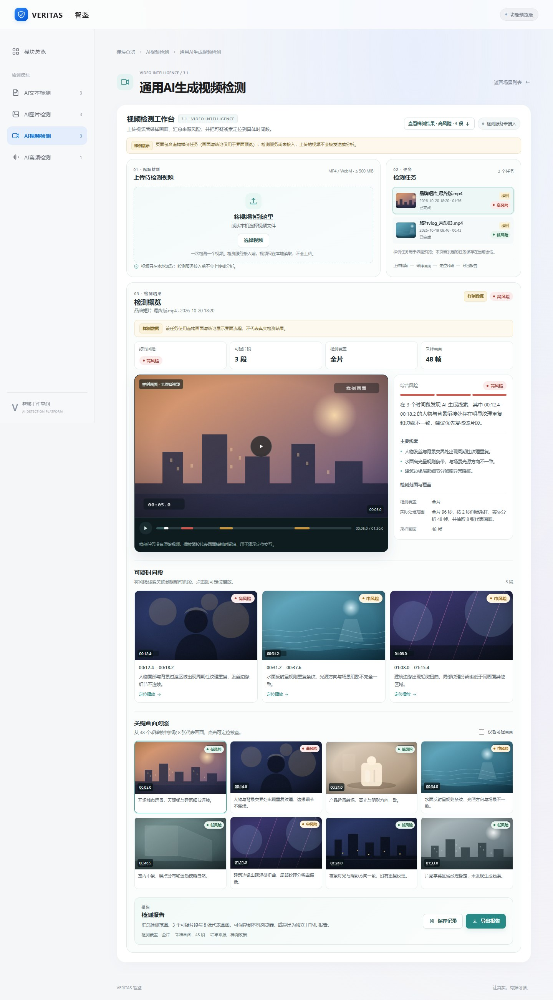
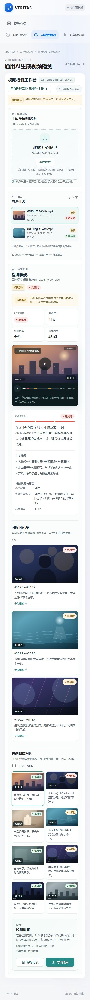

# 3.1 通用AI生成视频检测前端

场景路由 `#/video/general`。前端工作台已交付；真实检测已接入 **Native-Scale** 推理服务（`services/video-general/`，部署与权重准备见其 [README](../services/video-general/README.md)）：页面探测到检测服务就绪后自动配置适配器并调用 `POST /api/v1/video/general`，推理服务未启动时保持"未接入"状态、视频不上传。异步任务队列、文件持久化、权限和跨刷新历史仍待后续接入。

## 已实现

- 视频材料：MP4/WebM 拖拽或选择，单文件不超过 500 MiB；浏览器本地读取时长、画面尺寸并生成封面，不上传、不写服务端。
- 任务列表：会话内展示样例任务和本页新发起的检测任务，区分检测中、已完成、失败、已取消；任务切换保留各自结果；每个任务可随时删除（检测中的任务删除时先终止本次检测，样例任务删除后下次进入页面重新加载）；任务较多时列表在卡片内部滚动（细滚动条、限制最大高度，选中或新建的任务自动滚入可视区），窄屏下缩略图与间距自动收紧。
- 结果概览：综合风险、可疑片段数量、检测覆盖、采样画面数；检测范围、实际处理范围和主要线索。
- 可疑时间段：风险片段与时间轴风险带关联，点击片段可定位播放器；支持鼠标拖动和键盘调整时间轴。
- 关键画面对照：代表画面网格、风险标签、仅看可疑画面筛选、点击定位；样例任务按代表画面模拟播放，真实任务使用本地上传视频播放。
- 结果入口与响应式：顶部显示当前任务的风险/片段摘要，可一键跳到结果；窄屏自动压缩页头、任务标题换行，摘要改为双栏或单栏，片段与画面网格同步减少列数。
- 报告：保存记录到当前浏览器 `localStorage`（键 `veritas.video.general.reports.v1`，最多20条），或导出独立 HTML 报告；样例任务在页面和报告中均保留“样例数据”标识。

内置两条样例任务（品牌短片、旅行vlog）用于展示界面，画面为程序生成的抽象示意，结论为虚构数据，不代表真实检测结果。未配置检测服务时，点击“开始检测”只提示未接入，不调用现有501接口。





## 后端接入

页面通过 `window.Veritas.videoGeneralDetection` 暴露适配入口，源码在 `src/modules/video/general/detection.js`。页面不直接读取密钥；当前由 `src/modules/video/general/backend.js` 在页面渲染时探测 `GET /api/v1/health`，检测服务就绪（`services.videoGeneral.available=true`）且适配器未被外部占用时自动注册真实适配器，调用 `POST /api/v1/video/general` 并把 `data` 映射为结果结构。推理服务未启动时页面保持"检测服务未接入"，视频不上传。

替换为其他检测服务时仍可自行配置：

```js
window.Veritas.videoGeneralDetection.configure(async ({ file, metadata }, { signal, onProgress }) => {
  const body = new FormData();
  body.set('video', file, file.name);
  onProgress?.({ stage: '上传视频', percent: 10 });

  const response = await fetch('/your-video-detection-endpoint', {
    method: 'POST',
    body,
    signal,
    credentials: 'same-origin',
  });
  if (!response.ok) throw new Error('检测服务处理失败，请稍后重试。');

  const data = await response.json();
  // 在适配器内映射为下方结果结构；页面会再次做边界校验。
  return data;
});

// 移除配置（恢复“检测服务未接入”状态）
// window.Veritas.videoGeneralDetection.configure(null);
```

适配器输入：

| 字段 | 含义 |
| --- | --- |
| `file` | 通过前端文件类型、大小检查的原生 `File`，不是远端引用 |
| `metadata.name` | 文件名 |
| `metadata.size` | 字节数 |
| `metadata.type` | 浏览器声明的 MIME 类型 |
| `metadata.duration` | 浏览器读取的时长（秒） |
| `metadata.width` / `height` | 视频画面尺寸 |
| `options.signal` | 页面离开、取消或重新检测时触发；适配器应传给上传/轮询请求 |
| `options.onProgress({ stage, percent })` | 可选进度回调；`stage` 最多100字符，`percent` 为 `null` 或 0—100 |

适配器返回结构（前端归一化后展示）：

| 字段 | 要求 |
| --- | --- |
| `risk` | `low` / `medium` / `high` / `unknown`，分别显示低/中/高风险/无法判断；不得在前端自行推断 |
| `summary` | 非空结论，最多4000字符 |
| `coverage` | `full` 或 `partial` |
| `scope` | 非空实际处理范围，最多2000字符；部分覆盖必须如实说明 |
| `duration` | 视频时长（秒）；与浏览器读取时长相差超过2秒会被拒绝 |
| `sampledFrames` | 实际采样画面数，0—100000 的整数 |
| `findings` | 可选主要线索数组，最多12条、单条500字符 |
| `segments` | 可选可疑时间段，最多100项；`id` 唯一，`start < end` 且位于视频时长内，`risk`、`summary` 必填，`frameId` 可关联代表画面 |
| `frames` | 可选代表画面，最多200项；`id` 唯一、`time` 在时长内、`risk`、`caption` 必填；`image` 可为 `data:image/...`、`blob:`、`http(s):` 或相对路径，其他协议会被忽略 |

返回结果不合法时，该任务显示失败原因，不会把部分数据包装成成功报告。检测失败、取消和部分覆盖分别展示；失败/取消任务可在页面内重试（仍使用同一本地文件，文件不会上传到本仓库）。

## 接入边界

- 本页报告保存是浏览器本机记录，不是服务端历史；刷新页面后新发起的任务不恢复，正式历史任务需接公共任务服务。
- 上传文件仅在页面会话中保留，刷新或离开后释放；本页不保存原始视频。正式系统需按公共材料/版本协议完成持久化与权限校验。
- 页面内置样例和浏览器自检中的测试数据不属于生产数据。接入真实服务后，样例仍可用于界面预览，但不得将样例结论当作真实检测结果。
- 修改上传、任务、结果或报告协议时，请在同一PR更新 `src/modules/video/general/model.js`、`src/modules/video/contracts.d.ts`、本说明和调用方。

## 自检

除下述前端自检外，后端链路（multipart 网关 → 推理服务）由 `tests/video-general.backend.test.mjs` 覆盖；推理服务部署与训练见 [services/video-general/README](../services/video-general/README.md)。

```sh
npm run check
npm test
npm run build
```

浏览器验收脚本不增加项目运行依赖，将固定版本工具装在已忽略的 `tmp` 目录：

```sh
npm install --prefix tmp/browser-check --no-save --package-lock=false playwright@1.56.1
npx --prefix tmp/browser-check playwright install ffmpeg
node tests/video-general.browser.mjs
```

脚本默认使用本机 Edge，启动临时服务，验证样例、时间轴定位/播放、代表画面筛选、低风险状态、上传元数据、适配器进度与结果、报告保存/导出、取消/重试和390px窄屏；截图写入 `docs/screenshots/`。真实后端与算法不在本轮验证范围。

关联文档：[工作包proposal](../openspec/changes/add-video-general/proposal.md)、[验收spec](../openspec/changes/add-video-general/specs/video-general/spec.md)、[需求摘录第9页](../openspec/references/AI检测平台_需求摘录.md)、[接口使用约定](API_CONVENTIONS.md)。
