# 音频检测服务上线调研：腾讯云 / 阿里云的 API 与 MCP 做法

调研时间：2026-11。对象：本仓库 AI 音频伪造检测（`backend/`，HoliAntiSpoof = Qwen2.5-Omni-7B + DoRA）。
目的：搞清两家云怎么把「一项 AI 检测能力」包装成可售卖的 API 和 MCP 工具，并据此决定本服务的上线形态。

---

## 0. 结论先行

**两家云卖 AI 能力，都是同一套三层结构，不是三套东西：**

```
① HTTP OpenAPI    固定域名 + 签名 + SDK        ← 给后端工程师
② 异步任务        提交任务 → TaskId → 回调/轮询  ← 因为推理慢，不能同步等
③ MCP Server      initialize / tools/list / tools/call  ← 给 Agent 用
```

第 ③ 层永远是**薄壳**：它不跑模型，只把第 ①② 层的接口翻译成 MCP 工具。两家云的 MCP 托管环境（百炼的自定义 MCP、函数计算 Function AI、腾讯云 MCP 广场 Hosted）配置项都只有 **vCPU / 内存**，按调用时长计费——没有 GPU 选项，也装不下 7B 模型。这一点决定了你的架构必须分层。

**对你这个服务的四个直接判断：**

1. **推理层不能用 Serverless GPU。** 腾讯云 SCF 的 GPU 实例磁盘只有 10 GB，你的权重是 22 GB + 1.3 GB，直接出局；T4 单卡 16 GB 显存也装不下 18 GiB 的推理占用。必须 A10/L20 级常驻。
2. **对外接口必须异步。** 你现在的 `POST /api/v1/audio/forgery` 是同步的、单进程全局锁、30 秒以上要滑窗。任何 API 网关/MCP 客户端的默认超时都撑不住，必须改成「提交任务 + 查结果」。
3. **别做通用「整段是不是 AI」——两家云已经卖了，而且比你有数据。** 你的差异化是 `spoof_diarization` 里的**双人对话分人归属**（谁的声音是假的），腾讯云的 4 秒切片和阿里云的多模态鉴别都只给整体/片段结论，不给说话人归属。
4. **别按「音频分钟」定价。** 腾讯云卖 40 元/小时，阿里云同类语音能力在 1–5 元/小时量级，差 10–25 倍——这个品类没有价格共识。而你的分人流程是「1 次分离 + 2 次 7B 推理」，按分钟计价时 RTF 稍高就亏本（测算见第 15 节）。**按「次」计价**才是重模型的出路。

---

## 1. 两家云怎么对外暴露「音频 AI 生成检测」

### 1.1 腾讯云：OpenAPI 3.0 + TC3 签名 + 异步任务（最值得抄的样本）

腾讯云把音频 AIGC 识别放在**内容安全平台**里，不是独立产品，入口是「生成识别」。关键事实（[音频 AI 生成识别服务](https://cloud.tencent.com/document/product/1124/135206)）：

| 项 | 做法 |
| --- | --- |
| 能力 | 识别音频是否 AI 生成，覆盖 Fastspeech、VITS、VALL-E、ChatTTS、CosyVoice 等数十种 |
| 粒度 | **每 4 秒切一小段**，逐段鉴别 |
| 结论 | 按合成段占比给三档：`<10%` 非合成 / `10%–30%` 疑似少量合成（建议人工复核）/ `>30%` 大概率合成 |
| 接口 | `ams.tencentcloudapi.com`，`Action=CreateAudioModerationTask`，`Version=2020-12-29` |
| 类型参数 | `Type=AUDIO_AIGC`；`BizType` 是控制台里配的策略 ID |
| 同步/异步 | **异步**。创建任务拿 `TaskId`，再轮询或回调 `CallbackUrl` |
| 回调验签 | `X-Signature = hex(sha256(seed + body))`，`Seed` 由调用方自定义 |
| 输入 | URL 或文件流；文件 < 500 MB、时长 < 1 小时、码率 128–256 kbps、wav/mp3/aac/flac/amr/3gp/m4a/wma/ogg/ape |
| 配额 | 点播默认 10 路并发，超限排队；接口频率 20 次/秒 |
| 接入成本 | 首次开通送 10 小时免费调用时长 |

接口形状（原文示例）：

```http
POST / HTTP/1.1
Host: ams.tencentcloudapi.com
Content-Type: application/json
X-TC-Action: CreateAudioModerationTask
<公共参数>

{"BizType":"default","Type":"AUDIO","Tasks":[{"DataId":"...","Input":{"Type":"URL","Url":"https://..."}}]}
```

**这套设计的三个可取之处**，正好对应你现在缺的东西：

- 调用方不需要一直占着连接——默认并发只有 10 路，同步接口早被打爆了。
- 结论是「占比 + 分档建议 + 片段区间」，而不是一个裸概率。这比只返回 `aiScore` 有商业价值得多。
- `BizType` 把「用哪套策略（阈值、灵敏度）」和接口解耦，同一接口可以卖不同档位的检测。

**一个可以改进的点**：它的回调验签是 `sha256(seed + body)`，本质是带盐哈希，不是 HMAC，存在长度扩展的讨论空间。你自己实现时直接上 `HMAC-SHA256(secret, timestamp + "." + body)`，并加时间戳防重放。

### 1.2 阿里云：内容安全 / AI 安全护栏 里的多模态鉴别

阿里云没有单独的「音频鉴伪」产品，而是把它并进**内容安全**（绿网）体系，2025-08-31 上线 [AI 生成合成内容鉴别服务](https://www.aliyun.com/product/news/27467)：

> 针对各种场景，判断**图片、文本、语音、视频**是否由 AI 生成，帮助客户对 AI 生成合成内容进行检测和标识。

调用形态是标准 RESTful + ACS 签名 + 各家 SDK，同样是「提交—查询」两段式，按量计费。它走的是**合规叙事**（AI 生成内容标识），而不是「检测准确率」叙事——这点值得注意，下面第 9 节展开。

### 1.3 共性与你可以直接抄的模板

| 维度 | 两家云的做法 | 你该怎么做 |
| --- | --- | --- |
| 鉴权 | 云厂商 AK/SK 签名（TC3 / ACS），或 API Key | API Key + 网关限流；私有化客户再上签名 |
| 传输 | 一律异步任务 + 回调/轮询 | 必须改，见第 5 节 |
| 输入 | URL 优先，其次是文件流直传 | OSS/COS 预签名直传，接口只收 URL |
| 输出 | 结论分档 + 片段区间 + 占比 | 加说话人归属（你的独有项） |
| 策略 | `BizType` 把阈值/灵敏度外置 | `profile` 参数：`strict` / `balanced` / `loose` |
| 配额 | 明示并发路数与 QPS | 明示「同时处理 N 路」，超了排队 |
| 计量 | 按次/按时长 | 按「音频秒数」或「任务数」 |

---

## 2. 阿里云的 MCP 这一层怎么做的

阿里云是目前 MCP 通道做得最全的一家，有**四条互不冲突的路径**，按你的阶段选。

### 2.1 路径 A：百炼「自定义 MCP 服务」（最快，不用审核）

[自定义 MCP 服务](https://help.aliyun.com/zh/model-studio/custom-mcp) 支持三种部署方式：

| 方式 | 面向 | 机制 |
| --- | --- | --- |
| **使用脚本部署** | 已有 MCP 代码 | 托管到**函数计算 FC**，安装方式选 `npx` / `uvx` / `http` |
| **从 AI 网关导入** | 已有 REST API | AI 网关先把 REST 包成 MCP，再导入百炼 |
| **从阿里云 OpenAPI 导入** | 操作阿里云资源 | OpenAPI 门户生成 MCP + RAM 角色授权 |

对你的场景：**选「脚本部署 + 安装方式 http」**，配置写成：

```json
{"mcpServers": {"audio-forgery": {"url": "https://your-mcp.example.com/mcp"}}}
```

即：MCP 薄壳你自己部署（或扔 FC），百炼只做注册和转发。

计费（[MCP 简介](https://help.aliyun.com/zh/model-studio/mcp-introduction)）：

- **基础模式**：无部署费，调用时按 0.000156 元/秒计（≈0.56 元/小时），首次调用有启动延迟。
- **极速模式**：另加部署费 0.000036 元/秒（≈0.13 元/小时），消除冷启动。

> 注意：这是 **CPU 容器**的价格和规格。它适合放薄壳，不适合放 7B 模型。薄壳成本可忽略，贵的是你的 GPU。

### 2.2 路径 B：AI 网关「HTTP 转 MCP」（不写代码）

[AI 网关 MCP 管理](https://help.aliyun.com/zh/api-gateway/ai-gateway/user-guide/mcp-gateway-management) 提供两种模式：

- **MCP 直接代理**：后端本来就是 MCP Server，选 `SSE` 或 `Streamable HTTP`，填后端 path。
- **HTTP 转 MCP**：后端是普通 REST，**上传 Swagger 自动生成工具列表**（也支持自定义 YAML）。

同时支持：后端认证 `Basic` / `Bearer` / `API Key`；接入点路径形如 `/mcp-servers/{服务名}/{后端path}`；与 Nacos MCP Router 集成可让存量 HTTP 服务「零改动」升级。

**这条路径的价值**：你现有的 OpenAPI 快照（`docs/openapi.json`）可以直接喂进去生成工具，几乎零开发。代价是工具描述由 Swagger 自动推导，`description` 质量通常不足以让模型稳定选对工具——对「什么时候该调音频鉴伪」这种判断，建议还是手写 description。

### 2.3 路径 C：函数计算 Function AI 托管 MCP（要自己控代码时）

[开发 MCP 服务并接入智能体应用](https://help.aliyun.com/zh/functioncompute/mcp-server)：

- 托管 **STDIO** 和 **SSE**；STDIO 会自动起一个 SSE 代理，客户端按 SSE 访问。
- 开启鉴权 → 平台生成**只读 Bearer Token**。
- 运行环境：Node.js / Python / Java 官方运行时，或**自定义容器（ACR 镜像）**。
- 网络：可挂 VPC、可禁用公网 URL、可限定「仅指定 VPC 调用」。
- 弹性：默认模式（缩容到 0，有冷启动）/ 极速模式（预置快照）。
- 公网地址形如 `https://mcp-xxx.cn-hangzhou.fcapp.run/sse`。
- 官方明确提示：SSE 依赖 session 亲和，建议极速模式 + 预置 1 个快照 + 实例限额 1。

**这条路径对你有实际意义**：如果 MCP 薄壳必须放云上，用「自定义容器」部署，镜像里只放转发逻辑，靠 VPC 内网回连你的 GPU 服务，公网 URL 关掉。

### 2.4 路径 D：上架云市场卖（要变现时才看）

[发布 OneKey MCP 商品](https://help.aliyun.com/zh/marketplace/released-the-bailian-mcp-service-product/) 区分两种商品：

| 对比项 | OneKey MCP 服务 | 原生 MCP 商品 |
| --- | --- | --- |
| 发布渠道 | 仅 Agent 平台（百炼） | 云市场前台 |
| 接入模式 | **SPI 换 Key，一客一密** | 托管至 AI 网关，网关统一管控 |
| 鉴权 | Agent Key ↔ App_Key ↔ 实例 ID 三方绑定，用户无感 | AI 网关统一鉴权 |
| 计量 | 服务商推量（真值在服务商侧） | 服务商推量 |
| 开通 | 百炼首次调用时**懒开通** | 云市场直接订阅 |

硬性前提写得很清楚：

- MCP 协议链接必须是 `SSE` 或 `StreamableHttp`；
- **必须实现 `tools/list`**，平台靠它自动拉工具卡片；
- 凭证字段名固定为 `Authorization`（值如 `Bearer xxx`）；
- 要开发 **SPI 接口**接收实例创建/过期/释放并返回用户级 `App_Key`；
- 售卖方式只支持**按量**，计量维度可选：使用次数 / 时长 / 流量 / 字符数 / DAU / 存储 / vCPU / 内存 / Tokens / 个套；
- 服务商每 5 分钟推一次计量，云市场以 `requestId` 做幂等去重；
- OneKey 的伙伴是**邀约制**。

**结论**：上架是「有客户了再去谈」的事，不是上线第一步。

---

## 3. 腾讯云的 MCP 这一层怎么做的

### 3.1 MCP 广场：Hosted 为主，但**第三方暂不能上架**

[腾讯云 MCP 广场](https://cloud.tencent.com/document/product/1212/123193) 有两种模式：

- **Local 模式**：MCP 装在本地，`npx` / `uvx` 起 stdio，适合依赖本地文件/本地服务的 MCP（如文件系统）。
- **Hosted 模式**：部署在**广场统一提供的免费云资源**上，跨端体验友好，目前是主推模式。

关键限制（原文）：

> **针对第三方 MCP 产品，目前暂不提供上架与更新服务。**

也就是说：**你无法把自己的音频检测上架到腾讯云 MCP 广场**。想要「让腾讯云生态的 Agent 能调到你」，只能走下面 3.2 的自定义连接器。

### 3.2 智能体开发平台 ADP：自定义连接器（这才是你的入口）

[新建连接器](https://cloud.tencent.com/document/product/1759/115873) 明确写了基于 MCP 接入的三段要求：

| 阶段 | 必须实现 |
| --- | --- |
| 初始化 | `initialize`，返回 `protocolVersion`、`capabilities`、`serverInfo` |
| 能力声明 | `capabilities` 里要有非空的 `tools` |
| 工具列表 | `tools/list`，返回可调用工具；返回空数组也能接入，但不会生成可用工具 |
| 工具调用 | `tools/call`，按 MCP 协议返回结果 |

接入细节：

- 传输：**`sse` 和 `streamableHttp` 二选一**（无 stdio）。
- 高级设置：自定义 **Header**（塞认证信息）、**请求超时**（秒）、**SSE 超时**（秒）。
- 鉴权三选一：
  - **OAuth 2.0**：填 `ClientId`、`ClientSecret`、`AuthorizationUrl`、`TokenUrl`、`Scope`；回调地址固定为 `https://adp.cloud.tencent.com/api/plugin/oauth/callback`。
  - **API Key**：在 Header 或 Query 里配参数名和值。
  - Header 自定义。
- 支持粘贴 JSON 一键添加 MCP Server。

> **协议版本提示**：ADP 要求 `initialize` 握手，说明它实现的是 **legacy** 协议（`2025-11-25` 及更早）。MCP 在 `2026-07-28` 已移除握手改为无状态，详见第 13 节。

**对你的直接影响**：

1. 你的 MCP 薄壳必须监听一个公网可达的 **Streamable HTTP** 端点（推荐），不是 stdio。
2. ADP 的「请求超时」是**秒级**的，你的推理是分钟级——所以 MCP 工具**必须只做「提交任务」和「查任务」两个动作**，绝不能在 `tools/call` 里同步等推理完成。
3. OAuth 那套只对「第三方 SaaS 需要用户授权」有意义；你是自有服务，用 API Key + Header 就够。

### 3.3 腾讯云还有其他托管/网关位（信息较少）

腾讯云 2025 年后陆续有 AI 网关相关产品（微服务引擎 TSE 下的 AI 网关、部分 MCP 新建接口），但我这次能抓到的公开文档很薄（`document/product/1826` 返回空页）。**结论：腾讯云侧优先按 ADP 自定义连接器落地，不要指望 AI 网关的 REST→MCP 一键转换**，这块阿里云明显更成熟。

---

## 4. 你的服务能不能塞进这些通道：硬约束体检

| 约束 | 你的现状（`backend/README.md`） | 云端红线 | 结论 |
| --- | --- | --- | --- |
| 显存 | 约 **18 GiB** | 腾讯云 SCF 单卡 T4 = 16 GB（[函数算力支持](https://cloud.tencent.com/document/product/583/68734)） | **T4 装不下**，必须 A10 24G 起 |
| 权重体积 | 22 GB 基座 + 1.3 GB 适配器 | SCF GPU 实例**磁盘仅 10 GB** | **SCF 出局**（挂 CFS 也会卡在冷启） |
| 冷启动 | 加载约 8 秒（热盘）+ 读 23 GB 权重 | Serverless 缩容到 0 | 不能按次冷启，必须常驻 |
| 单请求耗时 | 30 秒以上走 10s 窗/5s 步滑窗 | 网关/MCP 默认秒级超时 | **必须异步** |
| 并发 | **单进程全局锁**，串行执行 | 云函数并发 = 实例数 | 要么排队，要么多卡多实例 |
| 上传 | ≤ 80 MB / ≤ 120 秒，超限 413 | 网关 body 限制通常更小 | 走对象存储直传，接口只收 URL |
| 鉴权 | 无鉴权、CORS 全开、仅限内网 | 公网必须鉴权 | 上线前必补 |

**一句话**：这套模型不适合任何「Serverless GPU 按次计费」的叙事。它的成本结构是**常驻 GPU 的固定成本**，要靠并发和单价摊薄。

---

## 5. 推荐架构

```mermaid
flowchart TD
    C["客户端 / Agent<br/>SDK · MCP"] -->|"HTTPS + API Key"| GW["API 网关<br/>鉴权 · 限流 · 计量 · WAF"]
    GW --> TS["任务服务（无状态，可多副本）<br/>创建任务 · 状态机 · 回调"]
    TS <--> OS[("对象存储<br/>OSS / COS")]
    TS -->|"入队"| Q["队列<br/>MNS·RocketMQ / TDMQ·CKafka"]
    Q --> GPU["GPU 推理池（常驻，多卡）<br/>滑窗 · 批处理 · 说话人分离"]
    GPU -->|"结果写回"| RS["结果存储 + 回调投递"]
    RS -->|"回调"| C

    MCP["MCP 薄壳（无状态，独立小容器）<br/>detect / get_task"] -.->|"只调 HTTP API"| TS
```



> 薄壳与 GPU 池之间**没有调用关系**：它只跟任务服务说话，不打模型、不碰显卡。这是整套架构最重要的一条边界。

### 5.1 两云选型对照

| 层 | 阿里云 | 腾讯云 |
| --- | --- | --- |
| 接入网关 | API 网关 / AI 网关 | API 网关 |
| 对象存储 | OSS（预签名 URL） | COS（预签名 URL） |
| 队列 | MNS / RocketMQ | TDMQ / CKafka |
| **推理（GPU 常驻）** | **ACK 容器 + gn7i(A10 24G)**，或 **PAI-EAS** 镜像部署（[文档](https://help.aliyun.com/zh/pai/model-deployment)：自定义镜像 + 公共资源按量 + 弹性扩缩容 + 公网/VPC 调用） | **TKE + GN7i(A10)**，或 ECS GPU 实例；HAI 适合临时验证 |
| 状态/结果 | RDS / Tablestore | TencentDB / COS |
| MCP 薄壳托管 | 百炼自定义 MCP（http）或 FC Function AI（自定义容器） | ADP 自定义连接器（streamableHttp），薄壳自建 |
| 上架售卖 | 云市场 OneKey / 原生 MCP 商品 | 无公开等价通道（广场不收第三方） |

**推荐**：如果客户主要在国内做内容合规/平台治理 → 阿里云链路更完整（网关 REST→MCP、云市场计量、合规叙事都对得上）。如果只是先把服务跑起来给内部/少量客户 → 腾讯云更省事（ADP 连接器配置即用）。

### 5.2 推理层具体怎么放

- **不要**把 `server.py` 直接暴露公网。它现在 CORS 全开、无鉴权。
- 推理进程从队列拉任务，而不是被 HTTP 直接调用。这样才解决「单进程全局锁 + 长音频占连接」。
- 滑动窗口可以批处理：一个任务内多个 10 秒窗拼 batch 送 GPU，比逐窗推理吞吐高得多。
- 显存 18 GiB 在 24 GB 卡上只剩 ~6 GB 给激活和 KV，长音频滑窗有 OOM 风险。**先实测 120 秒上限的峰值显存**，不够就上 L20 48G 或按窗释放。
- **阈值 0.5 未校准**（README 已注明）。对外必须输出 `calibrated: false`，否则客户会当概率用。

---

## 6. 接口设计建议

### 6.1 端点

```http
POST /v1/audio/forgery/tasks
Authorization: Bearer <api_key>
Idempotency-Key: <uuid>

{
  "audio_url": "https://bucket.oss-cn-hangzhou.aliyuncs.com/x.wav?Expires=...",
  "mode": "auto",              // auto | single | dialog
  "profile": "balanced",       // strict | balanced | loose（对应云的 BizType）
  "callback_url": "https://client.example.com/hook",
  "callback_secret": "..."     // 可选，用于 HMAC 验签
}
→ 202 {"task_id": "...", "status": "queued", "estimated_seconds": 12}

GET /v1/audio/forgery/tasks/{task_id}
→ 200 {
  "task_id": "...",
  "status": "succeeded",       // queued | running | succeeded | failed
  "audio": {"duration_sec": 47.2, "sample_rate": 16000, "channels": 1},
  "verdict": "suspected_fake", // real | suspected_fake | fake | uncertain
  "fake_ratio": 0.23,          // 合成段占比，对齐腾讯云口径
  "segments": [
    {"start": 12.0, "end": 16.0, "p_fake": 0.87, "decision": "fake"}
  ],
  "speakers": [                // ← 你的差异化，单段音频时为 null
    {"speaker": "A", "p_fake": 0.91, "decision": "fake", "segments": [...]},
    {"speaker": "B", "p_fake": 0.12, "decision": "real", "segments": [...]}
  ],
  "model": {"name": "HoliAntiSpoof", "base": "Qwen2.5-Omni-7B", "version": "..."},
  "threshold": 0.5,
  "calibrated": false,
  "warnings": ["threshold_not_calibrated"]
}
```

### 6.2 几个必须钉死的约定

- **异步 + 202**：创建即返回，绝不同步等。
- **回调验签**：`X-Signature: hex(HMAC_SHA256(secret, timestamp + "." + raw_body))`，配 `X-Timestamp`，容忍 ±5 分钟。比腾讯云的 `sha256(seed+body)` 更稳。
- **幂等**：`Idempotency-Key` 24 小时内重复提交返回同一 `task_id`。
- **错误分层**：参数/鉴权 4xx、限流 429（带 `Retry-After`）、系统 5xx、**业务失败放 task 的 `status=failed` + `error.code`**（不要在 HTTP 层表达「音频无法解析」）。
- **额度**：响应头带 `X-Quota-Remaining`（秒数或次数）。
- **URL 有效期**：结果里的音频链接 24 小时过期，报告不长期存原始音频。

### 6.3 与你现有代码的衔接

`docs/API_CONVENTIONS.md` 里定义的 `POST /api/v1/audio/forgery` 是同步语义。建议**保留它作为内部/调试接口**，对外新增 `/v1/audio/forgery/tasks` 异步族。同步接口继续只监听回环，不同步上公网。

---

## 7. MCP 工具设计

MCP 的价值不在「多一个协议」，而在于**模型靠 `description` 决定要不要调你**。所以工具数量要少、描述要写「什么时候用」。

### 7.1 建议只暴露 2 个工具

```json
{
  "tools": [
    {
      "name": "detect_audio_forgery",
      "description": "判断一段音频（或视频文件的音轨）是否由 AI 合成/声音克隆，并返回可疑时间段。当用户提供音频 URL 且关心真伪、来源可信度、AI 合成痕迹时调用。仅支持 ≤120 秒、≤80MB；更长的音频请先分段。返回 task_id，需再用 get_audio_forgery_task 查询结果（通常 10-60 秒完成）。",
      "inputSchema": {
        "type": "object",
        "properties": {
          "audio_url": {"type": "string", "description": "公网可访问的音频/视频 URL，支持 wav/mp3/flac/m4a/mp4"},
          "mode": {"type": "string", "enum": ["auto", "single", "dialog"],
                    "description": "dialog 表示双人对话，会额外返回每个说话人各自是否伪造；不确定时用 auto"},
          "profile": {"type": "string", "enum": ["strict", "balanced", "loose"],
                       "description": "strict 更少漏报、loose 更少误报，默认 balanced"}
        },
        "required": ["audio_url"]
      }
    },
    {
      "name": "get_audio_forgery_task",
      "description": "查询音频真伪检测任务的进度或结果。拿到 task_id 后调用；status 为 queued/running 时请等待 5-10 秒再查，不要连续轮询。",
      "inputSchema": {
        "type": "object",
        "properties": {"task_id": {"type": "string"}},
        "required": ["task_id"]
      }
    }
  ]
}
```

### 7.2 薄壳骨架（Python，Streamable HTTP）

```python
# 只做转发，不加载任何模型。部署为独立小容器，靠内网回连任务服务。
from fastmcp import FastMCP
import httpx, os

API = os.environ["FORGERY_API_BASE"]        # 内网地址
KEY = os.environ["FORGERY_API_KEY"]

mcp = FastMCP("audio-forgery")

@mcp.tool
async def detect_audio_forgery(audio_url: str, mode: str = "auto",
                               profile: str = "balanced") -> dict:
    async with httpx.AsyncClient(timeout=15) as c:
        r = await c.post(f"{API}/v1/audio/forgery/tasks",
                         headers={"Authorization": f"Bearer {KEY}"},
                         json={"audio_url": audio_url, "mode": mode,
                               "profile": profile})
        r.raise_for_status()
        return r.json()

@mcp.tool
async def get_audio_forgery_task(task_id: str) -> dict:
    async with httpx.AsyncClient(timeout=15) as c:
        r = await c.get(f"{API}/v1/audio/forgery/tasks/{task_id}",
                        headers={"Authorization": f"Bearer {KEY}"})
        r.raise_for_status()
        return r.json()

if __name__ == "__main__":
    mcp.run(transport="http", host="0.0.0.0", port=8020)   # 端点 /mcp
```

> SDK 方法名随版本变化（`fastmcp` vs 官方 `mcp`），落地时以锁定的版本为准。要点是：**超时 15 秒、绝不在这里等推理**。
>
> ⚠️ 这段骨架是 **legacy 语义**（走 `initialize` 握手）。MCP 在 2026-07-28 已改为无状态、移除握手，见第 13 节。要同时服务新旧客户端，需另实现 `server/discover`。

### 7.3 各平台注册方式

| 平台 | 怎么注册 | 注意 |
| --- | --- | --- |
| 阿里云百炼 | MCP 管理 → 创建 MCP 服务 → 使用脚本部署 → 安装方式 `http` → 填 `{"url": "https://.../mcp"}` | 不用审核，分钟级生效 |
| 阿里云 AI 网关 | MCP 管理 → 创建 MCP 服务 → **MCP 直接代理** → Streamable HTTP → 填后端 path | 适合已有 MCP Server |
| 阿里云 AI 网关（无代码） | HTTP 转 MCP → 上传 Swagger 生成工具 | 描述质量差，需手改 YAML |
| 腾讯云 ADP | 自定义连接器 → 接入类型 `streamableHttp` → URL + Header 里放 `Authorization` | 必须是公网可达；配好请求超时 |
| 腾讯云 MCP 广场 | **不可上架**（第三方暂不开放） | — |

---

## 8. 成本量级

**先明确一件事：成本几乎全在 GPU 上，网关/MCP/存储都是零头。** 竞品定价锚点与保本 RTF 测算见第 15 节。

| 项 | 量级 | 说明 |
| --- | --- | --- |
| GPU 常驻（A10 24G 单卡） | 按量约 10–20 元/小时；包月/节省计划通常显著更低 | **估算值，务必用两家价格计算器按地域核算**；这是你的主要成本 |
| 百炼自定义 MCP 薄壳 | 基础模式 ≈0.56 元/小时（仅调用时长）；极速模式 +≈0.13 元/小时 | 可忽略 |
| 对象存储 + 流量 | 按 GB 计，音频文件小 | 可忽略 |
| API 网关 | 按调用次数/规格 | 小 |

**算账的关键指标是「每音频秒的 GPU 成本」**：

```
单卡每小时成本 ÷ 3600 × 单任务平均 GPU 占用秒数 = 单任务成本
```

举例（数字仅为演示方法）：若单卡 12 元/小时、一个 60 秒音频任务占用 20 秒 GPU，则单任务算力成本约 0.067 元。**定价必须高于这个数乘以利用率倒数**（GPU 不可能 100% 满载）。

反过来说：**Serverless GPU 按次计费对你没有优势**——因为瓶颈是「加载 23 GB 权重」这笔固定开销，而不是算力时长。每冷启一次就亏一次。

---

## 9. 合规：这是比技术更硬的门槛

两家云都在打「AI 生成合成内容标识」这张牌，不是偶然。国内生成式 AI 内容标识要求下，**检测方要么自己有资质，要么你的输出只能定位为「辅助研判」，不能出具「认定」结论**。

具体到你的产品：

- 输出用 `verdict` + `p_fake` + `fake_ratio`，**不要**用「AI 合成概率 92%」这种表述。README 已经强调 `aiScore` 未校准，这条要贯彻到对外文档。
- 报告里带上「检测范围 / 未覆盖部分 / 模型版本 / 阈值」，让客户能复核。`openspec` 里 4.1 需求本来就要求「已检测范围」。
- 数据留存策略要写清楚：原始音频存多久、是否用于训练（默认不）。
- 若客户是平台方（内容平台、电商），他们买的是「留痕与申诉依据」，不是「准确率」——这决定了你的报告字段比模型分数更重要。

---

## 10. 上线路径（建议三阶段）

**阶段一：能跑（1–2 周）**
- GPU 常驻（ACK/TKE 或 EAS），`server.py` 加 API Key 鉴权、关 CORS、只监听内网。
- 补 `/healthz`（含模型是否就绪）和真实峰值显存实测。
- 用 Nginx/网关做 TLS + 限流，先只给 1–2 个内测客户。

**阶段二：能卖（3–4 周）**
- 改异步：任务表 + 队列 + 回调；对象存储预签名直传。
- 计量埋点（音频秒数/任务数），出账单口径。
- 输出结构补齐 `speakers`、`fake_ratio`、`segments`、`calibrated`。
- 阈值在真实业务分布上重标定一次，至少给 `profile` 三档。

**阶段三：能被 Agent 调（1 周）**
- MCP 薄壳上线（2 个工具）→ 注册百炼自定义 MCP / 腾讯云 ADP 连接器。
- 观察工具调用成功率与误触发，再决定是否上架云市场（阿里云 OneKey 需 SPI + 邀约）。

---

## 11. 风险清单

| 风险 | 影响 | 处理 |
| --- | --- | --- |
| 18 GiB 显存在 24 GB 卡上余量小 | 长音频滑窗 OOM | 实测 120 秒峰值；必要时 L20 48G 或分窗释放 |
| 单进程全局锁 | 并发 1，排队雪崩 | 队列 + 多副本多卡；或改 vLLM 式批处理 |
| 阈值未校准 | 客户当概率用，纠纷 | 输出 `calibrated:false` + `profile` 档位 |
| 与云厂商同类产品正面竞争 | 价格被压 | 打「分人归属」「可私有化」「数据不出域」 |
| 公开 Swagger 自动生成 MCP 工具 | 模型选错工具 | 手写 `description`，工具数控制在 2–3 个 |
| 同步接口被 MCP 客户端调用 | 超时、重试风暴 | 工具只返回 `task_id`，禁止同步等 |
| `docs/API_CONVENTIONS.md` 的 4 MiB 上限 | 与音频 80 MB 冲突 | 音频走对象存储，不经 JSON body |

---

## 12. 还需要你确认的三件事

1. **卖给谁**：平台方（要报告/留痕）还是开发者（要 API/便宜）？决定输出字段与定价单位。
2. **要不要私有化**：如果客户要求数据不出域，你的商业模型会从「API 按次」变成「镜像 + License」，这时候 MCP 只是交付形态之一。
3. **「分人鉴伪」要不要作为主打**：这是两家云都没有的能力（它们只做 4 秒切片/整段判别）。如果主打，接口和 MCP 描述都该把它放在第一位。

---

## 13. 第二轮补充：MCP 协议已经换代，设计要「双栈」

> 本节修正第 3.2 和第 7.2 节。写第一版时我按 2025 语义设计，核完规范发现 **MCP 在 2026-07-28 做了一次破坏性重构**，而两家云还停在旧版。

### 13.1 两个时代

规范把实现分成两类（[Versioning and Compatibility](https://modelcontextprotocol.io/specification/2026-07-28/basic/versioning)）：

| 术语 | 版本 | 握手机制 | 身份/能力 |
| --- | --- | --- | --- |
| **Legacy** | `2025-11-25` 及更早 | `initialize` + `notifications/initialized` | 连接级 session |
| **Modern** | `2026-07-28` 及以后 | **没有握手** | 每个请求在 `_meta` 里带 |
| **Dual-era** | 两者都支持 | 同一端点可并发服务两种 | — |

### 13.2 破坏性变更清单

1. **移除协议级 session** 和 `Mcp-Session-Id` 头；`tools/list` 等列表端点不再随连接变化。
2. **移除 `initialize` 握手**。每个请求带 `_meta`：`io.modelcontextprotocol/protocolVersion`、`clientCapabilities`、`clientInfo`。版本不匹配返回 `UnsupportedProtocolVersionError`。
3. **新增 `server/discover`，且 MUST 实现**——服务端用它公布支持的版本、能力、身份。
4. `subscriptions/listen` 取代 HTTP GET 端点和 `resources/subscribe`。
5. 移除 `ping`、`logging/setLevel`、`notifications/roots/list_changed`。
6. **tasks 移出核心协议，变成官方扩展** `io.modelcontextprotocol/tasks`。
7. MRTR（多轮往返）取代服务端主动发起的请求。
8. **所有 result 必须带 `resultType`**：`"complete"` 或 `"input_required"`。
9. 移除 SSE 断线重连（`Last-Event-ID`、事件 ID）。

### 13.3 两家云站在哪一边？

| 平台 | 证据 | 判定 |
| --- | --- | --- |
| **腾讯云 ADP** | 明文要求实现 `initialize`、返回 `protocolVersion`（[连接器文档](https://cloud.tencent.com/document/product/1759/115873)） | **Legacy** |
| **阿里云百炼** | 文档未公开版本号；支持 `sse` / `streamableHttp`，但整体形态是 2025 年的 | 推断 **Legacy** |

**结论：现在要接进两家云，你必须实现 legacy；modern 是留给未来客户端的。** 规范允许 dual-era 服务端在同一端点上并发服务两种客户端（"MAY serve both eras concurrently"）。

### 13.4 双栈必须钉死的三件事

```text
① server/discover        ← modern 客户端会先探它，MUST 实现且 MUST 返回 supported versions
② -32022                 ← UnsupportedProtocolVersionError，data.supported 列出所有支持的版本
③ resultType             ← 所有 result 必填，老客户端缺失时按 "complete" 处理
```

版本判定逻辑很简单：**请求里带 `_meta` 走 modern，`initialize` 走 legacy**，两条路径共用同一个任务表。

---

## 14. Tasks 扩展：官方给了异步标准答案，但你还用不了

### 14.1 它几乎是照你的场景写的

规范原文（[Tasks 扩展](https://modelcontextprotocol.io/extensions/tasks/overview)）：

> **External job systems.** If your server wraps an API that already uses job IDs (cloud deployments, async APIs, queued work), return a task when you create the job and resolve it when the job completes.

机制：

| 环节 | 协议动作 |
| --- | --- |
| 协商 | 客户端在每请求 `_meta` 的 `clientCapabilities.extensions` 里声明 `io.modelcontextprotocol/tasks`；服务端在 `server/discover` 里声明 |
| 创建 | `tools/call` 返回 `CreateTaskResult`，`resultType: "task"`，含 `taskId`、`ttlMs`、`pollIntervalMs` |
| 轮询 | `tasks/get` → 状态 `working` / `input_required` / `completed` / `failed` / `cancelled` |
| 中途输入 | `tasks/update` 回传 `inputResponses` |
| 取消 | `tasks/cancel`（协作式，不保证停） |
| 通知 | `notifications/tasks`，走 `subscriptions/listen` 订阅 |

注意：**服务端不能单方面返回 task**——必须先确认客户端声明了该扩展（"Never return a task to a client that did not declare support"）。

### 14.2 现实策略：legacy 用 handle，modern 用 Tasks

两家云是 legacy，不可能协商 tasks 扩展。所以你的主线其实是规范里另一段非规范性建议——**Stateful Tools**：

> MCP has no protocol-level session... Servers that need to maintain state across calls should do so by returning an explicit handle from a creation tool and accepting that handle as an argument on subsequent calls.

也就是说：**把 `task_id` 当普通字符串参数传**。这不是补丁，是 2026 版规范推荐的正统做法，而且**新旧协议都兼容**（对老客户端它就是普通参数）。

```text
tools/call detect_audio_forgery
  ├─ 客户端声明了 tasks 扩展？
  │    ├─ 是 → 返回 CreateTaskResult(resultType:"task", taskId, pollIntervalMs)
  │    └─ 否 → 返回 resultType:"complete" + structuredContent{task_id, status:"queued"}
  └─ 两种情况都往同一张任务表写一条记录
```

三条工程要求（规范里明确列了）：

- **handle 是不透明字符串**，不要编码内部结构；用 UUIDv4 级别熵。
- **每次调用都要重新鉴权**：handle 是名字不是凭证，不能拿 task_id 当访问令牌。
- **寿命写进工具描述**：比如「任务结果保留 24 小时」，模型才知道该什么时候取。

---

## 15. 定价锚点：40 元/小时是腾讯云的溢价，不是市场价

这条可能比技术选型更影响你能不能活下来。

| 产品 | 口径 | 价格 | 折合 |
| --- | --- | --- | --- |
| 腾讯云 **音频 AI 生成识别**（`AUDIO_AIGC`） | 音频时长 | **40 元/小时** | 0.667 元/分钟 |
| 阿里云 **语音审核** `audio_standard_cn`（中国区） | 音频时长 | USD 3.5 / 千分钟 | ≈1.5 元/小时 |
| 阿里云 **语音审核**（国际站） | 音频时长 | USD 9.0 / 千分钟 | ≈4.6 元/小时 |
| 阿里云 **图片 AIGC 鉴别** `aigcDetector_global` | 图片张数 | USD 0.6 / 千张 | — |

> **口径警告**：阿里云那两行是**内容审核**（涉黄涉政），不是 AIGC 鉴伪；阿里云的「AI 生成合成内容鉴别（语音）」是 2025-08 才上线的独立能力，公开价目表里**没有单列音频单价**，需在控制台核。所以这不是同口径比价，而是**定价量级**的参照。
>
> 汇率按 1 USD ≈ 7.1 元折算，仅用于量级判断。

**这里的信息是**：腾讯云把音频鉴伪当**高价值专项检测**卖到 40 元/小时；阿里云把语音类能力做成**按分钟的基建**，量级在 1–5 元/小时。两家差 10–25 倍，说明这个品类的价格**没有共识**，你的定价空间取决于你卖给谁、替代谁。

### 15.1 保本线公式

```text
保本条件： 音频秒数 × 音频单价 ≥ GPU 秒数 × GPU 单价
等价于：   RTF ≡ GPU秒 / 音频秒  ≤  音频单价 / GPU单价
```

`RTF ≤ 音频单价 ÷ GPU单价` —— **一个数就能判断这门生意做不做得成**。

### 15.2 敏感性表（保本 RTF 上限）

| GPU 单价（元/小时） | 按 40 元/小时定价 | 按 4 元/小时定价 | 按 1.5 元/小时定价 |
| --- | --- | --- | --- |
| 8 | 5.0 | 0.50 | 0.19 |
| 12 | 3.3 | 0.33 | 0.13 |
| 16 | 2.5 | 0.25 | 0.09 |
| 20 | 2.0 | 0.20 | 0.075 |
| 24 | 1.7 | 0.17 | 0.063 |

读法：若 GPU 是 12 元/小时、按 40 元/小时卖，只要**处理 1 秒音频不超过 3.3 GPU 秒**就保本——这个门槛很松，慢于实时也活得下来。若市场价被压到 1.5 元/小时，则要压到 **0.13 GPU 秒/音频秒**（比实时快 7.7 倍）才能保本，**7B 模型基本不可能**。

**结论：对重模型，按「音频分钟」计价是死路。**要么卖到腾讯云那个价位（需要资质/品牌/客户关系），要么**按「次」计价**（1 元/次 → 单次 GPU 成本 0.1 元就够），要么只做高价值场景（司法取证、金融反诈录音、平台申诉复核）。

---

## 16. RTF 是唯一的生死指标

你的分人流程对**一次对话**的开销是：

```
1 × pyannote 分离  +  2 × HoliAntiSpoof 推理（A、B 各一条等长掩码音轨）
```

依据：`spoof_diarization/README.md` 的流水线，以及 `SUMMARY.md` 里「93 对 / 186 文件 / 372 单位」—— **每对文件对应 2 个检测单位**，即每段对话要跑两次 7B。

而腾讯云的报价是按**音频时长**算的，你却是按**2× 音频 + 分离**烧 GPU。所以你的有效 RTF 天然是「单次 RTF × 2 + 分离开销」。

**必须实测的三个数**（建议用现有 `backend/detect.py` 跑 50–100 条真实长度音频）：

1. 单条 25 秒音频的 7B 推理秒数 → 得单次 RTF
2. pyannote 分离单条秒数
3. 120 秒上限时的峰值显存

拿到这三个数，第 15.2 的表就能直接代入，定价和选卡同时定了。

---

## 17. 这一轮改了什么

| 上一版 | 修正 |
| --- | --- |
| 7.2 骨架用 `FastMCP`（`initialize` 语义） | 骨架没错，但它是 **legacy**。要同时实现 `server/discover` 才能服务新客户端 |
| 3.2 说「ADP 要求 initialize」 | 现在有了协议史解释：ADP 是 legacy，所以是这么要求的 |
| 第 8 节成本只有估算 | 补了**竞品定价锚点**（腾讯云 40 元/小时、阿里云 1–5 元/小时量级）和**保本 RTF 公式** |
| 只说「推理要异步」 | 补了官方的异步标准（Tasks 扩展）和 legacy 下的正统替代（handle 当参数） |

### 仍未核实（需控制台/实测）

- 阿里云百炼、腾讯云 ADP 的 `tools/call` **超时秒数**——两轮检索都没找到公开值。这决定工具能不能容忍 3 秒以上的转发延迟，**必须在控制台实测**。
- 阿里云「AI 生成合成内容鉴别（语音）」的**单价**。
- 你自己的 **RTF 与峰值显存**。

---

## 参考

- 腾讯云 · [音频 AI 生成识别服务](https://cloud.tencent.com/document/product/1124/135206)
- 腾讯云 · [音频内容安全：创建音频审核任务](https://cloud.tencent.com/document/product/1219/53257)
- 腾讯云 · [云函数 函数算力支持（GPU 规格）](https://cloud.tencent.com/document/product/583/68734)
- 腾讯云 · [MCP 广场介绍](https://cloud.tencent.com/document/product/1212/123193)
- 腾讯云 · [智能体开发平台：新建连接器（MCP）](https://cloud.tencent.com/document/product/1759/115873)
- 阿里云 · [百炼：自定义 MCP 服务](https://help.aliyun.com/zh/model-studio/custom-mcp)
- 阿里云 · [百炼：MCP 简介与计费](https://help.aliyun.com/zh/model-studio/mcp-introduction)
- 阿里云 · [AI 网关：MCP 网关管理](https://help.aliyun.com/zh/api-gateway/ai-gateway/user-guide/mcp-gateway-management)
- 阿里云 · [函数计算：开发 MCP 服务并接入智能体应用](https://help.aliyun.com/zh/functioncompute/mcp-server)
- 阿里云 · [云市场：发布 OneKey MCP 商品](https://help.aliyun.com/zh/marketplace/released-the-bailian-mcp-service-product/)
- 阿里云 · [PAI-EAS：将模型部署为在线服务](https://help.aliyun.com/zh/pai/model-deployment)
- 阿里云 · [内容安全新增 AI 生成合成内容鉴别服务（2025-08-31）](https://www.aliyun.com/product/news/27467)
- 阿里云 · [AI Guardrails / Content Moderation 价格表](https://www.alibabacloud.com/en/product/content-moderation/pricing)
- MCP · [Specification 2026-07-28](https://modelcontextprotocol.io/specification/2026-07-28)
- MCP · [Key Changes（2026-07-28 changelog）](https://modelcontextprotocol.io/specification/2026-07-28/changelog)
- MCP · [Versioning and Compatibility（legacy / modern / dual-era）](https://modelcontextprotocol.io/specification/2026-07-28/basic/versioning)
- MCP · [Tools（Stateful Tools、outputSchema、resultType）](https://modelcontextprotocol.io/specification/2026-07-28/server/tools)
- MCP · [Tasks 扩展（异步任务）](https://modelcontextprotocol.io/extensions/tasks/overview)
